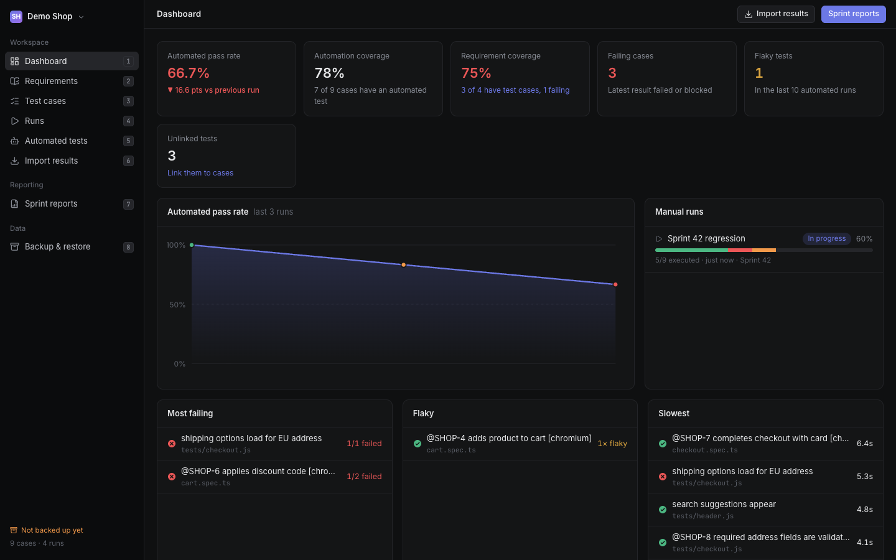
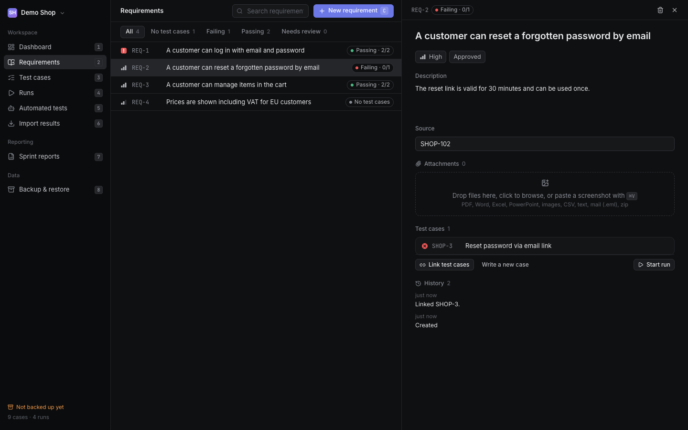
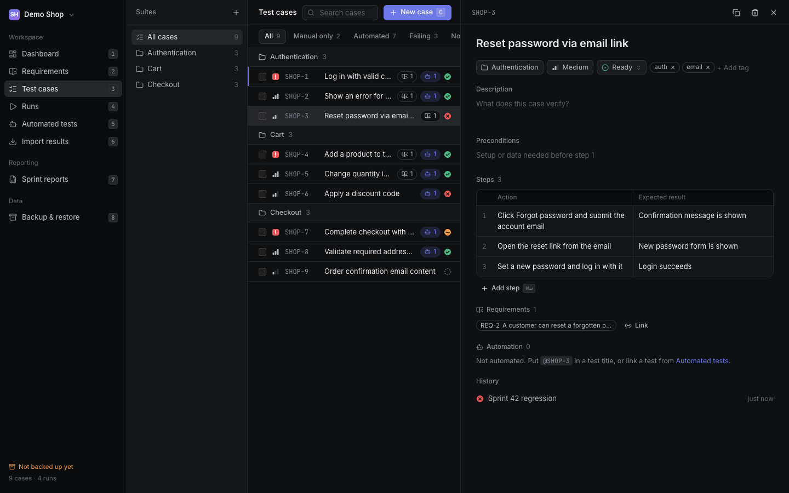
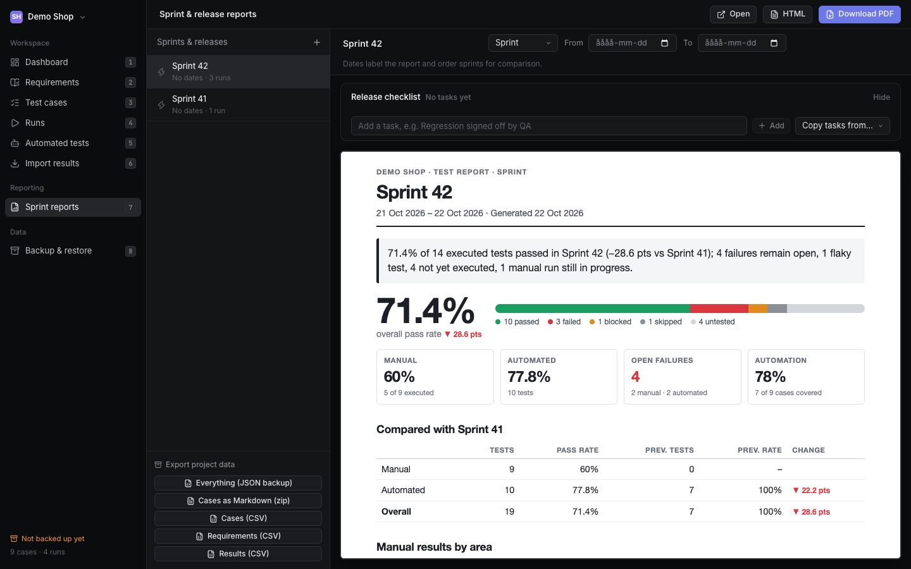

# Testbench

[](https://github.com/RolandChiranjeevi/TestBench/actions/workflows/ci.yml)

A test management app you run yourself. Write manual test cases and requirements, run them, import automated results from
Playwright, TestCafe, Selenium or any JUnit report (files or GitHub Actions), and hand managers a PDF report after each sprint or release.

- **Cases, suites and requirements** with links between them, coverage, change history and attachments
- **Manual runs** with step-by-step execution, evidence, and bug drafts you can paste into Jira
- **Automated results** linked to cases by the ID in the test name, with Playwright traces, screenshots and flaky-test tracking
- **Sprint and release reports** as PDF, with a release checklist, requirement coverage and trends
- **Yours:** your data stays in one SQLite file on your own machine or server, with automatic daily backups. No account, no per-seat price.

| | |
| --- | --- |
|  |  |
|  |  |

## Quick start

**With Docker** (nothing else to install; PDF export included):

```bash
git clone https://github.com/RolandChiranjeevi/TestBench.git
cd TestBench
docker compose up -d
```

Open <http://localhost:4100>. On the welcome page, **Load demo project** shows what it looks like. Your data lives in the Docker volume
`testbench-data`; **Backup & restore** in the app downloads it as one zip. To update: `git pull && docker compose up -d --build`.

**From source** (Node 24):

```bash
npm install
npm run dev              # development: http://localhost:5173
# or, as a single process:
npm run build && npm start   # http://localhost:4100
```

PDF export uses an installed Google Chrome (`TESTBENCH_CHROME_CHANNEL=msedge` for Edge, or `TESTBENCH_CHROME_PATH` for any Chromium).
Data lives in `data/testbench.db` (SQLite) and `data/uploads/`; back up that folder, or use **Backup & restore**.

By default Testbench only listens on this computer (127.0.0.1) and has no login, which is right for a personal tool.
To share it with other people, read **Running it for a team** below.

## Configuration

All settings are environment variables. None are required.

| Variable | Default | What it does |
| --- | --- | --- |
| `TESTBENCH_PORT` | `4100` | Port to listen on (`TESTBENCH_API_PORT` also works). |
| `TESTBENCH_HOST` | `127.0.0.1` | Address to listen on. Anything other than this computer requires a password. |
| `TESTBENCH_DATA` | `./data` | Where the database, uploads and backups are kept. |
| `TESTBENCH_PASSWORD` | none | Turns on the login page (at least 8 characters). |
| `TESTBENCH_SESSION_DAYS` | `7` | How long a sign-in lasts. |
| `TESTBENCH_ALLOWED_HOSTS` | none | Extra host names the app answers to, e.g. `testbench.example.com`. |
| `TESTBENCH_TRUST_PROXY` | off | Set to `1` behind a reverse proxy so HTTPS is detected and the secure cookie flag is set. |
| `TESTBENCH_ALLOW_NO_AUTH` | off | Set to `1` to allow listening beyond localhost without a password. Only for a port that is itself published on localhost only. |
| `TESTBENCH_AUTO_BACKUP` | on | `0` turns the daily automatic backup off. `TESTBENCH_BACKUP_DIR` and `TESTBENCH_BACKUP_KEEP` (default 7) set where and how many. |
| `TESTBENCH_POLL_MINUTES` | `5` | How often automatic GitHub imports check for new runs (`0` = off). |
| `GITHUB_TOKEN` | `gh auth token` | Token for importing GitHub Actions runs. A logged-in `gh` CLI is used when it is not set. |
| `TESTBENCH_CHROME_CHANNEL` / `_PATH` / `_NO_SANDBOX` | `chrome` | Which browser renders PDFs (see Quick start). |
| `TYPESAFE_API_KEY` | none | Optional AI link suggestions (see below). |

## Running it for a team

Testbench has one shared password, not user accounts. That is enough for a small team that trusts each other, and it keeps the setup small.
To host it on a server:

1. **Set a password and the host name** (in `docker-compose.yml`, remove `TESTBENCH_ALLOW_NO_AUTH` and add):
   ```yaml
   TESTBENCH_PASSWORD: "a long passphrase"
   TESTBENCH_ALLOWED_HOSTS: "testbench.example.com"
   TESTBENCH_TRUST_PROXY: "1"
   ```
2. **Put it behind HTTPS.** Without HTTPS the password and every request can be read on the network. A reverse proxy such as
   [Caddy](https://caddyserver.com) does it in two lines and gets the certificate for you:
   ```
   testbench.example.com {
       reverse_proxy localhost:4100
   }
   ```
   Keep the port published on `127.0.0.1:4100` so only the proxy can reach it.
3. **Keep a copy of the data elsewhere.** Automatic backups land in `/data/backups` on the same server; copy them off it.

What the login does: the password is checked with scrypt in constant time; a sign-in is a signed, expiring cookie
(`HttpOnly`, `SameSite=Strict`, `Secure` over HTTPS); five wrong passwords block an address for 15 minutes; everything including uploaded
files and reports is behind it; changing the password signs everyone out.

What it does not do: there are no individual users, so nothing records who changed what, and there is no password reset (change the variable
and restart). It is a small tool and has not been audited. Run one instance per team (the data is a single SQLite file), and if it will face the
open internet, put it behind a VPN or your own single sign-on proxy as well. To report a security problem, see [SECURITY.md](SECURITY.md).

## Known limitations

Testbench is young. These are the limits to expect today:

- **One shared password, no users.** Nothing records who changed what, and there is no password reset.
- **One instance per team.** The data is a single SQLite file: no clustering, no several servers writing at once.
- **It only works while it runs.** Automatic GitHub imports and the daily backup happen only while the process is up.
- **Backups stay on the same disk by default.** Point `TESTBENCH_BACKUP_DIR` at a synced folder, or copy them elsewhere.
- **Automatic import is GitHub only.** For GitLab, Jenkins and others, upload the report files (Playwright JSON or JUnit XML) on **Import results**.
- **No import of existing cases yet.** You can export cases (CSV, Markdown, JSON) but not bring them in from a spreadsheet or another tool.
- **Some basics are missing:** deleting or archiving a project, and undo for deletes (deleting asks for confirmation instead).
- **PDF reports need Chrome or Chromium.** The Docker image includes it.
- **Large data is untested.** It has not been tried with tens of thousands of cases or hundreds of thousands of results.
- **Tested mainly** on macOS and Docker, in Chrome. CI builds and smoke-tests the Docker image on Linux (x64). The layout is not designed for phones.
- **Not independently security-audited.**


## Suggested links (optional, TypeSafe)

Off by default. Set an API key from [TypeSafe](https://docs.typesafe.ai) in the environment and restart Testbench:

```bash
TYPESAFE_API_KEY=... npm run dev
```

On **Automated tests**, a **Suggested links** panel then appears while tests are unlinked. **Check** shortlists up to 5 candidate cases per
unlinked test by word overlap (locally), then asks TypeSafe one yes/no question per candidate: "does this test check what that case
describes?". Suggestions at or above the threshold show with their probability; **Link** or **Dismiss** each one. Nothing is linked
without your click, and exact IDs in test names still win.

- **What is sent to TypeSafe:** the test's title, suite and file name, and each candidate case's title, suite and first 8 steps. No
  results, errors, screenshots or traces. Without the key nothing is sent anywhere.
- **Cost control:** 20 tests per click, one request per test. Every judged pair is stored, so it is never judged (or billed) twice.
  **Check again** re-judges unlinked tests (dismissed pairs stay dismissed).
- **Settings:** `TYPESAFE_MODEL` (default `jev-latest`), `TYPESAFE_LINK_THRESHOLD` (default `0.7`), `TYPESAFE_API_URL`.
- This is a spike: the 0.7 threshold is a starting point to tune on your own data.

## Tests

```bash
npm test
```

Runs the automated tests (`test/`, Node's built-in runner through `tsx`). They cover the report parsers, linking tests to cases by ID, requirement
coverage and review flags, moving suites, the release checklist, the database indexes and the automatic backup. Each test file uses its own
temporary database, so your real `data/` is never touched. `npm run typecheck` checks the types, and `npm run build` typechecks and then bundles the web app. GitHub Actions runs the typecheck, the
tests, the build and a Docker smoke test (`scripts/docker-smoke.sh`, which you can also run yourself) on every push and pull request.

## Editing many cases at once

On **Test cases**, tick cases (or press `X`) and the toolbar offers:
- **Edit…**: move them to a suite, set priority or status, and add or remove tags. Anything left on "Keep" is untouched, and tags are added or
  removed, never replaced.
- **Duplicate**: makes a draft copy of each, titled "… (copy)", with the same suite, text, tags and steps. A copy does not inherit requirement
  links or automated tests, because those describe what the original covers.
- **Drag to a suite**: drag a case onto a suite in the left tree (or onto "No suite") to move it. Dragging a ticked case takes every ticked case along.

A single case also has a **Duplicate** button in its editor.

## Ordering suites

On **Test cases**, drag a suite in the left tree to reorder it: drop on the top or bottom edge of another suite to place it before or
after it, or in the middle to nest it inside. Drop below the last suite to move it to the end of the top level. The suite's `⋯` menu also has
**Move up** / **Move down**. The case list, the case pickers and exports follow the same order.

## Linking automated tests to cases

Each case gets an ID like `SHOP-12`. Put it in a test title, a `describe` title or a Playwright tag and imports link the test to the
case automatically. These all work: `@SHOP-12 login`, `[SHOP-12] login`, `SHOP-12 login`, `SHOP-12: login`. The key must match the project's
key and the case must exist. Tests imported before their case existed (or before the ID was in the name) are linked by **Re-link by name** on
**Automated tests**, and automatically after every import. You can also link by hand there.

## Requirements

**Requirements** (sidebar, key `2`) is where you write down what the system should do: a title, description, priority, status
(draft, approved, deprecated) and a source such as a Jira story key or link. Link any number of test cases to a requirement,
from the requirement ("Link test cases") or from the case ("Requirements" section), and one case can cover several requirements.
Each requirement shows how well it is covered, from the latest result of its linked cases: **Passing**, **Failing**, **Partly tested**,
**Not run yet** or **No test cases**. Deprecated cases don't count. The dashboard shows requirement coverage, sprint reports list the
requirements that are failing or weren't run, and exports include them (JSON and a requirements CSV).

- **Auto-link with `@REQ-4`**: put it in a case's title, description or tag, or in an automated test's title or tag, and the case
  (for a test: the case it is linked to) is linked to requirement 4. This only ever adds links.
- **Bulk link**: tick cases on Test cases and choose **Link to requirement**. The **No requirement** tab lists cases nobody covers.
- **Start run**: on a requirement, runs all its linked cases as a manual run named after it.
- **Change history**: every edit to a requirement (wording, priority, status, source, linked cases) is recorded on the page.
  When the title or description changes, the linked cases are flagged **to review** (on the requirement, in its list, in the case
  editor and under the **Needs review** tab) until you confirm them with **Still correct**. Cases linked afterwards start confirmed.
- Manual bug drafts list the requirements the failed case covers.
- **Attachments**: attach specs, mockups, mails and other files to a requirement (drop, browse, or paste a screenshot with ⌘V). PDF, Word,
  Excel, PowerPoint, images, CSV, text, `.eml`, zip and video are accepted, up to 100 MB each. Attaching or removing a file shows in the
  history. The files live in `data/uploads/`, so the backup zip includes them; the JSON export lists their names.

## Backup and restore

**Automatic backups:** while Testbench is running it saves a backup about once a day (the first shortly after start-up, once you have a project) and
keeps the newest 7, in `data/backups/`. That is the same disk as your data, so it protects against mistakes and a damaged database but not a lost
disk: for an off-disk copy start it with `TESTBENCH_BACKUP_DIR` pointing at a synced folder (iCloud Drive, Dropbox). `TESTBENCH_BACKUP_KEEP=14`
keeps more, `TESTBENCH_AUTO_BACKUP=0` turns it off. Restore any of them with "Choose backup .zip" below. The sidebar's "Backed up" counts both.

**Backup & restore** (sidebar, key `8`) downloads one zip with all projects: the database and every uploaded file. Restore it on this or
another computer, without restarting. A restore validates the zip first and moves your current data to `data/previous/<time>` instead
of deleting it. The sidebar footer turns amber when there is no backup from the last 7 days. `data/` is git-ignored, so this is how
your data is kept safe.

## Re-run, insights and automation candidates

- **Re-run failed** (button in any run): starts a manual run with the failed and blocked cases, carrying over title, environment and
  sprint. For an automated run it uses the cases its failing tests are linked to.
- **Automated tests → Insights**: flaky tests (needed a retry, or keep flipping between pass and fail) with a per-run strip, test time per
  run, tests that are getting slower, and **Automate next**: manual cases without an automated test, ranked by priority, how often they
  are run by hand, how often they fail and whether they are smoke/regression cases. The top few also show on the dashboard.

## Automatic GitHub imports

On the Import page, switch on **Import new runs automatically** for a connected repository. TestBench checks every 5 minutes while it
is running (`TESTBENCH_POLL_MINUTES=2` changes it, `0` turns it off) and imports finished workflow runs that were created after you
switched it on. Optionally limit it to branches (`main, release/*`) and give the imported runs a sprint. Runs without test artifacts
are skipped and remembered, and a run is never imported twice. **Check now** does it immediately.

## Playwright evidence

Turn on evidence in `playwright.config.ts` and write a JSON report:

```ts
reporter: [["html"], ["json", { outputFile: "results.json" }]],
use: { trace: "retain-on-failure", screenshot: "only-on-failure", video: "retain-on-failure" },
```

Upload `results.json` **and** `test-results/` (in GitHub Actions: `path: |` both, see the guide on the Import page). Then import
the downloaded artifact `.zip`, pick the project folder with **Choose a test-results folder**, or click Import on a workflow run.
Expand a test in an automated run to see:

- the **attempts** (Attempt 1, Retry 1…), so a flaky test shows what failed first and that it passed on retry
- the error with Playwright's code frame, the location, and console output
- **screenshots and video** per attempt, and **Open trace**, which runs Playwright's trace viewer from this app (nothing is uploaded anywhere)
- the **history** of that test over its last 20 runs, and a **Report bug** draft for Jira (same flow as manual bugs)

Evidence files are matched to tests by their path, so any artifact layout works. If both `results.json` and a JUnit XML of the same
run are present, the JSON is used (it has the details) so tests aren't counted twice. Deleting a run deletes its evidence files.

## Report formats

| Framework  | Report                                                          |
|------------|-----------------------------------------------------------------|
| Playwright | `json` reporter (adds flaky detection) or `junit`               |
| TestCafe   | `testcafe-reporter-xunit`                                       |
| Selenium   | JUnit XML from pytest `--junitxml`, Maven Surefire, TestNG, ... |

## GitHub Actions

Upload the report folder with `actions/upload-artifact`, connect the repo under **Import results**,
and click **Import** on a workflow run. The token comes from `GITHUB_TOKEN` or a logged-in `gh` CLI
and is never stored.

## Dashboard, sprint reports and export

- **Dashboard**: automated pass-rate trend, automation coverage, failing and flaky tests, slowest tests.
- **Sprint reports**: give runs a sprint or release name (a dropdown suggests existing ones). Each name gets a report with a
  headline, pass rate, comparison with the previous sprint, results per suite and open failures. Download it as **PDF**
  (rendered with your installed Google Chrome; set `TESTBENCH_CHROME_CHANNEL=msedge` to use Edge) or as standalone HTML.
  Sprint dates are set on the Reports page and decide which sprint counts as "previous".
- **Release checklist** (Reports page, above each report): add your own tasks to a sprint or release, like "Regression signed off"
  or "Release notes written", and tick them off. The time is recorded when you tick (click the time to correct it). The report
  gets a "Release checklist" section showing what is done and when, and what is still open. **Copy tasks from…** reuses the list from
  another sprint. Tasks have a `source` field ("manual" today) so automatic checks can be added later.
- **Export** (Reports page): full JSON backup, one Markdown file per case (zip), cases CSV, requirements CSV, results CSV.
- **Run templates** (Runs → Templates): a saved set of cases, like "Smoke test", with an optional default environment. Start a run
  from one in a click, or pick it in the New run dialog. Make one from ticked cases on Test cases ("Save as template"), or tick
  "Save this selection as a template" when starting a run. Templates follow your cases: deleted cases drop out, deprecated ones are skipped.
- **Bug reports for Jira**: on a failed or blocked result, **Report bug** opens an editable draft (summary, steps to reproduce with the
  failing step marked, expected/actual, environment, sprint, run). **Copy description** puts rich text on the clipboard for pasting
  into Jira's editor (plain text is the fallback). Attachments can't be pasted several at a time, so **Download .zip** gives you
  the screenshots to drag into the issue. Paste the issue key (or link) back to link it: it then shows on the result, in the run's
  case list, in the sprint report and in the exports.
- Manual runs freeze each case's title and steps when the run starts, so editing a case later doesn't rewrite old runs.

## Keyboard

`1`–`8` switch pages · `C` new case/run · `J`/`K` move · `X` select · `R` run selected ·
`P`/`F`/`B`/`S` pass/fail/block/skip while executing · `⌘V` paste a screenshot.

## License

[MIT](LICENSE). Use it, change it and share it, including commercially; keep the copyright notice.
