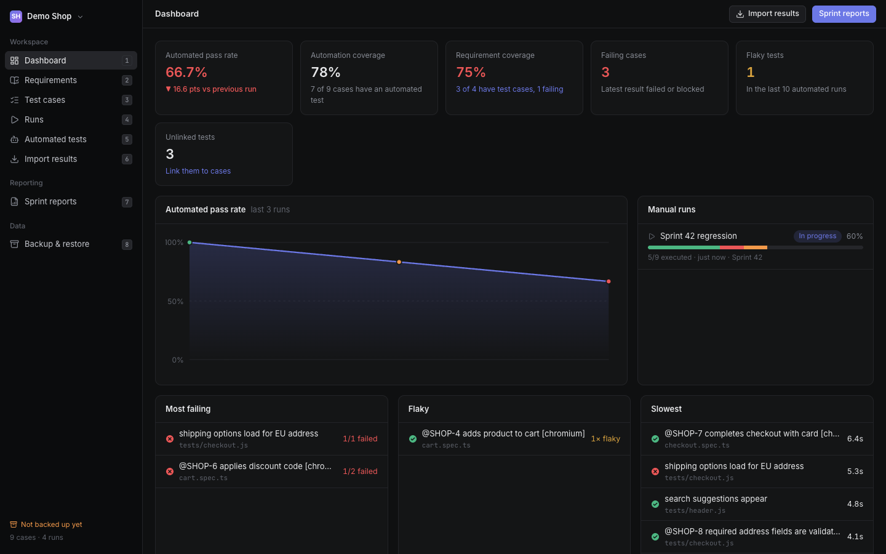
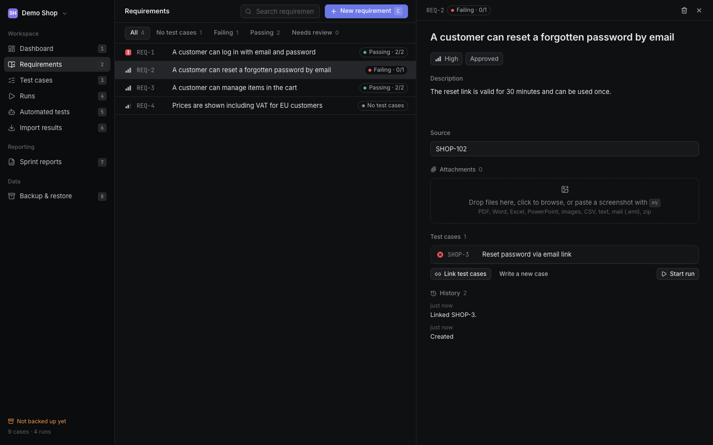
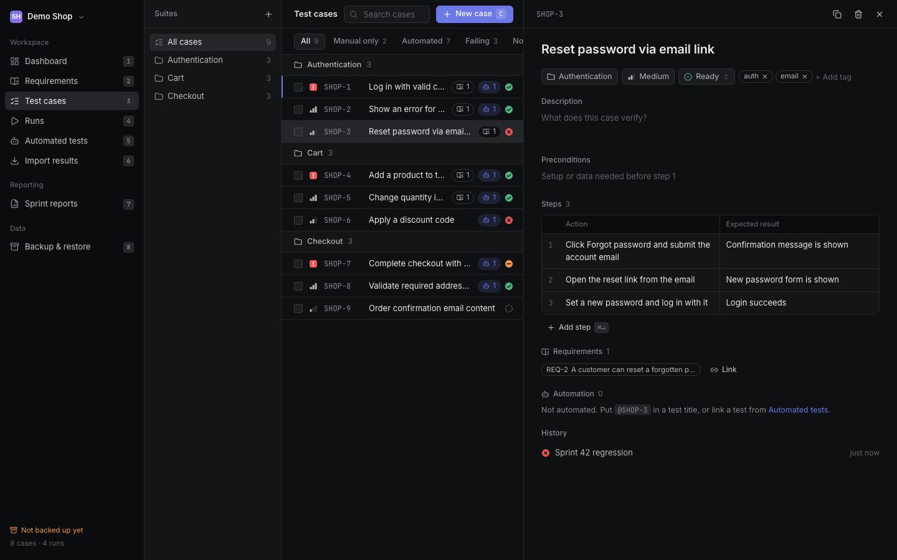
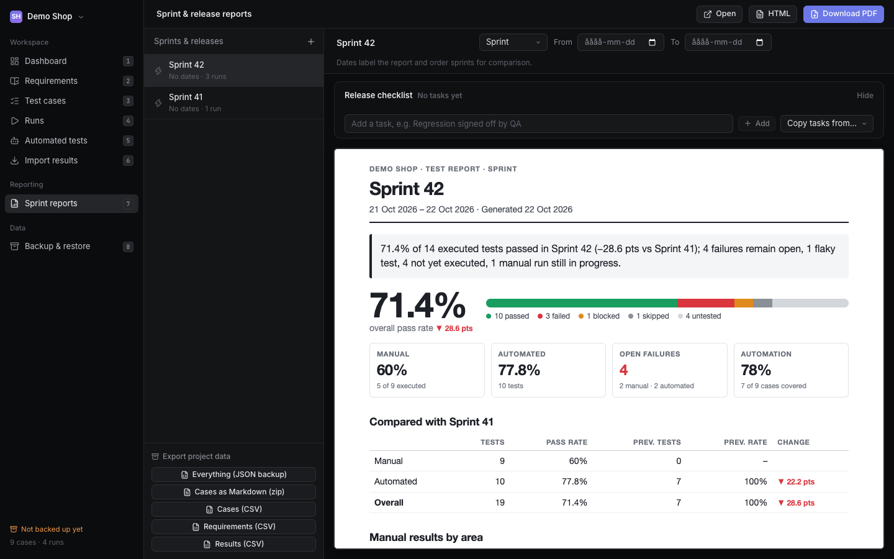

# Testbench

[](https://github.com/RolandChiranjeevi/TestBench/actions/workflows/ci.yml)

A test management app you run yourself. Write manual test cases and requirements, run them, import automated results from
Playwright, TestCafe, Selenium or any JUnit report (files or GitHub Actions), and hand managers a PDF report after each sprint or release.

- **Cases, suites and requirements** with links between them, coverage, change history and attachments
- **Manual runs** with step-by-step execution, evidence, and bug drafts you can paste into Jira
- **Automated results** linked to cases by the ID in the test name, with Playwright traces, screenshots and flaky-test tracking
- **Sprint and release reports** as PDF, with a release checklist, requirement coverage and trends
- **Yours:** your data stays in one SQLite file on your own machine or server, with automatic daily backups. No account, no per-seat price.

| | |
| --- | --- |
|  |  |
|  |  |

## Quick start

**With Docker** (nothing else to install; PDF export included):

```bash
git clone https://github.com/RolandChiranjeevi/TestBench.git
cd TestBench
docker compose up -d
```

Open <http://localhost:4100>. On the welcome page, **Load demo project** shows what it looks like. Your data lives in the Docker volume
`testbench-data`; **Settings, Data** in the app downloads it as one zip. To update: `git pull && docker compose up -d --build`.

**From source** (Node 24):

```bash
npm install
npm run dev              # development: http://localhost:5173
# or, as a single process:
npm run build && npm start   # http://localhost:4100
```

PDF export uses an installed Google Chrome (`TESTBENCH_CHROME_CHANNEL=msedge` for Edge, or `TESTBENCH_CHROME_PATH` for any Chromium).
Data lives in `data/testbench.db` (SQLite) and `data/uploads/`; back up that folder, or use **Settings, Data**.

By default Testbench only listens on this computer (127.0.0.1) and has no login, which is right for a personal tool.
To share it with other people, read **Running it for a team** below.

## Configuration

All settings are environment variables. None are required.

| Variable | Default | What it does |
| --- | --- | --- |
| `TESTBENCH_PORT` | `4100` | Port to listen on (`TESTBENCH_API_PORT` also works). |
| `TESTBENCH_HOST` | `127.0.0.1` | Address to listen on. Anything other than this computer requires a login: an account, or `TESTBENCH_PASSWORD`. |
| `TESTBENCH_DATA` | `./data` | Where the database, uploads and backups are kept. |
| `TESTBENCH_PASSWORD` | none | Turns on the shared-password login page (at least 8 characters). Once the first account exists it is asked for once, to make that account, and is ignored after that. |
| `TESTBENCH_SESSION_DAYS` | `7` | How long a sign-in lasts (the shared password's cookie, and an account's session). |
| `TESTBENCH_ALLOWED_HOSTS` | none | Extra host names the app answers to, comma-separated, e.g. `testbench.example.com,my-machine.tailnet.ts.net`. Exact names only (no ports, no wildcards; case is ignored). `localhost`, `127.0.0.1` and `::1` are always allowed and every other name gets `403 {"error":"Forbidden host"}`. A name that points at a tunnel makes Testbench reachable from outside: read "A public address" below first. |
| `TESTBENCH_TRUST_PROXY` | off | Set to `1` behind a reverse proxy so HTTPS is detected and the secure cookie flag is set. |
| `TESTBENCH_ALLOW_NO_AUTH` | off | Set to `1` to allow listening beyond localhost without a password. Only for a port that is itself published on localhost only. |
| `TESTBENCH_AUTO_BACKUP` | on | `0` turns the daily automatic backup off. `TESTBENCH_BACKUP_DIR` and `TESTBENCH_BACKUP_KEEP` (default 7) set where and how many. |
| `TESTBENCH_POLL_MINUTES` | `5` | How often automatic GitHub imports check for new runs (`0` = off). |
| `GITHUB_TOKEN` | `gh auth token` | Token for importing GitHub Actions runs. A logged-in `gh` CLI is used when it is not set. |
| `TESTBENCH_CHROME_CHANNEL` / `_PATH` / `_NO_SANDBOX` | `chrome` | Which browser renders PDFs (see Quick start). |
| `TYPESAFE_API_KEY` | none | Optional AI link suggestions (see below). |
| `LINEAR_API_KEY` | none | Optional: create Linear issues from failing tests (see "Creating Linear issues"). `LINEAR_TEAM_ID` (a team id or its short key, e.g. `ENG`) sets the default team. |
| `JIRA_BASE_URL`, `JIRA_EMAIL`, `JIRA_API_TOKEN`, `JIRA_PROJECT_KEY` | none | Optional: create Jira Cloud issues from failing tests (see "Creating Jira issues"). `JIRA_ISSUE_TYPE` (default `Bug`) names the issue type. |

## Running it for a team

Testbench can run in three ways: with no login on one computer (the default), with one shared password, or with accounts, where everyone signs in with their own
email and password. Accounts are what to use for a team: they say who did what, and a person's access can be ended without changing the password for everyone.
To host it on a server:

1. **Make the owner account and set the host name.** On the server, make the first account (see "Accounts" below), then in `docker-compose.yml` remove
   `TESTBENCH_ALLOW_NO_AUTH` and add:
   ```yaml
   TESTBENCH_ALLOWED_HOSTS: "testbench.example.com"
   TESTBENCH_TRUST_PROXY: "1"
   ```
   (The older way still works: `TESTBENCH_PASSWORD: "a long passphrase"` is a shared password for everyone, until the first account is made.)
2. **Put it behind HTTPS.** Without HTTPS the password and every request can be read on the network. A reverse proxy such as
   [Caddy](https://caddyserver.com) does it in two lines and gets the certificate for you:
   ```
   testbench.example.com {
       reverse_proxy localhost:4100
   }
   ```
   Keep the port published on `127.0.0.1:4100` so only the proxy can reach it.
3. **Keep a copy of the data elsewhere.** Automatic backups land in `/data/backups` on the same server; copy them off it.

### Accounts

Accounts have three states. **Open**: no account exists, and Testbench works as it always has. **Accounts**: at least one account exists, and everything needs a
sign-in. This is permanent: there is no setting that turns it off, and restoring an old backup cannot reopen it. **Locked**: accounts were on, but none exists (an older
backup was restored over the database). Everything is refused until the owner is made again on the server.

- **The first account** is the owner: it looks after the accounts and, later, the backups. Make it by opening `/setup` on the computer Testbench runs on (it is only
  offered from there: a request that comes through a proxy and was not addressed to localhost is refused), or on the server with `npm run accounts -- create-owner --email you@example.com --name "Your Name"` (**in Docker use this**:
  `docker compose exec testbench npm run accounts -- create-owner --email you@example.com`; `/setup` does not work there, because the container sees the request as coming
  from Docker's network, not from localhost). The password is typed at a prompt or piped in, never given as an
  argument. With `TESTBENCH_PASSWORD` set, `/setup` asks for that shared password once; after the first account it is ignored.
- **More people** are invited by the owner. An invitation is a link (seven days, works once, optionally for one email address). **Testbench sends no email**: the owner
  copies the link and hands it over. The same goes for a forgotten password: the owner makes a one-time reset link, or on the server
  `npm run accounts -- reset-password --email ...` sets one. Changing or resetting a password ends every other session of that account and cancels its open reset links. Changing the email address takes the current password.
- **Passwords** are hashed with scrypt, each with its own salt, at least 10 characters. A sign-in is a random session on the server (`HttpOnly`, `SameSite=Strict`,
  `Secure` over HTTPS) that can be ended from Settings or by turning the account off, which is immediate. Five wrong attempts from one address, or ten for one email
  address, are blocked for 15 minutes (so someone who knows an email address can slow that person's sign-in for a while; the owner can always use the command line).
- **Your account (`/account`).** Anyone signed in can open it from “Your account” in the sidebar, from Settings → Account, or, when they belong to no project, from the start page. It works without a project. **Profile:** your name, and your email address, which takes your current password. **Password:** current, new and new again; the rules are shown (at least 10 characters, not only spaces, not your name or email), and changing it signs out every other session of yours. **Sessions:** each place you are signed in, as device, address, when you signed in, last seen and when it expires, with “Sign out” for one and “Sign out everywhere else” for all but this one.
- **Administration (`/admin`, the owner only).** “Administration” in the sidebar (and on the start page when there is no project), or Settings → Account. **Accounts:** everyone with an account, with status, last sign-in and the projects each is in with the role. Switch an account off (its sessions end at once; the tokens it made for projects keep working) or on again, and make a one-time **password reset link** (shown once, works once, seven days). **Invite without a project:** an invitation link for someone who belongs to no project until an admin adds them, and the list of open invitations of every project with “Revoke”. **Audit log:** what happened to accounts and roles, newest first, in plain words with the event name beside it, filterable (sign-ins, accounts, passwords, profiles, sessions, invitations, members and roles) and paged with “Load older”; the API takes `GET /api/audit-log?action=<start of the action>`. Anyone else who opens `/admin` is told it is for the owner.
- **Who did what.** What a person creates or approves is recorded under the name of the account they are signed in with. That is the name on the account, which the person
  chose themselves: Testbench does not check that it is their real name or that the email address is theirs, and one account can be shared by several people. The owner can read an
  append-only audit log of accounts and sign-ins (`GET /api/audit-log`): it holds no passwords, tokens or hashes, and the database refuses any edit or delete of it.
- **Backups** contain the accounts (as hashes) and the audit log, so treat them as secrets. Downloading and restoring a backup, loading the demo and switching agent
  proposals on or off are for the owner only. Restoring a backup ends every session, and the audit log goes back to what the backup had.
- **Turning an account off** ends its sessions at once. Machine tokens made earlier (CI, agent, propose tokens) belong to a project, not to the person, and **stay valid**:
  that is deliberate, since a CI job must not stop when someone leaves. Revoke them under the project's settings if they should go too.
#### Projects and roles

With accounts, a person sees only the projects they are a member of, and each membership has a role:

| Role | Can |
| --- | --- |
| **Viewer** | read everything in the project: cases, runs, results, requirements, reports, exports, files |
| **Tester** | everything a viewer can, plus change test data: cases, runs, results, observations, bug reports, requirements, **generate proposals**, and approve or reject proposals; delete cases, runs and results |
| **Admin** | everything a tester can, plus the project's members and invitations, tokens (CI, agent, propose), integrations (GitHub sources, Jira, Linear), deleting suites, audits, milestones, templates and requirements, and the project itself |
| **Owner** (of the installation) | an admin of every project, and alone can: make projects, manage accounts, read the audit log, download or restore a backup, load the demo, switch agent proposals |

- **In the app.** The project name shows your role (Owner, Admin, Tester or Viewer). A control you may not use is switched off and says why on hover, for example “Needs the tester role in this project”; a viewer also sees a notice that the project is read-only. Settings tabs you cannot use are left out. The server decides in the end, so a switched-off control is only the screen being honest.
- **Settings, Members.** Everyone in a project sees who is in it and with which role. An **admin** also sees email addresses and can add an account that exists (by email and role), change a role, remove someone, and make an invitation link with a role (shown once, works once, seven days; Testbench sends no email) and revoke open ones. A **viewer** or **tester** sees the list only. Someone who belongs to no project is told so and can ask an admin; only the owner makes projects.
- A project you are not a member of does not exist for you: every route answers `404 Not found`, the same as for something that was never there. Files under `/uploads` follow the project they belong to.
- **Members.** An admin adds an existing account by email (the answer says if no account has that address) or makes an invitation link for the project with a role; whoever accepts becomes a member. Only the owner makes accounts that belong to no project. A project must keep one admin among its members (the owner can always step in).
- A role is checked on every request: changing or removing it, or switching the account off, takes effect on the next request, also for a session that is already open.
- **Installations from before roles** keep working: once, every account that is not the owner became a tester in every project that existed then (written to the audit log as `members.migrated`). The owner can take that back under each project's members.
- **An agent can never approve.** Agent, CI and proposal tokens open only their own route; approving, rejecting and generating proposals need a signed-in person with the tester or admin role, and the database refuses an AI-suggested requirement that is not approved by an account.
- What is recorded (created by, approved by, who decided a proposal) is the account that is signed in, as a name and an account id. It is the account, not a checked identity: the name is whatever the account was given and one account can be shared.

### Access at a glance

Five things stand between a request and your data. Each answers the same way every time and says no more than it has to:

| Layer | Setting | What happens |
| --- | --- | --- |
| Host check | built in, extended by `TESTBENCH_ALLOWED_HOSTS` | A request for any other host name gets `403 {"error":"Forbidden host"}` before anything else, the CI route included. |
| Login | accounts, or `TESTBENCH_PASSWORD` | Without a valid cookie every page, API route, upload and report gets `401 {"error":"Sign in required"}` (pages go to `/login`). A wrong or missing password gets `401` (`"Wrong password"`, or with accounts `"Wrong email or password"`, the same for an unknown email); five wrong ones from one address get `429` for 15 minutes. |
| Browser guard | built in | A change (any request that is not GET or HEAD) without the `X-Testbench` header gets `403`. |
| CI token | **Bug reports → CI** | Only `POST /api/projects/<id>/ci/test-results`, with `Authorization: Bearer <token>`. It needs neither the login nor the header, works for one project and that route only, and an invalid or missing token gets `401`. |
| Agent token | `docs/requirements.md` | Only `GET /api/agent/projects/<id>/requirements`, with `Authorization: Bearer tbag_…`: the active requirements of that project, read-only. It needs neither the login nor the header, opens nothing else, and a missing, wrong or revoked token gets `401`, a token of another project `403`. Made and revoked by an admin of the project, at most five per project. |

Through a Tailscale Funnel the same rules apply to whatever you publish. With only the CI paths mounted (one mount per project, each pointing at its own `/api/projects/<id>/ci/test-results`), every other path on the public address answers `404` from Funnel and never reaches Testbench, and the CI paths still need the token. The Funnel name (for example `my-machine.tailnet.ts.net`) has to be in `TESTBENCH_ALLOWED_HOSTS`, or CI gets `403`.

Limits to know: the 15-minute block counts per address, so behind a proxy or tunnel that shows every visitor as one address, wrong passwords from anyone count against everyone; and with `TESTBENCH_TRUST_PROXY=1` the address comes from `X-Forwarded-For`, which a client can set unless the proxy overwrites it.

### A public address (Tailscale Funnel, Cloudflare Tunnel, a reverse proxy)

A tunnel or Funnel that points at Testbench is an address on the internet. Until its name is in `TESTBENCH_ALLOWED_HOSTS` Testbench refuses it
(`403 Forbidden host`), which is the check that stops a web page or a stranger from using the app under another name. **Adding the name
removes that stop.** From then on everyone who knows the address reaches the whole app, and with no password that means every project, the
backups and the integrations whose keys are in `.env`. So, in this order:

1. Set `TESTBENCH_PASSWORD` (and restart) before you add the name.
2. Add the exact name to `TESTBENCH_ALLOWED_HOSTS`, and `TESTBENCH_TRUST_PROXY=1` only if a proxy in front sets the real client address.
3. Publish as little as possible. For CI only `POST /api/projects/<id>/ci/test-results` has to be reachable (see [docs/ci-integration.md](docs/ci-integration.md)).
   Check what is published (`tailscale funnel status` shows a mount on `/` as the whole app) and test from outside that `/` and `/api/projects` do not answer.

What the login does: the password is checked with scrypt in constant time; a sign-in is a signed, expiring cookie
(`HttpOnly`, `SameSite=Strict`, `Secure` over HTTPS); five wrong passwords block an address for 15 minutes; everything including uploaded
files and reports is behind it; changing the password signs everyone out.

What it does not do: with only the shared password there are no individual users, so nothing records who changed what, and there is no password reset (change the
variable and restart). Accounts fix both; per-project roles are still to come. It is a small tool and has not been audited. Run one instance per team (the data is a single SQLite file), and if it will face the
open internet, put it behind a VPN or your own single sign-on proxy as well. To report a security problem, see [SECURITY.md](SECURITY.md).

## Known limitations

Testbench is young. These are the limits to expect today:

- **Roles come with accounts.** With only the shared password there are no users at all: no roles, nothing records who changed what, and there is no password reset.
- **No email.** Invitations and password resets are links the owner hands over, or the command line on the server.
- **One instance per team.** The data is a single SQLite file: no clustering, no several servers writing at once.
- **It only works while it runs.** Automatic GitHub imports and the daily backup happen only while the process is up.
- **Backups stay on the same disk by default.** Point `TESTBENCH_BACKUP_DIR` at a synced folder, or copy them elsewhere.
- **Automatic import is GitHub only.** For GitLab, Jenkins and others, upload the report files (Playwright JSON or JUnit XML) on **Import results**.
- **No import of existing cases yet.** You can export cases (CSV, Markdown, JSON) but not bring them in from a spreadsheet or another tool.
- **Some basics are missing:** archiving a project, and undo for deletes. Deleting a project asks you to type its key and saves a backup first; deleting cases asks for confirmation.
- **PDF reports need Chrome or Chromium.** The Docker image includes it.
- **Large data is untested.** It has not been tried with tens of thousands of cases or hundreds of thousands of results.
- **Tested mainly** on macOS and Docker, in Chrome. CI builds and smoke-tests the Docker image on Linux (x64). The layout is not designed for phones.
- **Not independently security-audited.**


## Suggested links (optional, TypeSafe)

Off by default. Set an API key from [TypeSafe](https://docs.typesafe.ai) in the environment and restart Testbench:

```bash
TYPESAFE_API_KEY=... npm run dev
```

On **Automated tests**, a **Suggested links** panel then appears while tests are unlinked. **Check** shortlists up to 5 candidate cases per
unlinked test by word overlap (locally), then asks TypeSafe one yes/no question per candidate: "does this test check what that case
describes?". Suggestions at or above the threshold show with their probability; **Link** or **Dismiss** each one. Nothing is linked
without your click, and exact IDs in test names still win.

- **What is sent to TypeSafe:** the test's title, suite and file name, and each candidate case's title, suite and first 8 steps. No
  results, errors, screenshots or traces. Without the key nothing is sent anywhere.
- **Cost control:** 20 tests per click, one request per test. Every judged pair is stored, so it is never judged (or billed) twice.
  **Check again** re-judges unlinked tests (dismissed pairs stay dismissed).
- **Settings:** `TYPESAFE_MODEL` (default `jev-latest`), `TYPESAFE_LINK_THRESHOLD` (default `0.7`), `TYPESAFE_API_URL`.
- This is a spike: the 0.7 threshold is a starting point to tune on your own data.

## Tests

```bash
npm test
```

Runs the automated tests (`test/`, Node's built-in runner through `tsx`). They cover the report parsers, linking tests to cases by ID, requirement
coverage and review flags, moving suites, the release checklist, the database indexes and the automatic backup. Each test file uses its own
temporary database, so your real `data/` is never touched. `npm run typecheck` checks the types, and `npm run build` typechecks and then bundles the web app. GitHub Actions runs the typecheck, the
tests, the build and a Docker smoke test (`scripts/docker-smoke.sh`, which you can also run yourself) on every push and pull request.

**Layout check.** `npm run check:layout -- <url>` opens every page at 1440, 1100, 1024, 820, 600 and 390px and fails when a page scrolls sideways,
the case or requirement list is squeezed below 300px, top-bar items overlap, a control is pushed off screen, or a phone has no way to open the
menu. CI runs it when something visual changed (see "When the browser checks run" below), and it takes about two minutes. Same rule as below: point it at a throwaway instance (`CHECK_SEED=1` fills an
empty one with the demo project).

**Contrast check.** `npm run check:contrast -- <url>` opens every page in Chrome, in dark and light, and measures the real contrast of
all text against its background (WCAG AA: 4.5:1, or 3:1 for large text). CI runs it when something visual changed. Point it at a throwaway instance, not your
own data (`CONTRAST_SEED=1` creates the demo project in an empty one; `CONTRAST_ONLY=/login` checks just the sign-in page). When it fails, use
the colour tokens in `web/src/styles.css`: `--text-3`/`--text-4` for secondary text, `--accent-text` for links, and the `--passed-fg`,
`--failed-fg`, `--blocked-fg`, `--flaky-fg` tokens for status colours used as text (the plain status colours are for dots, icons and bars).

**When the browser checks run.** Contrast and layout are opt-in: they run when a change touches what the pages look like (`web/`, the check scripts, `vite.config.ts`, `package.json` and its lockfile, the CI workflow), and are skipped when it does not (docs, tests, server-only changes). The roles script
(`npm run check:roles -- <url>`, which drives the real screens as each role) runs when the screens or the server behind them change, and then without its contrast and layout part unless something visual changed too
(`ROLES_SKIP_VISUAL=1` leaves that part out). `node scripts/changed-areas.mjs origin/main` tells you what your change needs; CI asks the same script, and when it cannot tell what changed it runs everything.
The CI job "UI checks (contrast and layout)" always runs and finishes in seconds when it has nothing to do, so it can stay a required check.

## Editing many cases at once

On **Test cases**, tick cases (or press `X`) and the toolbar offers:
- **Edit…**: move them to a suite, set priority or status, and add or remove tags. Anything left on "Keep" is untouched, and tags are added or
  removed, never replaced.
- **Duplicate**: makes a draft copy of each, titled "… (copy)", with the same suite, text, tags and steps. A copy does not inherit requirement
  links or automated tests, because those describe what the original covers.
- **Drag to a suite**: drag a case onto a suite in the left tree (or onto "No suite") to move it. Dragging a ticked case takes every ticked case along.

A single case also has a **Duplicate** button in its editor.

## Ordering suites

On **Test cases**, drag a suite in the left tree to reorder it: drop on the top or bottom edge of another suite to place it before or
after it, or in the middle to nest it inside. Drop below the last suite to move it to the end of the top level. The suite's `⋯` menu also has
**Move up** / **Move down**. The case list, the case pickers and exports follow the same order.

## Linking automated tests to cases

Each case gets an ID like `SHOP-12`. Put it in a test title, a `describe` title or a Playwright tag and imports link the test to the
case automatically. These all work: `@SHOP-12 login`, `[SHOP-12] login`, `SHOP-12 login`, `SHOP-12: login`. The key must match the project's
key and the case must exist. Tests imported before their case existed (or before the ID was in the name) are linked by **Re-link by name** on
**Automated tests**, and automatically after every import. You can also link by hand there.

## Requirements

**Requirements** (sidebar, key `2`) is where you write down what the system should do: a title, description, priority, status
(draft, approved, deprecated) and a source such as a Jira story key or link. Link any number of test cases to a requirement,
from the requirement ("Link test cases") or from the case ("Requirements" section), and one case can cover several requirements.
Each requirement shows how well it is covered, from the latest result of its linked cases: **Passing**, **Failing**, **Partly tested**,
**Not run yet** or **No test cases**. Deprecated cases don't count. The dashboard shows requirement coverage, sprint reports list the
requirements that are failing or weren't run, and exports include them (JSON and a requirements CSV).

- **Auto-link with `@REQ-4`**: put it in a case's title, description or tag, or in an automated test's title or tag, and the case
  (for a test: the case it is linked to) is linked to requirement 4. This only ever adds links.
- **Bulk link**: tick cases on Test cases and choose **Link to requirement**. The **No requirement** tab lists cases nobody covers.
- **Start run**: on a requirement, runs all its linked cases as a manual run named after it.
- **Change history**: every edit to a requirement (wording, priority, status, source, linked cases) is recorded on the page.
  When the title or description changes, the linked cases are flagged **to review** (on the requirement, in its list, in the case
  editor and under the **Needs review** tab) until you confirm them with **Still correct**. Cases linked afterwards start confirmed.
- Manual bug drafts list the requirements the failed case covers.
- **Attachments**: attach specs, mockups, mails and other files to a requirement (drop, browse, or paste a screenshot with ⌘V). PDF, Word,
  Excel, PowerPoint, images, CSV, text, `.eml`, zip and video are accepted, up to 100 MB each. Attaching or removing a file shows in the
  history. The files live in `data/uploads/`, so the backup zip includes them; the JSON export lists their names.


**Requirements as a basis for a test agent.** A requirement also has a **kind** (functional, accessibility with WCAG criteria, responsive with
viewports, security and privacy, business rule, usability) and an optional stable id. Import them from a JSON file with a preview (**Import**),
**An import never approves anything:** new requirements land as **drafts** (whatever status the file gives them, except retired), with who ran the import, when, and the file's name; a requirement that already exists keeps its status and its approver (a file can retire it, not approve it). A banner on the Requirements page then offers **Review and approve N requirements**, where you read the list, untick any you do not want yet, and approve the rest: you are recorded as the approver (with your account), and the audit log notes how many. Drafts are not counted as requirements and are not given to an agent.
and download the active ones for an agent (**For the agent**, or `GET /api/projects/<id>/agent/requirements`). The Requirements page also shows
which requirements have no test, have open bugs, or were not named by the latest audit run, counting only what a person has accepted. An agent
can use requirements to choose tests and to propose manual tests (they arrive in **Agent proposals**; accept one and **Create test case** to run it in Runs), but can never mark a requirement as met. See [docs/requirements.md](docs/requirements.md).

## Creating Linear issues

Optional. On a failed or blocked result (a manual run or an automated test), **Report bug** builds a draft from the case, steps, environment and
error output. With a Linear key set it also shows **Create in Linear**: the issue is created with that draft and its link is saved on the result,
so it appears next to the result and in the reports. Without a key nothing changes; you can still copy the draft into Jira or anywhere else.

1. In Linear: Settings, Account, Security & access, create a **personal API key**.
2. Put it in the `.env` file next to `docker-compose.yml` (git-ignored), or export it before `npm start`:
   `LINEAR_API_KEY=lin_api_...`. Optionally `LINEAR_TEAM_ID=ENG`; with several teams and no default you pick the team in the dialog.
3. Restart Testbench.

The key stays on the server and is sent only to `api.linear.app`. It can create issues as you, so treat it like a password and revoke it in Linear if
it leaks. A result that already has a linked issue cannot create a second one by mistake.

## Creating Jira issues

Optional, and independent of Linear. With the four Jira values set, **Report bug** also offers **Create in Jira**; with both Jira and Linear
set, a small switch in that card chooses which one (the last choice is remembered in the browser). The issue is created in your project
with the draft as its description, and its link is saved on the result like a pasted key would be.

1. In Jira Cloud: id.atlassian.com, Security, **Create API token** (free on every plan).
2. Put these in `.env` next to `docker-compose.yml` (or export them before `npm start`):
   `JIRA_BASE_URL=https://yourteam.atlassian.net`, `JIRA_EMAIL=you@example.com`, `JIRA_API_TOKEN=...`, `JIRA_PROJECT_KEY=PROJ`.
   Optionally `JIRA_ISSUE_TYPE=Defect` if your project does not use "Bug".
3. Restart Testbench. The card checks the project and issue type and shows what is wrong if something is.

The token stays on the server and is sent only to the site in `JIRA_BASE_URL` (https only). It acts as your account, so treat it like a
password and revoke it on the Atlassian page if it leaks. Projects with required custom fields reject the create; the card shows Jira's message
naming the field. Jira Server / Data Center is not supported, only Jira Cloud.

## TestPilot, the test agent

TestPilot is the AI test agent that works with Testbench: discover → plan → run → report → deliver. It lives in this repository (it was a separate
repository before; its history is kept, and old pull request numbers are written `testpilot#N`).

| Where | What |
|---|---|
| `.claude/skills/` and `.claude/references/` | The skills (init, discover, plan, run, report, deliver, API testing, load testing, security review, design review) and the shared rules, including the audit contract. Claude Code finds them here when you start it in the repository root. |
| `testpilot/` | Its Python tools (API test runner, package builder), their tests and configuration templates. See [testpilot/README.md](testpilot/README.md). |
| `.testpilot/` | Your own configuration (project and target profiles). Git-ignored: copy it from `testpilot/config/` and edit. |
| `audits/` | Audit packages that a run produces. Git-ignored. |
| `examples/testpilot-audits/` | Three finished audit packages, kept as references. |

TestPilot runs from Claude Code on your own computer. It is not part of the Docker image. `npm run test:python` runs its tests.
Everything it sends to Testbench is a proposal that a person decides on.

## Bug reports from a test agent

Optional. A test agent can leave an **audit package** (its findings, evidence and its own report) that Testbench imports as **proposals** on the
**Bug reports** page. A person reads each one and accepts or rejects it; the agent's own review never decides anything, and nothing is
sent to Jira or Linear by the import. Import a package by hand (**Bug reports, Import audit package**: a zip or a folder, with a preview first)
or upload it from CI as an artifact named `testbench-audit-*` and let the GitHub import pick it up. GitHub only delivers packages from the
workflows you list for the source (**Workflows allowed to deliver audit packages**); with an empty list nothing is imported.

The format, the rules for importing the same report again, the limits and a worked example (`examples/audit-package/`, for the demo project)
are in [docs/audit-package.md](docs/audit-package.md). How a test agent should write a package, with stable ids so that a repeated audit gives
new versions instead of duplicates, is in [docs/agent-audit-guide.md](docs/agent-audit-guide.md); `npm run audit:package -- <folder> --write` fills in and
checks a package, and `examples/agent-audit-run/` holds two runs of the same audit.

### CI results as bugs

Your CI can send its test results to `POST /api/projects/:id/ci/test-results` with a project token (**Bug reports → CI**). A failing test becomes one bug,
keyed by its stable test key; the same test failing again, on any branch, is added to that bug. A test that turns green is only marked *may be resolved*:
CI never closes a bug. Every bug has a workflow status (open, may be resolved, closed) and an assignee, separate from the review status. For GitHub Actions
and Playwright (`test-results/results.json`) there is a ready example in `examples/github-actions/` and a one-file script, `scripts/ci-report.mjs`.
The answer counts the bugs a run touched under `bugsCreated`, `bugsUpdated` (new result, no status change), `reopened` and `resolvedSuspected`; a bug is in exactly
one of them, so a reopened bug is not also "updated". The bug list starts with the latest CI run and audit import and how many bugs came with each; those
bugs are marked **New**, and "N new" or the New filter shows just them. Details, limits and what is kept: [docs/ci-integration.md](docs/ci-integration.md).

### Reports that are missing from the latest run

Testbench remembers which reports each run of an audit (each import of a package with the same audit id) contained. When a report is not in the
latest run, the report shows **Not present in latest audit run** with the run and date it was last seen, and the list marks it **Not in latest run**.
A filter on the Bug reports page, **Latest run**, shows the reports that are still present, the ones that are not, and the ones with **no later run
available** (the audit has had one run only, was deleted, or its latest run was imported before runs were recorded).

This is only information. A missing report is never removed, closed, archived or marked as fixed, and its review, revisions, evidence and links to
Jira or Linear stay as they are; whether the problem is gone is your decision. If the agent reports it again it is the same report, back in the
latest run, and the usual rules apply to a new version (an untouched report is updated, a reviewed or edited one waits for you).

### Publishing an accepted report to Linear

Optional, one report at a time. On **Bug reports**, **Set up publishing** stores a destination for the project: a Linear team and an API key.
The key is checked against Linear when you save, kept encrypted on the server (the key file `.secret-key` in the data folder, owner only), never
shown again (only its last four characters) and not part of backups, so after restoring a backup elsewhere the key has to be entered again. Without
a key of its own the project uses the server's `LINEAR_API_KEY`.

The key needs permission to read (teams and the issue itself), to create issues **and to write**: without write permission Linear creates the
issue but refuses the files, and the report shows "N files did not get attached" with Linear's own reason. Give the key write permission and press
**Retry files**; the issue is not touched. A key limited to the one team you publish to is enough.

A report can be published only after **you** accepted it, and accepting never sends anything. **Publish to Linear…** opens a preview of exactly what
will be created: the team, the title, the full description, how the severity maps to Linear's priority, which links to requirements and test cases
are included and which evidence files are attached (each can be unticked). The issue is created only when you tick the approval and press the
button; if the report or your selection changes after the preview, it is refused and you look at the new preview.

The issue is created under an id Testbench picks and stores first. If Linear's answer is unclear (timeout, broken connection, server error) the
report is marked **unclear** and nothing is retried by itself: **Check status** asks Linear whether the issue exists, and publishing again reuses
the same id, so one report can never become two issues. A refusal from Linear leaves no local record. Files are attached after the issue exists;
a file that fails is listed and can be retried without touching the issue. Testbench keeps the issue id, link, time and the exact content sent.
There is no status sync and no bulk publishing. Jira is not available for this yet.

## What is new

**New** marks what arrived since the latest run or import, or since a few days ago. It means something a little different on each list, because the lists
get their rows in different ways. Nothing is stored for it: it is worked out each time a list is shown.

| List | A row is New when | It stops being New when |
| --- | --- | --- |
| Bug reports | its first CI occurrence came with the project's latest CI run, or its first version came with the project's latest audit import | a newer CI run or audit import arrives, also one that found nothing new |
| Agent proposals | its first version came with the project's latest audit import that carried a `manual-tests.json` | a newer import with proposals arrives; an import without that file changes nothing |
| Test cases | `cases.created_at` is within the last 7 days | seven days have passed |

- **Test cases are time-based on purpose.** A case is made by a person (by hand, as a copy, or from an accepted proposal), never by a CI run or an import,
  so there is no run it first appeared in. The window is `NEW_CASE_WINDOW_DAYS` (7) in `server/newcases.ts`, read against the current time.
- Only `created_at` counts. Editing a case (`updated_at`) never makes it New, a copy is New because it gets its own `created_at`, and demo-seeded cases
  follow the same rule.
- A bug or proposal stays New whatever its review status. A case made from a proposal is New by its own `created_at`, not by when the proposal was imported.
- Bug reports and Agent proposals start with a line for the latest run or import and an "N new" button that shows just those rows; Test cases have the
  same line and a **New** switch. Hover a **New** marker to see what it refers to. The rules for bugs and proposals in detail: [docs/ci-integration.md](docs/ci-integration.md).

## Test cases from agent proposals

On **Agent proposals**, accept a proposal and press **Create test case**. The case is added to the project (status *ready*, no suite, with the proposal's steps),
and applying a newer version of the proposal later updates the text of that case. One proposal makes one case; a second try is refused.

- **The link** is stored on the proposal, in `manual_tests.case_id`. The case itself has no origin column, so "from an agent proposal" means that a row of
  `manual_tests` points at it.
- **On Test cases** a case made from a proposal has a **proposal** chip, and the **From agent proposal** switch (with its count) shows just those cases.
  The switch combines with **New**, with the tabs (All, Manual only, Automated, Failing, No requirement) and with the search, and never changes the order.
  The count and the filter use the same condition.
- **Deleting the case** sets `case_id` back to empty (`ON DELETE SET NULL`). The proposal keeps its review status, and because it has no case any more, a
  new case can be made from it.

## Navigation

The sidebar follows the work: plan and run tests first, then what comes back and needs review, then the automation feed, then reports, then Settings. The number
beside each page is its keyboard shortcut.

| # | Page | Group |
| --- | --- | --- |
| 1 | Dashboard | Workspace |
| 2 | Requirements | Workspace |
| 3 | Test cases | Workspace |
| 4 | Runs | Workspace |
| 5 | Bug reports | Workspace (what comes back) |
| 6 | Agent proposals | Workspace (what comes back) |
| 7 | Automated tests | Workspace (automation) |
| 8 | Import results | Workspace (automation) |
| 9 | Sprint reports | Reporting |
| 0 | Settings | Manage |

Settings has five sections: **Agent access** (make and revoke the agent tokens of the project; a new token is shown once), **Project** (name, key and id, rename, delete), **Data** (backup and restore), **Keyboard shortcuts** and **Account** (sign out). The id is what an agent's configuration calls `projectId` and what the API addresses contain; the key is what case IDs use.

## Deleting cases and projects

**Cases:** open a case and use the trash icon, or tick cases in the list (the box at the start of the toolbar ticks everything shown, after
the search and filter) and press Delete. A dialog lists what is affected first. Steps and links to requirements and run templates go with the
case; results already recorded in past runs stay in their run (so reports and history keep their numbers) but lose the link to the case, and
automated tests that were linked to it become unlinked.

**Whole project:** Settings, Project, "Delete this project…". You have to type the project key to confirm. Everything in the project goes, including
runs, requirements, sprints, checklists and the uploaded files.

**Safety net:** deleting a project, or 5 or more cases at once, first saves a backup named `testbench-before-delete-<date>.zip` next to the
automatic ones (newest 10 kept) and refuses to delete if that backup fails. Restore it from Settings, Data. If you turned automatic backups off
(`TESTBENCH_AUTO_BACKUP=0`) no backup is taken, and the dialog says so.

## Backup and restore

**Automatic backups:** while Testbench is running it saves a backup about once a day (the first shortly after start-up, once you have a project) and
keeps the newest 7, in `data/backups/`. That is the same disk as your data, so it protects against mistakes and a damaged database but not a lost
disk: for an off-disk copy start it with `TESTBENCH_BACKUP_DIR` pointing at a synced folder (iCloud Drive, Dropbox). `TESTBENCH_BACKUP_KEEP=14`
keeps more, `TESTBENCH_AUTO_BACKUP=0` turns it off. Restore any of them with "Choose backup .zip" below. The sidebar's "Backed up" counts both.

**Settings, Data** (sidebar, key `0`) downloads one zip with all projects: the database and every uploaded file. Restore it on this or
another computer, without restarting. A restore validates the zip first and moves your current data to `data/previous/<time>` instead
of deleting it. The sidebar footer turns amber when there is no backup from the last 7 days. `data/` is git-ignored, so this is how
your data is kept safe.

## Re-run, insights and automation candidates

- **Re-run failed** (button in any run): starts a manual run with the failed and blocked cases, carrying over title, environment and
  sprint. For an automated run it uses the cases its failing tests are linked to.
- **Automated tests → Insights**: flaky tests (needed a retry, or keep flipping between pass and fail) with a per-run strip, test time per
  run, tests that are getting slower, and **Automate next**: manual cases without an automated test, ranked by priority, how often they
  are run by hand, how often they fail and whether they are smoke/regression cases. The top few also show on the dashboard.

## Automatic GitHub imports

On the Import page, switch on **Import new runs automatically** for a connected repository. TestBench checks every 5 minutes while it
is running (`TESTBENCH_POLL_MINUTES=2` changes it, `0` turns it off) and imports finished workflow runs that were created after you
switched it on. Optionally limit it to branches (`main, release/*`) and give the imported runs a sprint. Runs without test artifacts
are skipped and remembered, and a run is never imported twice. **Check now** does it immediately.

## Playwright evidence

Turn on evidence in `playwright.config.ts` and write a JSON report:

```ts
reporter: [["html"], ["json", { outputFile: "results.json" }]],
use: { trace: "retain-on-failure", screenshot: "only-on-failure", video: "retain-on-failure" },
```

Upload `results.json` **and** `test-results/` (in GitHub Actions: `path: |` both, see the guide on the Import page). Then import
the downloaded artifact `.zip`, pick the project folder with **Choose a test-results folder**, or click Import on a workflow run.
Expand a test in an automated run to see:

- the **attempts** (Attempt 1, Retry 1…), so a flaky test shows what failed first and that it passed on retry
- the error with Playwright's code frame, the location, and console output
- **screenshots and video** per attempt, and **Open trace**, which runs Playwright's trace viewer from this app (nothing is uploaded anywhere)
- the **history** of that test over its last 20 runs, and a **Report bug** draft for Jira (same flow as manual bugs)

Evidence files are matched to tests by their path, so any artifact layout works. If both `results.json` and a JUnit XML of the same
run are present, the JSON is used (it has the details) so tests aren't counted twice. Deleting a run deletes its evidence files.

## Report formats

| Framework  | Report                                                          |
|------------|-----------------------------------------------------------------|
| Playwright | `json` reporter (adds flaky detection) or `junit`               |
| TestCafe   | `testcafe-reporter-xunit`                                       |
| Selenium   | JUnit XML from pytest `--junitxml`, Maven Surefire, TestNG, ... |
| Bruno      | `bru run --reporter-junit results.xml` (API tests, see below)   |

### Bruno (API tests)

Run the collection in CI and upload the JUnit file like any other report:

```yaml
- run: npm install -g @usebruno/cli
- run: bru run --env ci --reporter-junit test-results/bruno.xml
  working-directory: api-tests          # the folder with your collection
- uses: actions/upload-artifact@v4
  if: always()
  with: { name: test-results, path: api-tests/test-results/ }
```

Each request file becomes the test's suite and file; each `test(...)` or assertion in it is one test. The request URL is not part
of the test's identity, so the same request run against staging and production is the same test. Put a case ID in the test name
(`test("@SHOP-12 returns the user", ...)`) to link it. A request that cannot run at all (connection refused) shows as one failed
test, "Request failed to run".

## GitHub Actions

Upload the report folder with `actions/upload-artifact`, connect the repo under **Import results**,
and click **Import** on a workflow run. The token comes from `GITHUB_TOKEN` or a logged-in `gh` CLI
and is never stored.

## Dashboard, sprint reports and export

- **Dashboard**: automated pass-rate trend, automation coverage, failing and flaky tests, slowest tests.
- **Sprint reports**: give runs a sprint or release name (a dropdown suggests existing ones). Each name gets a report with a
  headline, pass rate, comparison with the previous sprint, results per suite and open failures. Download it as **PDF**
  (rendered with your installed Google Chrome; set `TESTBENCH_CHROME_CHANNEL=msedge` to use Edge) or as standalone HTML.
  Sprint dates are set on the Reports page and decide which sprint counts as "previous".
- **Release checklist** (Reports page, above each report): add your own tasks to a sprint or release, like "Regression signed off"
  or "Release notes written", and tick them off. The time is recorded when you tick (click the time to correct it). The report
  gets a "Release checklist" section showing what is done and when, and what is still open. **Copy tasks from…** reuses the list from
  another sprint. Tasks have a `source` field ("manual" today) so automatic checks can be added later.
- **Export** (Reports page): full JSON backup, one Markdown file per case (zip), cases CSV, requirements CSV, results CSV.
- **Run templates** (Runs → Templates): a saved set of cases, like "Smoke test", with an optional default environment. Start a run
  from one in a click, or pick it in the New run dialog. Make one from ticked cases on Test cases ("Save as template"), or tick
  "Save this selection as a template" when starting a run. Templates follow your cases: deleted cases drop out, deprecated ones are skipped.
- **Bug reports for Jira**: on a failed or blocked result, **Report bug** opens an editable draft (summary, steps to reproduce with the
  failing step marked, expected/actual, environment, sprint, run). **Copy description** puts rich text on the clipboard for pasting
  into Jira's editor (plain text is the fallback). Attachments can't be pasted several at a time, so **Download .zip** gives you
  the screenshots to drag into the issue. Paste the issue key (or link) back to link it: it then shows on the result, in the run's
  case list, in the sprint report and in the exports.
- Manual runs freeze each case's title and steps when the run starts, so editing a case later doesn't rewrite old runs.

## Keyboard

`1`–`9` and `0` switch pages, in the order of the sidebar (the number is shown next to each page) · `C` new case/run · `J`/`K` move · `X` select · `R` run selected ·
`P`/`F`/`B`/`S` pass/fail/block/skip while executing · `⌘V` paste a screenshot. The list is also in Settings, Keyboard shortcuts.

## License

[MIT](LICENSE). Use it, change it and share it, including commercially; keep the copyright notice.
