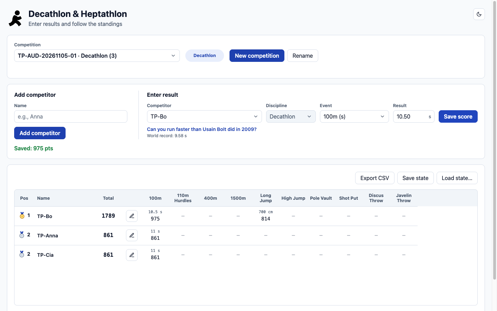
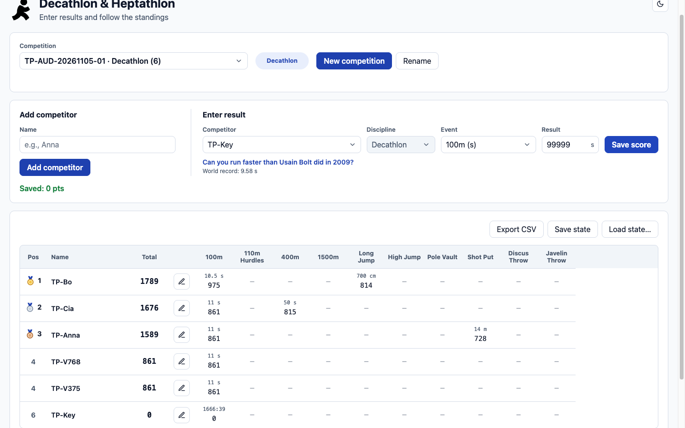

# Audit report: AUD-20261105-01

## Summary

Target: http://localhost:8080 (local, build unknown). Executions: 17 in total. **pass: 11, fail: 4, blocked: 2, skipped: 0, inconclusive: 0.** These counts are separate; blocked, skipped and inconclusive are never counted as pass or fail.

Test plan items run: TPI-001 to TPI-005, TPI-007 to TPI-013 (14 items in the plan; TPI-006 and TPI-014 are blocked).

- **Bug proposals:** 2 (BP-001, BP-002), both status `proposed`.
- **Manual test proposals:** 5 (MTP-001 to MTP-005), status `proposed`.
- **Coverage gaps:** 11.
- **TestBench backlog:** 1 item (TBB-001).

Findings in short:

1. REQ-LOCAL-004 (TPI-009, `fail`): the standings table shows total and total position but no rank within each event (BP-001).
2. REQ-LOCAL-006 (TPI-012, `fail`): negative, non-numeric, empty and too fast values are rejected with a clear message, but 99999 s for the 100m is accepted and saved (BP-002).
3. REQ-LOCAL-003 (TPI-008, `pass`): the five Decathlon results compared equal the World Athletics reference values; Heptathlon and the other events were not compared.
4. TPI-006 and TPI-014 could not run (`blocked`, test-data), see Limitations.

Everything above is a proposal. Nothing has been accepted or closed; review is yours.

## Scope and environment

- Objective: Check the core flows (add competitor, enter result, standings and ranking, CSV export) of the Decathlon & Heptathlon app against REQ-LOCAL-001 to REQ-LOCAL-007.
- Target: http://localhost:8080, environment local, build not known.
- Confirmed by: johan at 2026-11-05T15:15:55Z.
- Included requirements: REQ-LOCAL-001, REQ-LOCAL-002, REQ-LOCAL-003, REQ-LOCAL-004, REQ-LOCAL-005, REQ-LOCAL-006, REQ-LOCAL-007. Excluded: none.
- Allowed check types: Functional, Responsive, Accessibility, Validation (Validation added for TPI-012 on user confirmation). Mode: `mcp-exploration` only; no saved Playwright test.
- Viewports: 1440×900, 768×1024, 375×812.
- State changes: allowed only in competitions starting with `TP-`; used only in `TP-AUD-20261105-01`. Actions: create_competition (once), add_competitor (9 names), save_result (at most 20, attempts counted), export_csv (at most 2, only from the TP competition).
- Out of scope: Save state, Load state, Rename, dark mode, performance, cross-browser, server-side validation depth, security testing.
- Browser: Playwright MCP browser. TestBench: not used; requirements are local (`REQ-LOCAL-<nnn>`, not registered in TestBench).

Stop condition set by the user: stop immediately on an unexpected error, data loss, or a write outside TP-AUD-20261105-01. None occurred.

## Requirements and readiness

| requirement_id | Title | Source | Readiness | Acceptance criteria |
|---|---|---|---|---|
| REQ-LOCAL-001 | A user can add a participant with a name | local (not registered in TestBench) | ready | After adding a participant with a name, that name is shown in the app (competitor selector or standings). |
| REQ-LOCAL-002 | A user can register a result per event | local (not registered in TestBench) | ready | A result saved for a participant and an event is shown for that participant under that event. |
| REQ-LOCAL-003 | Points are calculated per the current Decathlon/Heptathlon tables | local (not registered in TestBench) | ready | Points per event equal the World Athletics (IAAF) combined-events scoring-table value for that event and result (INT of A*(B-P)^C for track, A*(P-B)^C for field). A deviating value is a finding with the calculation and expected value. |
| REQ-LOCAL-004 | The table shows total points and placement per event | local (not registered in TestBench) | ready | The table shows the rank within each event, and also the total and the total position. |
| REQ-LOCAL-005 | Ties share a placement | local (not registered in TestBench) | ready | Participants with equal totals show the same position. The position that follows a tie is not specified and is not judged. |
| REQ-LOCAL-006 | Invalid results are rejected with a clear error message | local (not registered in TestBench) | ready | Negative, non-numeric, empty and unreasonable values for an event are rejected with a clear error message and the result is not saved. |
| REQ-LOCAL-007 | Export CSV contains the same data as the table | local (not registered in TestBench) | ready | The exported CSV contains every participant, total, position and event value shown in the table. Column order and format are not specified and are not judged. |

Criteria for REQ-LOCAL-001, 002, 005 and 007 were derived by the agent from the requirement wording; criteria for 003, 004 and 006 are the user's clarifications.

## Execution results

| execution_id | test_plan_item_id | requirement_id | Status | Reason | Viewport | Started | Finished | Evidence |
|---|---|---|---|---|---|---|---|---|
| EX-001 | TPI-001 | REQ-LOCAL-001 | pass |  | 1440×900 | 2026-11-05T15:16:44Z | 2026-11-05T15:17:22Z | EV-001, EV-002, EV-003, EV-004 |
| EX-002 | TPI-002 | REQ-LOCAL-001 | pass |  | 1440×900 | 2026-11-05T15:17:42Z | 2026-11-05T15:18:00Z | EV-005, EV-006 |
| EX-003 | TPI-004 | REQ-LOCAL-002 | pass |  | 1440×900 | 2026-11-05T15:18:31Z | 2026-11-05T15:18:37Z | EV-007, EV-008 |
| EX-004 | TPI-005 | REQ-LOCAL-002 | pass |  | 1440×900 | 2026-11-05T15:19:05Z | 2026-11-05T15:19:10Z | EV-009, EV-010 |
| EX-005 | TPI-010 | REQ-LOCAL-005 | pass |  | 1440×900 | 2026-11-05T15:19:32Z | 2026-11-05T15:19:37Z | EV-011, EV-012 |
| EX-006 | TPI-011 | REQ-LOCAL-005 | pass |  | 1440×900 | 2026-11-05T15:19:37Z | 2026-11-05T15:26:12Z | EV-011, EV-012, EV-039 |
| EX-007 | TPI-009 | REQ-LOCAL-004 | fail |  | 1440×900 | 2026-11-05T15:20:07Z | 2026-11-05T15:20:15Z | EV-013, EV-014 |
| EX-008 | TPI-008 | REQ-LOCAL-003 | pass |  | 1440×900 | 2026-11-05T15:20:54Z | 2026-11-05T15:21:27Z | EV-015, EV-016, EV-017, EV-018 |
| EX-009 | TPI-007 | REQ-LOCAL-002 | pass |  | 768×1024 | 2026-11-05T15:21:48Z | 2026-11-05T15:22:11Z | EV-019, EV-020 |
| EX-010 | TPI-007 | REQ-LOCAL-002 | pass |  | 375×812 | 2026-11-05T15:22:29Z | 2026-11-05T15:23:06Z | EV-021, EV-022, EV-023 |
| EX-011 | TPI-003 | REQ-LOCAL-001 | pass |  | 1440×900 | 2026-11-05T15:23:59Z | 2026-11-05T15:24:07Z | EV-024, EV-025 |
| EX-012 | TPI-012 | REQ-LOCAL-006 | fail |  | 1440×900 | 2026-11-05T15:24:39Z | 2026-11-05T15:25:53Z | EV-026, EV-027, EV-028, EV-029, EV-030, EV-031, EV-032, EV-033, EV-034, EV-035, EV-036, EV-037, EV-038 |
| EX-013 | TPI-009 | REQ-LOCAL-004 | fail |  | 1440×900 | 2026-11-05T15:20:14Z | 2026-11-05T15:26:39Z | EV-013, EV-014, EV-039, EV-040, EV-041 |
| EX-014 | TPI-013 | REQ-LOCAL-007 | pass |  | 1440×900 | 2026-11-05T15:26:25Z | 2026-11-05T15:26:39Z | EV-040, EV-041 |
| EX-015 | TPI-014 | REQ-LOCAL-007 | blocked | test-data | 1440×900 | 2026-11-05T15:27:05Z | 2026-11-05T15:27:14Z | EV-042, EV-043, EV-044, EV-045 |
| EX-016 | TPI-012 | REQ-LOCAL-006 | fail |  | 1440×900 | 2026-11-05T15:28:00Z | 2026-11-05T15:28:09Z | EV-046, EV-047, EV-048 |
| EX-017 | TPI-006 | REQ-LOCAL-002 | blocked | test-data | 1440×900 | 2026-11-05T15:16:44Z | 2026-11-05T15:16:54Z | EV-001, EV-002 |

### EX-001: TPI-001, Add one participant with a plain name (pass)

- Requirement: REQ-LOCAL-001; mode: `mcp-exploration`.
- Expected: After adding a participant with a name, that name is shown in the app (competitor selector or standings).
- Actual and scope of verification: Verified: after adding TP-Anna to TP-AUD-20261105-01 the name is shown in the competitor selector and in the standings (counter 1); the console had no errors. Setup action: the competition was created first (ACT-001). Not verified: persistence, blank or special-character names, server-side behaviour.

### EX-002: TPI-002, Add several participants (count 0, 1, many) (pass)

- Requirement: REQ-LOCAL-001; mode: `mcp-exploration`.
- Expected: After adding a participant with a name, that name is shown in the app (competitor selector or standings).
- Actual and scope of verification: Verified: TP-Bo and TP-Cia were added; all three names are shown and the competition counter shows 3. Not verified: more than three participants, duplicate names.

### EX-003: TPI-004, Save a valid time result (100m, Decathlon) (pass)

- Requirement: REQ-LOCAL-002; mode: `mcp-exploration`.
- Expected: A result saved for a participant and an event is shown for that participant under that event.
- Actual and scope of verification: Verified: 100m 11.00 s saved for TP-Anna is shown in her 100m cell (11 s, 861); the status line says Saved: 861 pts; the console had no errors. Not verified: the other nine events, overwriting a result.

### EX-004: TPI-005, Save a valid result in another event type (Long Jump, Decathlon) (pass)

- Requirement: REQ-LOCAL-002; mode: `mcp-exploration`.
- Expected: A result saved for a participant and an event is shown for that participant under that event.
- Actual and scope of verification: Verified: Long Jump (unit cm) 700 saved for TP-Bo is shown in his Long Jump cell (700 cm, 814). Test data deviation from the plan: 7.00 m was entered as 700 because the UI unit is cm. Not verified: other field events.

### EX-005: TPI-010, Two participants with equal totals share a position (pass)

- Requirement: REQ-LOCAL-005; mode: `mcp-exploration`.
- Expected: Participants with equal totals show the same position. The position that follows a tie is not specified and is not judged.
- Actual and scope of verification: Verified: TP-Anna and TP-Cia both have total 861 and both show position 1. Not verified: ties in other totals, ties at lower positions, how ties are ordered inside the table.

### EX-006: TPI-011, A participant with a different total is not given the tied position (pass)

- Requirement: REQ-LOCAL-005; mode: `mcp-exploration`.
- Expected: Participants with equal totals show the same position. The position that follows a tie is not specified and is not judged.
- Actual and scope of verification: Verified: TP-Bo (total 814 at that time, 1789 later) never shows the tied position; with the tie at 1, TP-Bo shows 3. After later data the table shows 1, 2, 3, then 4 and 4 (TP-V768 and TP-V375 tied) and 6. The position after a tie is therefore counted as in 1, 1, 3 and is recorded, not judged (CG-004).

### EX-007: TPI-009, Total and placement per event in the table (fail)

- Requirement: REQ-LOCAL-004; mode: `mcp-exploration`.
- Expected: The table shows the rank within each event, and also the total and the total position.
- Actual and scope of verification: Violated criterion: the table shows the rank within each event, plus total and total position. Observed: total (Total) and total position (Pos) are shown, but each event cell shows only the result and the points (TP-Bo 100m: 10.5 s, 975), and no rank within the event appears in the table, in its HTML, on hover, or elsewhere on the page. TP-Bo scored 975 pts in 100m (reference 975, matches). Reproduced: see EX-013. Cause checked: not a selector or timing fault (values read from the DOM and screenshot).

### EX-008: TPI-008, Points calculation per official tables (pass)

- Requirement: REQ-LOCAL-003; mode: `mcp-exploration`.
- Expected: Points per event equal the World Athletics (IAAF) combined-events scoring-table value for that event and result (INT of A*(B-P)^C for track, A*(P-B)^C for field). A deviating value is a finding with the calculation and expected value.
- Actual and scope of verification: Verified for five Decathlon results against the World Athletics formula (INT of A*(B-P)^C): 100m 11.00 s = 861, Long Jump 700 cm = 814, 400m 50.00 s = 815, Shot Put 14.00 m = 728, 100m 10.50 s = 975; all equal the expected values. Not verified: the other Decathlon events (110m Hurdles, 1500m, High Jump, Pole Vault, Discus, Javelin) and every Heptathlon event (no Heptathlon competition was permitted by the scope, see EX-017); the reference constants were recalled by the agent and not read from the official document (CG-011).

### EX-009: TPI-007, Result entry at 768 and 375 px (pass)

- Requirement: REQ-LOCAL-002; mode: `mcp-exploration`.
- Expected: A result saved for a participant and an event is shown for that participant under that event.
- Actual and scope of verification: Verified at 768 px: TP-V768 was added and a 100m result saved and shown (861); the page has no horizontal scroll (scrollWidth 753); the standings table scrolls inside its own container. Layout observations are heuristic-based and have no design reference.

### EX-010: TPI-007, Result entry at 768 and 375 px (pass)

- Requirement: REQ-LOCAL-002; mode: `mcp-exploration`.
- Expected: A result saved for a participant and an event is shown for that participant under that event.
- Actual and scope of verification: Verified at 375 px: TP-V375 was added and a 100m result saved and shown (861); controls were readable and operable; the standings table scrolls inside its own container. Observation (heuristic-based, no requirement or design reference): the page is 8 px wider than the viewport (scrollWidth 383 against 375) and the element causing it was not identified (CG-014).

### EX-011: TPI-003, Add a participant with the keyboard only (pass)

- Requirement: REQ-LOCAL-001; mode: `mcp-exploration`.
- Expected: After adding a participant with a name, that name is shown in the app (competitor selector or standings).
- Actual and scope of verification: Verified: TP-Key was added with the keyboard only (Tab to Name, typing, Tab to Add competitor, Enter). Focus order from the Rename button was Name then Add competitor; a 2 px outline was present on each focused control; no keyboard trap was seen in that sequence. Setup note: focus was placed on the Rename button by script to start the sequence just before Name. No automated accessibility scan was performed; this does not establish WCAG 2.1 AA conformance.

### EX-012: TPI-012, Invalid results rejected with a clear message (fail)

- Requirement: REQ-LOCAL-006; mode: `mcp-exploration`.
- Expected: Negative, non-numeric, empty and unreasonable values for an event are rejected with a clear error message and the result is not saved.
- Actual and scope of verification: Violated criterion: negative, non-numeric, empty and unreasonable values are rejected with a clear message and not saved. Observed for 100m: -1 (Result cannot be negative), abc (Enter the result in seconds (163) or as minutes:seconds (2:43)), empty (Result is required) and 0.5 (Faster than the world record for 100m: 9.58 s) were rejected with a visible message and not saved. 99999 (about 27.8 hours) was accepted: no error, Saved: 0 pts, the value is shown as 1666:39 and the server answered 200. Reproduced: see EX-016 and the reload check in EX-013. Not verified: other events, other unreasonable values, client versus server cause for each rejection.

### EX-013: TPI-009, Total and placement per event in the table (fail)

- Requirement: REQ-LOCAL-004; mode: `mcp-exploration`.
- Expected: The table shows the rank within each event, and also the total and the total position.
- Actual and scope of verification: Repeat of EX-007 by another route (page reload, then reading the standings, and the exported CSV). Violated criterion: rank within each event is shown. Observed again: the table cells hold only result and points, and the CSV has result and points columns per event, Total and Position, but no per-event rank. The data is persisted by the server (values unchanged after reload).

### EX-014: TPI-013, Export CSV from the Decathlon tab matches the table (pass)

- Requirement: REQ-LOCAL-007; mode: `mcp-exploration`.
- Expected: The exported CSV contains every participant, total, position and event value shown in the table. Column order and format are not specified and are not judged.
- Actual and scope of verification: Verified (export 1 of 2): the CSV contains the same seven rows as the table with matching position, name, total, and result and points per event (for example TP-Bo 1, 10.5 / 975, 700 / 814, 1789). Results are shown as entered (TP-Key 99999 against 1666:39 in the table; same data, different format). Not verified: the Heptathlon tab, column order and format (not specified), other browsers. Observations: the Competition column holds the type (Decathlon); event names in the header are inconsistent (100m result, longJump result).

### EX-015: TPI-014, CSV keeps names with comma and quote intact (blocked)

- Requirement: REQ-LOCAL-007; mode: `mcp-exploration`.
- Expected: The exported CSV contains every participant, total, position and event value shown in the table. Column order and format are not specified and are not judged.
- Actual and scope of verification: The check could not run: the required test data cannot be created. The app rejected TP-Csv, Comma and TP-Csv "Quote" with Name must contain valid letters (server answered 400 both times), so no name with a comma or quote exists. Needed to unblock: a participant name that the app accepts and that contains a CSV delimiter or quote, or confirmation that such names are intentionally not allowed. This is not recorded as a product defect: no requirement defines valid names.

### EX-016: TPI-012, Invalid results rejected with a clear message (fail)

- Requirement: REQ-LOCAL-006; mode: `mcp-exploration`.
- Expected: Negative, non-numeric, empty and unreasonable values for an event are rejected with a clear error message and the result is not saved.
- Actual and scope of verification: Repeat of EX-012 attempt 5 with the same steps. Violated criterion: unreasonable values are rejected and not saved. Observed again: 99999 for 100m was accepted, Saved: 0 pts, cell 1666:39, server answered 200. Reproduced 2 of 2.

### EX-017: TPI-006, Save a valid result in the Heptathlon discipline (blocked)

- Requirement: REQ-LOCAL-002; mode: `mcp-exploration`.
- Expected: A result saved for a participant and an event is shown for that participant under that event.
- Actual and scope of verification: The check could not run: the competition TP-AUD-20261105-01 was created as type Decathlon and its Discipline control is disabled, so no Heptathlon result can be saved in it. A Heptathlon result needs a second competition of type Heptathlon; creating a second competition is not in the confirmed state-change limits (create_competition once per audit). Needed to unblock: user approval to create one Heptathlon competition whose name starts with TP-. The same limit prevented the Heptathlon part of TPI-008. Not recorded as a product defect.

### Skipped items

No item was skipped. All 14 plan items have an execution; two are `blocked`.

### Other observations (not findings)

- A Decathlon-type competition has a locked Discipline control; the Decathlon/Heptathlon tabs are not shown for it.
- Event cells show the entered value and the points (for example `11 s` over `861`).
- Console errors during the audit are browser logs of server 400 answers to rejected input; the app showed a message each time.
- The CSV header mixes styles (`100m result`, `longJump result`) and its Competition column holds the type.
- Names with a comma or a quote are rejected (`Name must contain valid letters`); no requirement defines valid names.
- Data is stored by a server API (`/api/competitions/c1/...`); values survive a page reload.

No automated accessibility scan was performed in this audit. Accessibility signals were assessed through Playwright MCP exploration, keyboard interaction and DOM/accessibility-tree inspection. This does not establish WCAG 2.1 AA conformance.

## Bug proposals

Duplicate check: `not_available` for both (no bug data from a configured TestBench integration).

### BP-001: Standings table: no rank within each event is shown when results are saved

#### Classification
- Bug proposal ID: BP-001
- Finding category: functional

#### Duplicate check
- Duplicate check: not_available
- Possible duplicate of: null
- Notes: No bug data is available through a configured TestBench integration, so no comparison was made.

#### Requirement link
- Requirement ID: REQ-LOCAL-004
- Acceptance criterion: The table shows the rank within each event, and also the total and the total position (user clarification of REQ-LOCAL-004).
- Test plan item ID: TPI-009
- Execution ID(s): EX-007, EX-013

#### Environment
- URL: http://localhost:8080/
- Browser: Playwright MCP browser (Chromium-based, version not recorded)
- Viewport: 1440x900
- Build / commit: unknown (no build or version given)
- Test environment: local, competition TP-AUD-20261105-01

#### Preconditions
1. The app is running at http://localhost:8080/.
2. Competition TP-AUD-20261105-01 (Decathlon) is selected.
3. TP-Anna and TP-Cia each have 100m 11.00; TP-Bo has 100m 10.50 and Long Jump 700 cm.

#### Steps to reproduce
1. Open the app and select the competition TP-AUD-20261105-01.
2. Look at the standings table, including the 100m and Long Jump columns, and hover the event cells.
3. Optionally click Export CSV and open the file.
4. Look for the rank of each competitor within the 100m event and within the Long Jump event.

#### Expected result
Each competitor has a rank within each event they have a result in, plus the total and total position. Source: REQ-LOCAL-004 as clarified by the user ("Placement per event means rank within each event; total and total placement are also shown").

#### Actual result
The table shows the total and the total position (Pos). Each event cell shows only the result and points, for example TP-Bo 100m: 10.5 s and 975. No rank within an event is shown in the table, in its HTML, on hover, or in the CSV export (columns: Position, Name, Competition, result and points per event, Total).

#### Reproduction rate
- Always
- Attempts: 2 of 2 (EX-007; EX-013 after a page reload and with the CSV export)

#### Evidence
- EV-013 (dom-excerpt): Table HTML after saving 100m 10.50 for TP-Bo: event cells hold only points and a data-raw value, no rank within the event. (`evidence/tpi-009-standings-table-html-after-bo-100m-2026-11-05.html`)
- EV-014 (screenshot): Standings table: each event cell shows the result and points (TP-Bo 10.5 s 975), no per-event rank. (`evidence/tpi-009-standings-after-bo-100m-screenshot-2026-11-05.png`)
- EV-039 (test-output): Standings read after a page reload: all values persisted, TP-Key still holds 1666:39 (99999 s), no per-event rank element. (`evidence/recheck-after-reload-standings-2026-11-05.json`)
- EV-040 (test-output): CSV from Export CSV (export 1 of 2): seven rows, per-event result and points columns, Total, no per-event rank column. (`evidence/tpi-013-export-1-decathlon-results-2026-11-05.csv`)

#### Severity
- Medium
- Rationale: A clarified requirement is not met, but totals, positions and points are correct and no data is lost. Severity is a proposal for human review.

#### Agent confidence
- Medium
- Basis: The absence of an event rank is clearly observed and reproduced through three routes. Confidence is not High because the requirement text was clarified by the user and a design reference was not available; the UI may intentionally show only points per event.

#### Proposed manual test
- Manual test proposal ID: MTP-002
- Objective: Confirm with the product owner how rank within an event is meant to be shown.
- Steps: Review the requirement and design for event rank.; With three competitors holding different 100m results, check where the 100m rank is shown.
- Expected result: The agreed event rank is visible for each competitor and event.

#### Status
- proposed

### BP-002: Enter result: an unreasonable 100m value (99999 s) is accepted and saved without an error

#### Classification
- Bug proposal ID: BP-002
- Finding category: functional

#### Duplicate check
- Duplicate check: not_available
- Possible duplicate of: null
- Notes: No bug data is available through a configured TestBench integration, so no comparison was made.

#### Requirement link
- Requirement ID: REQ-LOCAL-006
- Acceptance criterion: Negative, non-numeric, empty and unreasonable values for an event are rejected with a clear error message and the result is not saved (user clarification of REQ-LOCAL-006).
- Test plan item ID: TPI-012
- Execution ID(s): EX-012, EX-016

#### Environment
- URL: http://localhost:8080/
- Browser: Playwright MCP browser (Chromium-based, version not recorded)
- Viewport: 1440x900
- Build / commit: unknown (no build or version given)
- Test environment: local, competition TP-AUD-20261105-01

#### Preconditions
1. The app is running at http://localhost:8080/.
2. Competition TP-AUD-20261105-01 (Decathlon) is selected with a competitor TP-Key that has no results.

#### Steps to reproduce
1. Click the row TP-Key so that the competitor is loaded in Enter result.
2. Select discipline Decathlon and event 100m (s).
3. Type 99999 in Result and click Save score.
4. Read the message, then reload the page, select the competition and look at the TP-Key row.

#### Expected result
The value is rejected with a clear error message and nothing is saved. Source: REQ-LOCAL-006 as clarified by the user (unreasonable values for the event are invalid).

#### Actual result
No error is shown. The status line says Saved: 0 pts, the 100m cell shows 1666:39 (99999 s), TP-Key gets position 6 and the server answered 200. The value is still there after a reload. In the same session, 0.5 s was rejected with Faster than the world record for 100m: 9.58 s, so an unreasonable low value is handled and an unreasonable high one is not.

#### Reproduction rate
- Always
- Attempts: 2 of 2 (EX-012 attempt 5 and EX-016); persisted after reload (EX-013)

#### Evidence
- EV-034 (test-output): Attempt 99999 for 100m: no error, Saved: 0 pts, TP-Key cell holds the value. (`evidence/tpi-012-attempt-5-unreasonable-high-100m-result-2026-11-05.json`)
- EV-035 (screenshot): Page after attempt 99999: Saved: 0 pts and TP-Key shows 1666:39 in the 100m column. (`evidence/tpi-012-attempt-5-unreasonable-high-100m-screenshot-2026-11-05.png`)
- EV-036 (network-trace): POST /api/competitions/c1/score requests with status codes: 200 for saves, 400 for three rejected attempts, 200 for 99999. (`evidence/tpi-012-score-requests-after-invalid-attempts-2026-11-05.txt`)
- EV-038 (test-output): TP-Key row HTML after attempt 99999 and the status text. (`evidence/tpi-012-attempt-5-key-row-after-99999-2026-11-05.json`)
- EV-039 (test-output): Standings read after a page reload: all values persisted, TP-Key still holds 1666:39 (99999 s), no per-event rank element. (`evidence/recheck-after-reload-standings-2026-11-05.json`)
- EV-046 (test-output): Repeat of 99999 for TP-Key 100m: Saved: 0 pts, cell 1666:39. (`evidence/tpi-012-repeat-99999-result-2026-11-05.json`)
- EV-047 (network-trace): Repeat score request: POST /api/competitions/c1/score returned 200. (`evidence/tpi-012-repeat-score-requests-2026-11-05.txt`)
- EV-048 (screenshot): Page after the repeated 99999 save. (`evidence/tpi-012-repeat-99999-screenshot-2026-11-05.png`)

#### Severity
- Medium
- Rationale: Invalid data is stored and shown in the standings (scored 0 points), but other clearly invalid values are rejected and the data stays contained in a test competition. Severity is a proposal for human review.

#### Agent confidence
- Medium
- Basis: The behaviour is reproduced twice and persisted. Confidence is not High because no numeric upper limit for unreasonable values is defined; 99999 s (about 27.8 hours) is unreasonable under any reading, but the exact threshold is unspecified.

#### Proposed manual test
- Manual test proposal ID: MTP-001
- Objective: Find out which upper limits the app should enforce per event and check each event.
- Steps: Agree an upper limit per event.; For each event enter a value just below, at and above the limit.; Check message and that above-limit values are not saved.
- Expected result: Values above the limit are rejected with a clear message and are not saved.

#### Status
- proposed

## Manual test proposals

### MTP-001: Upper limits for result values per event
- Requirement: REQ-LOCAL-006
- Origin: bug_proposal BP-002
- Objective: Agree and verify upper limits for unreasonable result values in every event.
- Steps:
  1. Agree an upper limit per event with the product owner.
  2. In a TP- competition, enter a value just below, at and above the limit for each event.
  3. Check the message and that above-limit values are not saved, also after a page reload.
- Expected result: Values above the agreed limit are rejected with a clear message and are not saved.
- Why manual: Needs a product decision on the limits before it can be automated.
- Status: proposed

### MTP-002: Rank within each event
- Requirement: REQ-LOCAL-004
- Origin: bug_proposal BP-001
- Objective: Confirm how rank within an event is meant to be shown and check it once it is defined.
- Steps:
  1. Review the requirement and any design for event rank with the product owner.
  2. Give three competitors different 100m results in a TP- competition.
  3. Check where each competitor's 100m rank is shown, and that a tie shares the rank.
- Expected result: The agreed event rank is visible for each competitor and event.
- Why manual: The presentation of event rank is not defined in a design reference.
- Status: proposed

### MTP-003: Heptathlon result entry and points
- Requirement: REQ-LOCAL-002
- Origin: coverage_gap CG-010
- Objective: Check that a Heptathlon result can be saved and that its points equal the World Athletics table.
- Steps:
  1. Create one competition of type Heptathlon whose name starts with TP-.
  2. Add a competitor and save 100m Hurdles 14.00 s.
  3. Compare the points with the reference value (978) and check the Heptathlon standings.
- Expected result: The result is shown under 100m Hurdles and the points equal the reference value.
- Why manual: A second competition was outside the confirmed state-change limits (create_competition once per audit).
- Status: proposed

### MTP-004: CSV export with special characters in names
- Requirement: REQ-LOCAL-007
- Origin: coverage_gap CG-012
- Objective: Find which characters the app accepts in names and check that the CSV keeps them intact.
- Steps:
  1. Try names with apostrophe, accents (for example Åsa) and other characters to see which are accepted.
  2. Add each accepted name to a TP- competition with a result and export the CSV.
  3. Open the CSV with a CSV parser and compare each name with the table.
- Expected result: Every name in the CSV equals the name in the table.
- Why manual: Names with comma and quote are rejected by the app, so the planned data could not be created.
- Status: proposed

### MTP-005: Page width at 375 px
- Requirement: REQ-LOCAL-002
- Origin: execution EX-010
- Objective: Find what makes the page 8 px wider than a 375 px viewport and judge it against a design reference.
- Steps:
  1. Open the app at 375 px width with a real device or devtools.
  2. Scroll horizontally on the page outside the table.
  3. Compare with the design reference and note the element that overflows.
- Expected result: No page-level horizontal scroll, unless the design allows it.
- Why manual: No design reference exists and the overflowing element was not identified.
- Status: proposed

## Coverage gaps and not verified

| coverage_gap_id | requirement_id | What is not verified, and why |
|---|---|---|
| CG-004 | REQ-LOCAL-005 | Which position follows a tie is not judged. The requirement does not specify it. The app counts positions as 1, 1, 3 and 4, 4, 6 (EX-006). |
| CG-005 | REQ-LOCAL-001 | Blank, duplicate, very long and special-character names, and which characters are valid are not verified. No criterion exists. Observation: names with a comma or quote were rejected with Name must contain valid letters (EX-015). |
| CG-006 | REQ-LOCAL-002 | Results in the other events (7 Decathlon events not run), changing or overwriting an existing result, and persistence of each saved value are not verified. Only 100m, Long Jump, 400m and Shot Put were saved. |
| CG-007 | REQ-LOCAL-007 | CSV from a Heptathlon competition, the CSV column order and format, a second export, and Save state / Load state are not verified. The format is not specified, and Save and Load are out of scope. |
| CG-008 | REQ-LOCAL-002 | Rename competition, the dark mode toggle and the Actions column (edit) are not verified. No requirement covers them. Create competition was used only as setup. |
| CG-009 | REQ-LOCAL-001 | Server-side validation is only observed through response codes (400 for rejected scores and names, 200 for accepted ones). Injection protection and server-side behaviour in general are not verified. |
| CG-010 | REQ-LOCAL-002 | Saving a Heptathlon result (TPI-006) was not verified. The competition is of type Decathlon and its Discipline control is disabled; a second competition of type Heptathlon was not permitted by the scope (EX-017). |
| CG-011 | REQ-LOCAL-003 | Points were compared only for 100m, Long Jump, 400m and Shot Put in Decathlon. 110m Hurdles, 1500m, High Jump, Pole Vault, Discus, Javelin and all Heptathlon events are not verified. Reference constants were recalled by the agent and not read from the official World Athletics document. |
| CG-012 | REQ-LOCAL-007 | CSV handling of names with a comma or quote is not verified (TPI-014 blocked): the app does not accept such names (EX-015). |
| CG-013 | REQ-LOCAL-006 | Invalid results were tried only for the 100m event and only with -1, abc, empty, 0.5 and 99999. Other events, other unreasonable values, boundary values and the exact limits are not verified. |
| CG-014 | REQ-LOCAL-002 | The 8 px page-level horizontal overflow at 375 px (EX-010) is only observed. The overflowing element was not identified, and there is no design reference to judge it against. |

CG-001 to CG-003 from the draft plan were removed when the user's clarifications made REQ-LOCAL-003, 004 and 006 testable; IDs are not reused.

## Limitations

- 2026-11-05T15:15:55Z: Scope confirmed by the user. The state-change limits and the export_csv approval (max 2, only from TP-AUD-20261105-01) were confirmed as proposed.
- 2026-11-05T15:15:55Z: Scope change confirmed by the user: REQ-LOCAL-003, 004 and 006 now have user-supplied clarifications and are ready. The Validation check type was added to allowed_check_types for TPI-012. REQ-LOCAL-003 uses the World Athletics scoring tables; reference values are computed with the published formula constants as recalled by the agent and were not read from the official document in this audit.
- 2026-11-05T15:15:55Z: Execution scope confirmed by the user: TPI-001 to TPI-014 (TPI-008, TPI-009 and TPI-012 included).
- Execution start and finish times are derived from recorded action timestamps and evidence file capture times; they are not measured to the second. Evidence captured_at is the file modification time (the CSV copy keeps the download time).
- TPI-006 and TPI-014 are blocked (test-data) and TPI-008 covers only Decathlon results; see EX-017, EX-015 and CG-010, CG-011, CG-012. A second competition of type Heptathlon needs a scope change that the user has not confirmed.
- Only 2 export_csv actions were allowed; 1 was used. Created data remains in TP-AUD-20261105-01 (participants TP-Anna, TP-Bo, TP-Cia, TP-V768, TP-V375, TP-Key, including a stored 99999 s result for TP-Key); no delete action was in scope and no action touched other competitions.
- Console errors seen during the audit are the browser logs of server 400 responses to rejected inputs (invalid scores and names); no uncaught script errors were seen.
- Heights of the viewports (900, 1024, 812) were chosen by the agent.
- No automated accessibility scan was performed in this audit. Accessibility signals were assessed through Playwright MCP exploration, keyboard interaction and DOM/accessibility-tree inspection. This does not establish WCAG 2.1 AA conformance.
- Visual design review (step 4) was not run as a separate check: no requirement concerns visual presentation and no design reference exists. Responsive layout was observed in TPI-007 only.
- Duplicate check not available: no bug data from a configured TestBench integration.

## TestBench backlog

- TBB-001 (other, proposed): TestBench configuration lacks requirementsSource and deliveryPath. config/testbench.json has no requirementsSource or deliveryPath, and deliveryEnabled is false. Requirements were supplied locally and the package cannot be delivered. Needed: a configured requirements source and an audit-package delivery path.

Delivery: `not_configured`. The package is not delivered and no TestBench call was made. Package validation and TestBench acceptance are separate facts; there has been no acceptance.

## Evidence index

| evidence_id | Type | Captured (UTC) | Location | Related | Description |
|---|---|---|---|---|---|
| EV-001 | screenshot | 2026-11-05T15:16:44Z | [evidence/setup-new-competition-dialog-2026-11-05.png](evidence/setup-new-competition-dialog-2026-11-05.png) | EX-001, EX-017 | New competition dialog with the name TP-AUD-20261105-01 entered and the Type choice Decathlon / Heptathlon. |
| EV-002 | dom-excerpt | 2026-11-05T15:16:54Z | [evidence/setup-competition-created-dom-2026-11-05.yml](evidence/setup-competition-created-dom-2026-11-05.yml) | EX-001, EX-017 | Accessibility tree after the competition was created: type Decathlon, the Discipline control is disabled. |
| EV-003 | dom-excerpt | 2026-11-05T15:17:22Z | [evidence/tpi-001-add-anna-dom-2026-11-05.yml](evidence/tpi-001-add-anna-dom-2026-11-05.yml) | EX-001 | Accessibility tree after adding TP-Anna: name shown in the competitor selector and standings, counter 1. |
| EV-004 | screenshot | 2026-11-05T15:17:22Z | [evidence/tpi-001-add-anna-screenshot-2026-11-05.png](evidence/tpi-001-add-anna-screenshot-2026-11-05.png) | EX-001 | Page after adding TP-Anna. |
| EV-005 | dom-excerpt | 2026-11-05T15:18:00Z | [evidence/tpi-002-add-bo-cia-dom-2026-11-05.yml](evidence/tpi-002-add-bo-cia-dom-2026-11-05.yml) | EX-002 | Accessibility tree after adding TP-Bo and TP-Cia: three names, counter 3. |
| EV-006 | screenshot | 2026-11-05T15:18:00Z | [evidence/tpi-002-add-bo-cia-screenshot-2026-11-05.png](evidence/tpi-002-add-bo-cia-screenshot-2026-11-05.png) | EX-002 | Page after adding TP-Bo and TP-Cia. |
| EV-007 | dom-excerpt | 2026-11-05T15:18:37Z | [evidence/tpi-004-save-anna-100m-dom-2026-11-05.yml](evidence/tpi-004-save-anna-100m-dom-2026-11-05.yml) | EX-003 | Accessibility tree after saving 100m 11.00 for TP-Anna: cell 11 s 861, status Saved: 861 pts. |
| EV-008 | screenshot | 2026-11-05T15:18:37Z | [evidence/tpi-004-save-anna-100m-screenshot-2026-11-05.png](evidence/tpi-004-save-anna-100m-screenshot-2026-11-05.png) | EX-003 | Page after saving 100m 11.00 for TP-Anna. |
| EV-009 | dom-excerpt | 2026-11-05T15:19:10Z | [evidence/tpi-005-save-bo-longjump-dom-2026-11-05.yml](evidence/tpi-005-save-bo-longjump-dom-2026-11-05.yml) | EX-004 | Accessibility tree after saving Long Jump 700 cm for TP-Bo: cell 700 cm 814, status Saved: 814 pts. |
| EV-010 | screenshot | 2026-11-05T15:19:10Z | [evidence/tpi-005-save-bo-longjump-screenshot-2026-11-05.png](evidence/tpi-005-save-bo-longjump-screenshot-2026-11-05.png) | EX-004 | Page after saving Long Jump 700 cm for TP-Bo. |
| EV-011 | dom-excerpt | 2026-11-05T15:19:37Z | [evidence/tpi-010-save-cia-100m-tie-dom-2026-11-05.yml](evidence/tpi-010-save-cia-100m-tie-dom-2026-11-05.yml) | EX-005, EX-006 | Accessibility tree after saving 100m 11.00 for TP-Cia: TP-Anna and TP-Cia both total 861 and position 1, TP-Bo position 3. |
| EV-012 | screenshot | 2026-11-05T15:19:37Z | [evidence/tpi-010-save-cia-100m-tie-screenshot-2026-11-05.png](evidence/tpi-010-save-cia-100m-tie-screenshot-2026-11-05.png) | EX-005, EX-006 | Standings with the tie between TP-Anna and TP-Cia. |
| EV-013 | dom-excerpt | 2026-11-05T15:20:14Z | [evidence/tpi-009-standings-table-html-after-bo-100m-2026-11-05.html](evidence/tpi-009-standings-table-html-after-bo-100m-2026-11-05.html) | EX-007, EX-013, BP-001 | Table HTML after saving 100m 10.50 for TP-Bo: event cells hold only points and a data-raw value, no rank within the event. |
| EV-014 | screenshot | 2026-11-05T15:20:15Z | [evidence/tpi-009-standings-after-bo-100m-screenshot-2026-11-05.png](evidence/tpi-009-standings-after-bo-100m-screenshot-2026-11-05.png) | EX-007, EX-013, BP-001 | Standings table: each event cell shows the result and points (TP-Bo 10.5 s 975), no per-event rank. |
| EV-015 | test-output | 2026-11-05T15:21:00Z | [evidence/tpi-008-cia-400m-result-2026-11-05.json](evidence/tpi-008-cia-400m-result-2026-11-05.json) | EX-008 | Read-out after saving 400m 50.00 for TP-Cia: Saved: 815 pts, total 1676. |
| EV-016 | screenshot | 2026-11-05T15:21:01Z | [evidence/tpi-008-cia-400m-screenshot-2026-11-05.png](evidence/tpi-008-cia-400m-screenshot-2026-11-05.png) | EX-008 | Page after saving 400m 50.00 for TP-Cia. |
| EV-017 | test-output | 2026-11-05T15:21:26Z | [evidence/tpi-008-standings-values-after-shotput-2026-11-05.json](evidence/tpi-008-standings-values-after-shotput-2026-11-05.json) | EX-008 | Read-out of all standings rows and event cells after saving Shot Put 14.00 for TP-Anna (728 pts). |
| EV-018 | screenshot | 2026-11-05T15:21:27Z | [evidence/tpi-008-anna-shotput-screenshot-2026-11-05.png](evidence/tpi-008-anna-shotput-screenshot-2026-11-05.png) | EX-008 | Page after saving Shot Put 14.00 for TP-Anna. |
| EV-019 | test-output | 2026-11-05T15:22:10Z | [evidence/tpi-007-768-layout-and-result-2026-11-05.json](evidence/tpi-007-768-layout-and-result-2026-11-05.json) | EX-009 | At 768 px: saved result 861, no page-level horizontal scroll (scrollWidth 753), table scrolls inside its container. |
| EV-020 | screenshot | 2026-11-05T15:22:11Z | [evidence/tpi-007-768-fullpage-screenshot-2026-11-05.png](evidence/tpi-007-768-fullpage-screenshot-2026-11-05.png) | EX-009 | Full-page screenshot at 768 px after saving the TP-V768 result. |
| EV-021 | test-output | 2026-11-05T15:22:52Z | [evidence/tpi-007-375-layout-and-result-2026-11-05.json](evidence/tpi-007-375-layout-and-result-2026-11-05.json) | EX-010 | At 375 px: saved result 861, document scrollWidth 383 against 375, table scrolls inside its container. |
| EV-022 | screenshot | 2026-11-05T15:22:53Z | [evidence/tpi-007-375-fullpage-screenshot-2026-11-05.png](evidence/tpi-007-375-fullpage-screenshot-2026-11-05.png) | EX-010 | Full-page screenshot at 375 px after saving the TP-V375 result. |
| EV-023 | test-output | 2026-11-05T15:23:06Z | [evidence/tpi-007-375-overflow-elements-2026-11-05.json](evidence/tpi-007-375-overflow-elements-2026-11-05.json) | EX-010 | Elements outside the table whose right edge exceeds the viewport at 375 px: empty list, source of the 8 px overflow not identified. |
| EV-024 | test-output | 2026-11-05T15:24:06Z | [evidence/tpi-003-keyboard-add-key-focus-and-names-2026-11-05.json](evidence/tpi-003-keyboard-add-key-focus-and-names-2026-11-05.json) | EX-011 | Focus order, 2 px outline and control names while adding TP-Key with the keyboard; TP-Key listed, counter 6. |
| EV-025 | dom-excerpt | 2026-11-05T15:24:07Z | [evidence/tpi-003-keyboard-add-key-dom-2026-11-05.yml](evidence/tpi-003-keyboard-add-key-dom-2026-11-05.yml) | EX-011 | Accessibility tree after adding TP-Key with the keyboard only. |
| EV-026 | test-output | 2026-11-05T15:24:39Z | [evidence/tpi-012-attempt-1-negative-result-2026-11-05.json](evidence/tpi-012-attempt-1-negative-result-2026-11-05.json) | EX-012 | Attempt -1 for 100m: message Result cannot be negative, aria-invalid true, nothing saved. |
| EV-027 | screenshot | 2026-11-05T15:24:40Z | [evidence/tpi-012-attempt-1-negative-screenshot-2026-11-05.png](evidence/tpi-012-attempt-1-negative-screenshot-2026-11-05.png) | EX-012 | Page after attempt -1. |
| EV-028 | test-output | 2026-11-05T15:24:57Z | [evidence/tpi-012-attempt-2-nonnumeric-result-2026-11-05.json](evidence/tpi-012-attempt-2-nonnumeric-result-2026-11-05.json) | EX-012 | Attempt abc for 100m: message Enter the result in seconds (163) or as minutes:seconds (2:43), nothing saved. |
| EV-029 | screenshot | 2026-11-05T15:24:58Z | [evidence/tpi-012-attempt-2-nonnumeric-screenshot-2026-11-05.png](evidence/tpi-012-attempt-2-nonnumeric-screenshot-2026-11-05.png) | EX-012 | Page after attempt abc: red message and marked field. |
| EV-030 | test-output | 2026-11-05T15:25:07Z | [evidence/tpi-012-attempt-3-empty-result-2026-11-05.json](evidence/tpi-012-attempt-3-empty-result-2026-11-05.json) | EX-012 | Attempt with an empty value: message Result is required, nothing saved. |
| EV-031 | screenshot | 2026-11-05T15:25:08Z | [evidence/tpi-012-attempt-3-empty-screenshot-2026-11-05.png](evidence/tpi-012-attempt-3-empty-screenshot-2026-11-05.png) | EX-012 | Page after the empty attempt. |
| EV-032 | test-output | 2026-11-05T15:25:28Z | [evidence/tpi-012-attempt-4-unreasonable-low-100m-result-2026-11-05.json](evidence/tpi-012-attempt-4-unreasonable-low-100m-result-2026-11-05.json) | EX-012 | Attempt 0.5 for 100m: message Faster than the world record for 100m: 9.58 s, nothing saved. |
| EV-033 | screenshot | 2026-11-05T15:25:29Z | [evidence/tpi-012-attempt-4-unreasonable-low-100m-screenshot-2026-11-05.png](evidence/tpi-012-attempt-4-unreasonable-low-100m-screenshot-2026-11-05.png) | EX-012 | Page after attempt 0.5. |
| EV-034 | test-output | 2026-11-05T15:25:38Z | [evidence/tpi-012-attempt-5-unreasonable-high-100m-result-2026-11-05.json](evidence/tpi-012-attempt-5-unreasonable-high-100m-result-2026-11-05.json) | EX-012, BP-002 | Attempt 99999 for 100m: no error, Saved: 0 pts, TP-Key cell holds the value. |
| EV-035 | screenshot | 2026-11-05T15:25:38Z | [evidence/tpi-012-attempt-5-unreasonable-high-100m-screenshot-2026-11-05.png](evidence/tpi-012-attempt-5-unreasonable-high-100m-screenshot-2026-11-05.png) | EX-012, BP-002 | Page after attempt 99999: Saved: 0 pts and TP-Key shows 1666:39 in the 100m column. |
| EV-036 | network-trace | 2026-11-05T15:25:45Z | [evidence/tpi-012-score-requests-after-invalid-attempts-2026-11-05.txt](evidence/tpi-012-score-requests-after-invalid-attempts-2026-11-05.txt) | EX-012, BP-002 | POST /api/competitions/c1/score requests with status codes: 200 for saves, 400 for three rejected attempts, 200 for 99999. |
| EV-037 | console-log | 2026-11-05T15:25:45Z | [evidence/tpi-012-console-errors-after-invalid-attempts-2026-11-05.txt](evidence/tpi-012-console-errors-after-invalid-attempts-2026-11-05.txt) | EX-012 | Console errors after the invalid attempts: browser logs of the 400 responses. |
| EV-038 | test-output | 2026-11-05T15:25:53Z | [evidence/tpi-012-attempt-5-key-row-after-99999-2026-11-05.json](evidence/tpi-012-attempt-5-key-row-after-99999-2026-11-05.json) | EX-012, BP-002 | TP-Key row HTML after attempt 99999 and the status text. |
| EV-039 | test-output | 2026-11-05T15:26:12Z | [evidence/recheck-after-reload-standings-2026-11-05.json](evidence/recheck-after-reload-standings-2026-11-05.json) | EX-006, EX-013, BP-001, BP-002 | Standings read after a page reload: all values persisted, TP-Key still holds 1666:39 (99999 s), no per-event rank element. |
| EV-040 | test-output | 2026-11-05T15:26:25Z | [evidence/tpi-013-export-1-decathlon-results-2026-11-05.csv](evidence/tpi-013-export-1-decathlon-results-2026-11-05.csv) | EX-013, EX-014, BP-001 | CSV from Export CSV (export 1 of 2): seven rows, per-event result and points columns, Total, no per-event rank column. |
| EV-041 | screenshot | 2026-11-05T15:26:39Z | [evidence/tpi-013-table-at-export-1-screenshot-2026-11-05.png](evidence/tpi-013-table-at-export-1-screenshot-2026-11-05.png) | EX-013, EX-014 | Standings table at the time of export 1, for comparison with the CSV. |
| EV-042 | screenshot | 2026-11-05T15:27:05Z | [evidence/tpi-014-name-with-comma-rejected-screenshot-2026-11-05.png](evidence/tpi-014-name-with-comma-rejected-screenshot-2026-11-05.png) | EX-015 | Page after trying to add TP-Csv, Comma: message Name must contain valid letters. |
| EV-043 | test-output | 2026-11-05T15:27:13Z | [evidence/tpi-014-name-with-quote-result-2026-11-05.json](evidence/tpi-014-name-with-quote-result-2026-11-05.json) | EX-015 | After trying to add TP-Csv "Quote": same message, no new row, six names listed. |
| EV-044 | network-trace | 2026-11-05T15:27:14Z | [evidence/tpi-014-add-competitor-requests-2026-11-05.txt](evidence/tpi-014-add-competitor-requests-2026-11-05.txt) | EX-015 | Both POST /api/competitions/c1/competitors requests returned 400. |
| EV-045 | console-log | 2026-11-05T15:27:14Z | [evidence/tpi-014-console-errors-2026-11-05.txt](evidence/tpi-014-console-errors-2026-11-05.txt) | EX-015 | Console errors for the two rejected add-competitor requests (400). |
| EV-046 | test-output | 2026-11-05T15:28:08Z | [evidence/tpi-012-repeat-99999-result-2026-11-05.json](evidence/tpi-012-repeat-99999-result-2026-11-05.json) | EX-016, BP-002 | Repeat of 99999 for TP-Key 100m: Saved: 0 pts, cell 1666:39. |
| EV-047 | network-trace | 2026-11-05T15:28:09Z | [evidence/tpi-012-repeat-score-requests-2026-11-05.txt](evidence/tpi-012-repeat-score-requests-2026-11-05.txt) | EX-016, BP-002 | Repeat score request: POST /api/competitions/c1/score returned 200. |
| EV-048 | screenshot | 2026-11-05T15:28:09Z | [evidence/tpi-012-repeat-99999-screenshot-2026-11-05.png](evidence/tpi-012-repeat-99999-screenshot-2026-11-05.png) | EX-016, BP-002 | Page after the repeated 99999 save. |

## Human review handover

- All bug proposals (BP-001, BP-002), manual test proposals (MTP-001 to MTP-005) and the TestBench backlog item (TBB-001) have status `proposed`. Review and any decision are the reviewer's. The agent has not accepted, rejected, closed or ticketed anything (`external_actions` is empty).
- Decisions needed: (1) approve or decline a Heptathlon competition (`TP-` prefix) for TPI-006 and the Heptathlon part of TPI-008; (2) whether names with comma or quote are meant to be rejected; (3) limits for unreasonable values; (4) how rank within an event should be shown.
- Data left behind in `TP-AUD-20261105-01`: TP-Anna, TP-Bo, TP-Cia, TP-V768, TP-V375, TP-Key (with a stored 99999 s result). No delete action was in scope.
- Human review status: pending.

### Reviewer notes (stated by the user, 2026-11-05T19:48:10Z)

These notes record what the user wrote in the session. The agent has not changed any status; the proposals stay `proposed` and `human_review.status` stays `pending`. The agent takes no action on them.

- **BP-001 (REQ-LOCAL-004, no rank per event):** the user states it is accepted as a valid deviation. REQ-LOCAL-004 is confirmed as "rank within each event must be shown", and this is not present in the UI, the HTML or the CSV (EX-007, EX-013).
- **BP-002 (REQ-LOCAL-006, 99999 s accepted for 100 m):** the user states it is accepted as a valid deviation. Validation of unreasonable values is missing for the 100 m event, which is a shortcoming against REQ-LOCAL-006 (EX-012, EX-016).
- **TPI-006 (EX-017):** stays `blocked`, not `fail`. Heptathlon is outside the confirmed scope.
- **TPI-014 (EX-015):** stays `blocked`, not `fail`. Names with a comma or quote are rejected by the app; the user classes this as a separate observation, not part of this audit's scope.
- **Delivery:** no delivery to TestBench is made (`delivery.status` stays `not_configured`).
- No bugs are closed, changed or forwarded. Everything stays `proposed` pending the user's manual handling.
