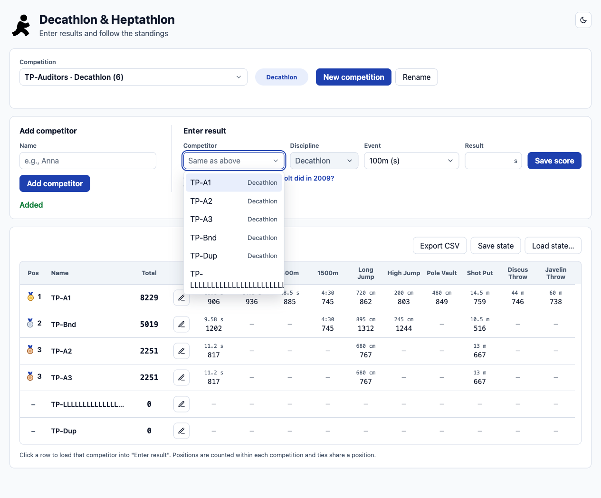
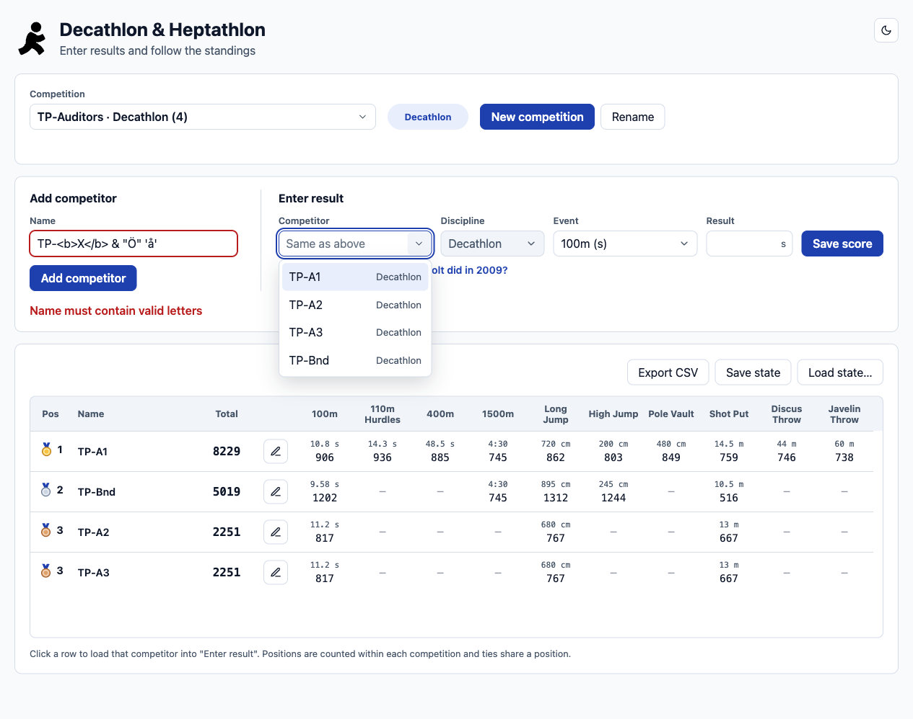
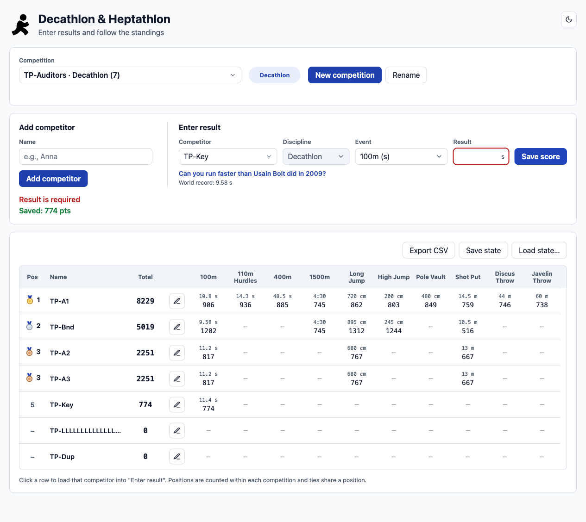
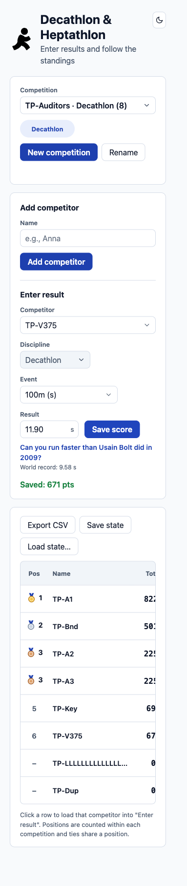

# Audit report: AUD-20261109-01

## Summary

Black-box release-readiness audit of the Decathlon & Heptathlon app at http://localhost:8080 (local), for TestBench project TS (Testpilot). All 39 plan items were executed: 49 executions in total, because failures were checked again and two test-script slips were re-run.

| Execution status | Executions | Plan items (latest execution) |
|---|---|---|
| pass | 37 | 35 |
| fail | 9 | 4 |
| blocked | 1 | 0 |
| skipped | 0 | 0 |
| inconclusive | 2 | 0 |

- Bug proposals: 4 (status `proposed`): BP-001 High, BP-002 Medium, BP-003 Medium, BP-004 Low.
- Manual test proposals: 11 (status `proposed`).
- Coverage gaps: 8. TestBench backlog items: 1.
- The `blocked` and `inconclusive` executions were test-script problems (EX-009, EX-035) or an attempt that could not be judged (EX-021); each was followed by a further execution of the same plan item. They are not counted as pass or fail.
- No automated accessibility scan was performed in this audit. Accessibility signals were assessed through Playwright MCP exploration, keyboard interaction and DOM/accessibility-tree inspection. This does not establish WCAG 2.1 AA conformance.
- Release view (for human review): scoring, validation, persistence, export/import and keyboard use worked as required; the four bug proposals (duplicate names silently dropped, apostrophe/ampersand names rejected, low field-border contrast, sideways scroll on phones) are the open deviations.

## Scope and environment

- Objective: Black-box release-readiness check of the Decathlon & Heptathlon app: main flows, scoring accuracy, data handling, accessibility and layout, reporting what blocks a release.
- Target: http://localhost:8080, environment `local`, build unknown (`null`; the page loaded app.js?v=13 throughout). Browser: Chromium via Playwright MCP.
- Viewports: 1280x800, 768x1024, 375x812; light and dark mode.
- Included requirements: REQ-LOCAL-001, REQ-LOCAL-002, REQ-LOCAL-003, REQ-LOCAL-004, REQ-LOCAL-005, REQ-LOCAL-006, REQ-LOCAL-007, REQ-LOCAL-008, REQ-LOCAL-009, REQ-LOCAL-010, REQ-LOCAL-011, REQ-LOCAL-012. Excluded: none.
- Allowed check types: Functional, Validation, State, Accessibility, Responsive, Visual.
- State changes: State-changing actions only inside TP-Auditors and TP-Auditors-H. General must not be changed (it may only be viewed). Load state only in TP-Auditors. Theme and selected competition are browser-only preferences. Downloads are saved as evidence. Cleanup: try to delete both TP competitions; if that is not possible, remove all TP competitors and report it.

| Allowed action | Limit | Data | Performed |
|---|---|---|---|
| create_competition | 2 per audit | TP-Auditors (type Decathlon) and TP-Auditors-H (type Heptathlon) | 2 |
| rename_competition | 2 per audit | TP-Auditors -> TP-Auditors-R -> TP-Auditors | 2 |
| add_competitor | 18 attempts per audit across both TP competitions, rejected attempts included (15 originally; +3 approved for TPI-006) | TP-A1..TP-A5 and TP-prefixed edge-case names, only in TP-Auditors or TP-Auditors-H; plus exactly TP-Åsa Öberg, TP-O'Neil & Co and TP-&lt;b>X&lt;/b> in TP-Auditors (TPI-006 follow-up) | 12 |
| save_result | 90 attempts per audit across both TP competitions, rejected attempts included | Fixed values in the test plan, only in TP-Auditors or TP-Auditors-H | 38 |
| edit_competitor | 5 per audit | TP-* competitors in TP-Auditors or TP-Auditors-H | 2 |
| remove_competitor | 15 per audit, cleanup included | TP-* competitors in TP-Auditors or TP-Auditors-H | 12 |
| load_state | 3 per audit | Only with TP-Auditors selected; only files saved from TP-Auditors or invalid copies made from them | 1 |

'Performed' counts completed actions in `manifest.actions[]`. Rejected attempts count against the limits but have no action entry: add_competitor 18 attempts in total (12 completed), save_result 50 attempts (38 completed), load_state 3 attempts (1 completed).
- Test data: 3-5 made-up athletes with fixed results and expected points calculated in advance: TP-A1..TP-A3 in TP-Auditors, TP-A4 and TP-A5 in TP-Auditors-H. Other test names start with TP-. No real names or personal data. Duplicate names allowed (user decision). Decimal comma accepted (user decision).
- Out of scope: Load and performance testing; Security testing beyond input handling; Browsers other than Chromium; Calling the API directly; Any environment other than local; The General competition (view only).
- Stop conditions: General changes, or an action would affect anything outside TP-Auditors and TP-Auditors-H; Load state would run with a competition other than TP-Auditors selected; An action limit would be exceeded; The server stops responding or keeps returning 5xx; The app version (app.js) changes during the run; A product defect cannot be told from a tool or data problem.
- Scope confirmed 2026-11-09T12:32:40Z by johan; two later scope changes were confirmed by the user (see Limitations).

## Requirements and readiness

All requirements are local (`REQ-LOCAL`, source `local`), drafted from the scope the user approved and confirmed by the user. They are not registered in TestBench.

| requirement_id | Title | Source | Readiness | Acceptance criteria |
|---|---|---|---|---|
| REQ-LOCAL-001 | Competitors can be added, edited and removed | local (not registered in TestBench) | ready | A valid name adds exactly one row in the selected competition. Edit changes the name. Remove asks for confirmation, then deletes the competitor and their results. An empty or blank name is rejected with a visible message and nothing is added. |
| REQ-LOCAL-002 | Unusual and duplicate competitor names are handled predictably | local (not registered in TestBench) | ready | Special characters (&lt;b>, &, quotes, å/ä/ö) are shown literally, not interpreted as HTML. A 200-character name does not widen the page beyond the viewport. Duplicate names are allowed: each duplicate is its own row, can be selected on its own in 'Enter result', and a result, edit or removal affects only the chosen one. |
| REQ-LOCAL-003 | Results are validated | local (not registered in TestBench) | ready | A valid result saves and shows a success message. Empty, non-numeric, negative or impossible results (better than the world record, or beyond the min/max that /api/events defines) are rejected with a visible message and the stored value does not change. A decimal comma is accepted as a decimal point (10,5 = 10.5). Times for minute events can be typed as seconds or as m:ss. |
| REQ-LOCAL-004 | Points follow the World Athletics scoring tables | local (not registered in TestBench) | ready | Each event's points equal the World Athletics combined-events formula (track A*(B-T)^C, field A*(M-B)^C, standard coefficients; jumps in cm, throws in m, times in s), rounded down to a whole number. The total is the sum of the event points. |
| REQ-LOCAL-005 | Standings are ordered and interactive | local (not registered in TestBench) | ready | Rows are sorted by total, highest first. Equal totals share a position. The count on each tab equals the number of rows in it. Clicking a row loads that competitor into 'Enter result'. |
| REQ-LOCAL-006 | Competitions can be created, renamed and kept apart | local (not registered in TestBench) | ready | A competition can be created with a name and a type and renamed. Data in one competition never appears in another (TP-Auditors, TP-Auditors-H, General). The selected competition is still selected after a page reload. |
| REQ-LOCAL-007 | Data persists | local (not registered in TestBench) | ready | After a page reload all competitors and results are unchanged. |
| REQ-LOCAL-008 | Export CSV and Save state match the standings | local (not registered in TestBench) | ready | The exported files contain exactly the competitors, results and totals shown for the selected competition. |
| REQ-LOCAL-009 | Load state restores saved data and rejects invalid files | local (not registered in TestBench) | ready | Loading a file saved from TP-Auditors restores identical data. An invalid or edited file is rejected with a message and existing data is unchanged. |
| REQ-LOCAL-010 | The app is accessible | local (not registered in TestBench) | ready | Every flow can be completed with the keyboard alone with visible focus. Every control has an accessible name. Status messages are announced through a live region. Text contrast meets WCAG 2.2 AA (4.5:1 normal text, 3:1 large text and UI components). |
| REQ-LOCAL-011 | The layout works at all viewports and themes | local (not registered in TestBench) | ready | At 1280, 768 and 375 px, in light and dark mode, the page does not scroll horizontally except inside the standings table, and no controls overlap or are cut off. |
| REQ-LOCAL-012 | The app is robust in normal use | local (not registered in TestBench) | ready | No console errors and no unexpected 4xx/5xx responses during normal flows. Rejected input shows a message instead of an unhandled error. |

## Test plan

The full plan with steps, preconditions, test data and acceptance criteria is in [test-plan.md](test-plan.md).

| test_plan_item_id | requirement_id | Type | Risk | Priority | Readiness | Title |
|---|---|---|---|---|---|---|
| TPI-001 | REQ-LOCAL-001 | Functional | High | High | ready | Create TP-Auditors (Decathlon) and TP-Auditors-H (Heptathlon); General untouched |
| TPI-002 | REQ-LOCAL-001 | Functional | High | High | ready | Add a competitor with a valid name |
| TPI-003 | REQ-LOCAL-001 | Validation | Medium | High | ready | Reject empty and blank competitor names |
| TPI-004 | REQ-LOCAL-001 | Functional | Medium | Medium | ready | Edit a competitor's name |
| TPI-005 | REQ-LOCAL-001 | Functional | High | High | ready | Remove a competitor only after confirmation |
| TPI-006 | REQ-LOCAL-002 | Validation | High | High | ready | Show special characters in names literally |
| TPI-007 | REQ-LOCAL-002 | Responsive | Medium | Medium | ready | A 200-character name does not widen the page |
| TPI-008 | REQ-LOCAL-002 | Functional | High | High | ready | Duplicate names are separate and individually addressable |
| TPI-009 | REQ-LOCAL-003 | Validation | High | High | ready | Reject empty and non-numeric results |
| TPI-010 | REQ-LOCAL-003 | Validation | Medium | High | ready | Reject negative results |
| TPI-011 | REQ-LOCAL-003 | Validation | High | High | ready | Track boundary at the world record |
| TPI-012 | REQ-LOCAL-003 | Validation | High | High | ready | Field boundaries at the max from /api/events |
| TPI-013 | REQ-LOCAL-003 | Validation | Medium | High | ready | Accept a decimal comma |
| TPI-014 | REQ-LOCAL-003 | Validation | Medium | Medium | ready | Minute times as seconds or m:ss, and malformed times |
| TPI-015 | REQ-LOCAL-003 | Validation | High | High | ready | A rejected result leaves the stored value unchanged |
| TPI-016 | REQ-LOCAL-004 | Functional | High | High | ready | Full decathlon scoring (TP-A1) |
| TPI-017 | REQ-LOCAL-004 | Functional | High | High | ready | Full heptathlon scoring (TP-A4) |
| TPI-018 | REQ-LOCAL-004 | Functional | Medium | High | ready | Scoring with decimal comma and seconds input (TP-A5) |
| TPI-019 | REQ-LOCAL-004 | State | High | High | ready | Re-saving an event replaces the score |
| TPI-020 | REQ-LOCAL-005 | Functional | High | High | ready | Sort order and shared positions for equal totals |
| TPI-021 | REQ-LOCAL-005 | Functional | Medium | Medium | ready | Tab counts match the rows |
| TPI-022 | REQ-LOCAL-005 | Functional | Medium | Medium | ready | Clicking a row loads the competitor |
| TPI-023 | REQ-LOCAL-006 | Functional | Medium | Medium | ready | Rename the competition and rename it back |
| TPI-024 | REQ-LOCAL-006 | State | High | High | ready | Competitions are kept apart (TP-Auditors, TP-Auditors-H, General) |
| TPI-025 | REQ-LOCAL-006 | State | Low | Low | ready | The selected competition is remembered after reload |
| TPI-026 | REQ-LOCAL-007 | State | High | High | ready | All data survives a reload |
| TPI-027 | REQ-LOCAL-008 | Functional | Medium | Medium | ready | Export CSV matches the standings |
| TPI-028 | REQ-LOCAL-008 | Functional | Medium | Medium | ready | Save state matches the standings |
| TPI-029 | REQ-LOCAL-009 | State | High | High | ready | Load state restores a saved file |
| TPI-030 | REQ-LOCAL-009 | Validation | High | High | ready | Load state rejects a malformed file |
| TPI-031 | REQ-LOCAL-009 | Validation | High | High | ready | Load state rejects an edited file with impossible values |
| TPI-032 | REQ-LOCAL-010 | Accessibility | High | High | ready | Main flows with keyboard only |
| TPI-033 | REQ-LOCAL-010 | Accessibility | Medium | Medium | ready | Accessible names and live status messages |
| TPI-034 | REQ-LOCAL-010 | Accessibility | Medium | Medium | ready | Text and UI contrast in light and dark mode |
| TPI-035 | REQ-LOCAL-011 | Responsive | Medium | Medium | ready | Layout at 1280 px, light and dark |
| TPI-036 | REQ-LOCAL-011 | Responsive | Medium | Medium | ready | Layout at 768 px, light and dark |
| TPI-037 | REQ-LOCAL-011 | Responsive | High | High | ready | Layout at 375 px, light and dark |
| TPI-038 | REQ-LOCAL-012 | Functional | High | High | ready | No console errors or failed requests in normal flows |
| TPI-039 | REQ-LOCAL-012 | Validation | Medium | Medium | ready | Rejected input produces a message, not an unhandled error |

Coverage gaps:

- **CG-001** (REQ-LOCAL-010): No automated accessibility scan (axe) is run: axe-core is not installed and loading it was not approved. Issues an automated scan would find may be missed.
- **CG-002** (REQ-LOCAL-010): Screen reader output is not verified: no assistive technology is used. Only the accessibility tree and live-region markup are checked.
- **CG-003** (REQ-LOCAL-006): Mixed (typeless) named competitions are not tested: the app only creates Decathlon or Heptathlon competitions, and only General holds both. Holding both disciplines in one list is not verified.
- **CG-004** (REQ-LOCAL-006): Deleting a competition is not tested: the UI offers no delete action. TP-Auditors and TP-Auditors-H will be emptied instead of deleted.
- **CG-005** (REQ-LOCAL-004): Scoring is checked on a sample of values (one or two per event), not across the whole points table. Hand timing and other rule variants are not covered.
- **CG-006** (REQ-LOCAL-012): Behaviour when the server fails (5xx, timeouts) is not tested: forcing server errors is out of scope.
- **CG-007** (REQ-LOCAL-011): Visual design is not compared with a reference: none exists. Only clear defects (overflow, overlap, cut-off) are judged.
- **CG-008** (REQ-LOCAL-012): Only Chromium is tested: other browsers are out of scope.

## Execution results

### EX-001: TPI-001, Create TP-Auditors (Decathlon) and TP-Auditors-H (Heptathlon); General untouched (pass)
- Requirement: REQ-LOCAL-001. Viewport 1280x800. Mode `mcp-exploration`. 2026-11-09T12:39:42Z to 2026-11-09T12:41:58Z.
- Verified: 'New competition' created TP-Auditors (Decathlon) and TP-Auditors-H (Heptathlon); each was selected after creation with message 'Created &lt;name>' and the right type label; General still reads 'General · Mixed (0)' before and after. TP-Auditors re-selected for the next items. Not verified: server-side storage beyond what the selector shows (checked by reload in TPI-025/026). Observation: the Heptathlon tab stays visible (count 0) in the Decathlon-only competition.
- Evidence: [EV-001](evidence/tpi001-tp-auditors-created-1280-2026-11-09.png), [EV-002](evidence/tpi001-tp-auditors-h-created-1280-2026-11-09.png), [EV-003](evidence/tpi001-tp-auditors-selected-general-0-1280-2026-11-09.png), [EV-004](evidence/tpi001-competition-options-2026-11-09.json)

### EX-002: TPI-002, Add a competitor with a valid name (pass)
- Requirement: REQ-LOCAL-001. Viewport 1280x800. Mode `mcp-exploration`. 2026-11-09T12:42:32Z to 2026-11-09T12:42:33Z.
- Verified in TP-Auditors: entering TP-A1 and clicking 'Add competitor' shows 'Added', adds exactly one row (TP-A1, total 0) and the selector count goes from 0 to 1. Not verified here: persistence after reload (TPI-026).
- Evidence: [EV-005](evidence/tpi002-tp-a1-added-1280-2026-11-09.png)

### EX-003: TPI-003, Reject empty and blank competitor names (pass)
- Requirement: REQ-LOCAL-001. Viewport 1280x800. Mode `mcp-exploration`. 2026-11-09T12:42:33Z to 2026-11-09T12:42:35Z.
- Verified: an empty name and a name of 3 spaces are both rejected with the visible message 'Name must contain valid letters', the field is marked aria-invalid, and the row count stays 1. The requests reached the server and were answered 400 (server-side rejection observed through the UI's own request, not tested directly). The browser logs one 'Failed to load resource 400' console error per rejection. Two add attempts counted against the limit; no action entries because nothing was added.
- Evidence: [EV-006](evidence/tpi003-empty-name-1280-2026-11-09.png), [EV-007](evidence/tpi003-blank-name-1280-2026-11-09.png), [EV-008](evidence/tpi003-network-console-2026-11-09.txt)

### EX-004: TPI-016, Full decathlon scoring (TP-A1) (pass)
- Requirement: REQ-LOCAL-004. Viewport 1280x800. Mode `mcp-exploration`. 2026-11-09T12:43:14Z to 2026-11-09T12:43:27Z.
- Verified: all 10 decathlon results for TP-A1 were saved through 'Enter result' (1500m typed as 4:30) and every event's points and the total (8229) equal the World Athletics formula rounded down. Not verified: other values per event (CG-005). The standings table shows points per event, not the typed result values.
- Evidence: [EV-009](evidence/tpi016-tp-a1-decathlon-scores-1280-2026-11-09.png), [EV-010](evidence/tpi016-tp-a1-expected-vs-actual-2026-11-09.txt)

### EX-005: TPI-017, Full heptathlon scoring (TP-A4) (pass)
- Requirement: REQ-LOCAL-004. Viewport 1280x800. Mode `mcp-exploration`. 2026-11-09T12:43:50Z to 2026-11-09T12:44:25Z.
- Verified in TP-Auditors-H: TP-A4 added and all 7 heptathlon results saved (800m typed as 2:12); every event's points and the total 6445 equal the World Athletics formula rounded down. Not verified: other values per event (CG-005).
- Evidence: [EV-011](evidence/tpi017-tp-a4-heptathlon-scores-1280-2026-11-09.png), [EV-012](evidence/tpi017-018-heptathlon-expected-vs-actual-2026-11-09.txt)

### EX-006: TPI-018, Scoring with decimal comma and seconds input (TP-A5) (pass)
- Requirement: REQ-LOCAL-004. Viewport 1280x800. Mode `mcp-exploration`. 2026-11-09T12:44:25Z to 2026-11-09T12:44:27Z.
- Verified: TP-A5 added; 200m typed with a decimal comma (24,50) is accepted and scores 933; 800m typed in seconds (135.5) scores 886; total 1819 as expected.
- Evidence: [EV-013](evidence/tpi018-tp-a5-comma-seconds-1280-2026-11-09.png), [EV-012](evidence/tpi017-018-heptathlon-expected-vs-actual-2026-11-09.txt)

### EX-007: TPI-019, Re-saving an event replaces the score (pass)
- Requirement: REQ-LOCAL-004. Viewport 1280x800. Mode `mcp-exploration`. 2026-11-09T12:44:38Z to 2026-11-09T12:44:40Z.
- Verified: re-saving TP-A5 200m opens an overwrite dialog naming the old and new value; after confirming, 200m shows 981 and the total is 1867 (not 933+981); re-saving 24,50 brings the total back to 1819.
- Evidence: [EV-014](evidence/tpi019-tp-a5-200m-overwritten-24-00-1280-2026-11-09.png), [EV-015](evidence/tpi019-tp-a5-200m-restored-24-50-1280-2026-11-09.png), [EV-016](evidence/tpi019-004-network-2026-11-09.txt)

### EX-008: TPI-004, Edit a competitor's name (pass)
- Requirement: REQ-LOCAL-001. Viewport 1280x800. Mode `mcp-exploration`. 2026-11-09T12:44:48Z to 2026-11-09T12:44:50Z.
- Verified: the row's Edit button opens 'Edit competitor' with the name prefilled; renaming TP-A5 to TP-A5-E and back shows 'Changes saved' each time and keeps the total 1819. Only rename requests were sent. Not verified: editing results inside the edit dialog.
- Evidence: [EV-017](evidence/tpi004-tp-a5-renamed-tp-a5-e-1280-2026-11-09.png), [EV-018](evidence/tpi004-tp-a5-renamed-back-1280-2026-11-09.png), [EV-016](evidence/tpi019-004-network-2026-11-09.txt)

### EX-009: TPI-022, Clicking a row loads the competitor (blocked, reason `tooling`)
- Requirement: REQ-LOCAL-005. Viewport 1280x800. Mode `mcp-exploration`. 2026-11-09T12:45:00Z to 2026-11-09T12:45:35Z.
- First attempt did not reach the check: the script clicked the Heptathlon tab, which is not visible in a Heptathlon-only competition (the tab list is hidden there), and timed out after 30 s. Test-script problem, not a product defect. Retried as the next execution without the tab click.

### EX-010: TPI-022, Clicking a row loads the competitor (pass)
- Requirement: REQ-LOCAL-005. Viewport 1280x800. Mode `mcp-exploration`. 2026-11-09T12:46:04Z to 2026-11-09T12:46:05Z.
- Second attempt (after the tooling-blocked first one). Verified in TP-Auditors-H: clicking the TP-A4 row (name cell) loads TP-A4 into 'Enter result' with discipline Heptathlon (event 200m, result prefilled 24 from TP-A4's stored value). Observation for TPI-032: the row has only a data-name attribute (no role, no tabindex), so this is a mouse action; keyboard reachability is checked in TPI-032.
- Evidence: [EV-019](evidence/tpi022-row-click-loads-tp-a4-1280-2026-11-09.png)

### EX-011: TPI-020, Sort order and shared positions for equal totals (pass)
- Requirement: REQ-LOCAL-005. Viewport 1280x800. Mode `mcp-exploration`. 2026-11-09T12:46:24Z to 2026-11-09T12:46:29Z.
- Verified in TP-Auditors: TP-A2 and TP-A3 added; their 3 results (entered in opposite order) score 817/767/667 each, totals 2251 and 2251; rows are sorted 1 TP-A1 8229, 2 TP-A2 2251, 2 TP-A3 2251, so equal totals share position 2. Not verified in this execution: that the next row skips to position 4, because no lower-scoring row existed yet; it is re-checked in a later execution of TPI-020. In a single-discipline competition the Decathlon/Heptathlon tab list is hidden.
- Evidence: [EV-020](evidence/tpi020-sort-and-tie-1280-2026-11-09.png)

### EX-012: TPI-015, A rejected result leaves the stored value unchanged (pass)
- Requirement: REQ-LOCAL-003. Viewport 1280x800. Mode `mcp-exploration`. 2026-11-09T12:46:57Z to 2026-11-09T12:46:58Z.
- Verified: 'xyz' for TP-A1 100m is rejected in the browser with a visible message, the field is marked invalid, no request is sent, and TP-A1 still shows 100m 906 points and total 8229. Client-side validation verified; the server's handling of this value was not exercised.
- Evidence: [EV-021](evidence/tpi015-tp-a1-xyz-rejected-1280-2026-11-09.png), [EV-022](evidence/tpi009-010-015-validation-network-2026-11-09.txt)

### EX-013: TPI-009, Reject empty and non-numeric results (pass)
- Requirement: REQ-LOCAL-003. Viewport 1280x800. Mode `mcp-exploration`. 2026-11-09T12:46:57Z to 2026-11-09T12:46:59Z.
- Verified: TP-Bnd added. Empty result: message 'Result is required'; the request reached the server and was answered 400, nothing stored. 'abc': rejected in the browser with 'Enter the result in seconds (163) or as minutes:seconds (2:43).', no request sent, nothing stored. TP-Bnd stays at total 0. Observation: for 100m (not a minute event) the 'abc' message mentions minutes:seconds, which is misleading wording but still rejects the input.
- Evidence: [EV-023](evidence/tpi009-empty-result-1280-2026-11-09.png), [EV-024](evidence/tpi009-abc-result-1280-2026-11-09.png), [EV-022](evidence/tpi009-010-015-validation-network-2026-11-09.txt)

### EX-014: TPI-010, Reject negative results (pass)
- Requirement: REQ-LOCAL-003. Viewport 1280x800. Mode `mcp-exploration`. 2026-11-09T12:46:59Z to 2026-11-09T12:47:00Z.
- Verified: 100m -5 and shot put -1 are both rejected with 'Result cannot be negative'; both requests reached the server and were answered 400 (rejection observed through the UI's own request); TP-Bnd still has no results.
- Evidence: [EV-025](evidence/tpi010-negative-100m-1280-2026-11-09.png), [EV-026](evidence/tpi010-negative-shotput-1280-2026-11-09.png), [EV-022](evidence/tpi009-010-015-validation-network-2026-11-09.txt)

### EX-015: TPI-011, Track boundary at the world record (pass)
- Requirement: REQ-LOCAL-003. Viewport 1280x800. Mode `mcp-exploration`. 2026-11-09T12:47:48Z to 2026-11-09T12:47:50Z.
- Verified: 100m 9.57 is rejected with 'Faster than the world record for 100m: 9.58 s' (server answered 400); 9.58 is accepted ('Saved: 1202 pts', matching the formula) and stored as 9.58 (read back in the Edit dialog, cancelled).
- Evidence: [EV-027](evidence/tpi011-100m-9-57-rejected-1280-2026-11-09.png), [EV-028](evidence/tpi011-100m-9-58-accepted-1280-2026-11-09.png), [EV-029](evidence/tpi011-014-boundaries-2026-11-09.txt), [EV-030](evidence/tpi011-014-tp-bnd-stored-values-edit-dialog-1280-2026-11-09.png)

### EX-016: TPI-020, Sort order and shared positions for equal totals (pass)
- Requirement: REQ-LOCAL-005. Viewport 1280x800. Mode `mcp-exploration`. 2026-11-09T12:47:49Z to 2026-11-09T12:47:50Z.
- Second execution of TPI-020, completing what the first (EX-011) could not check: with TP-Bnd at 1202 points, the standings read 1 TP-A1 8229, 2 TP-A2 2251, 2 TP-A3 2251, 4 TP-Bnd 1202, so the position after the tie skips to 4 (standard competition ranking).
- Evidence: [EV-028](evidence/tpi011-100m-9-58-accepted-1280-2026-11-09.png), [EV-029](evidence/tpi011-014-boundaries-2026-11-09.txt)

### EX-017: TPI-012, Field boundaries at the max from /api/events (pass)
- Requirement: REQ-LOCAL-003. Viewport 1280x800. Mode `mcp-exploration`. 2026-11-09T12:47:50Z to 2026-11-09T12:47:52Z.
- Verified: long jump 896 and high jump 246 are rejected with 'Beyond the world record for ...: 895 cm / 245 cm' (server answered 400); 895 and 245 are accepted (1312 and 1244 pts, matching the formula) and stored as 895 and 245.
- Evidence: [EV-031](evidence/tpi012-longjump-896-rejected-1280-2026-11-09.png), [EV-032](evidence/tpi012-highjump-246-rejected-1280-2026-11-09.png), [EV-033](evidence/tpi012-field-max-accepted-1280-2026-11-09.png), [EV-029](evidence/tpi011-014-boundaries-2026-11-09.txt), [EV-030](evidence/tpi011-014-tp-bnd-stored-values-edit-dialog-1280-2026-11-09.png)

### EX-018: TPI-013, Accept a decimal comma (pass)
- Requirement: REQ-LOCAL-003. Viewport 1280x800. Mode `mcp-exploration`. 2026-11-09T12:47:52Z to 2026-11-09T12:47:52Z.
- Verified: shot put typed as 10,5 is accepted ('Saved: 516 pts', the formula value for 10.5 m) and stored as 10.5 (Edit dialog).
- Evidence: [EV-034](evidence/tpi013-shotput-decimal-comma-1280-2026-11-09.png), [EV-029](evidence/tpi011-014-boundaries-2026-11-09.txt), [EV-030](evidence/tpi011-014-tp-bnd-stored-values-edit-dialog-1280-2026-11-09.png)

### EX-019: TPI-014, Minute times as seconds or m:ss, and malformed times (pass)
- Requirement: REQ-LOCAL-003. Viewport 1280x800. Mode `mcp-exploration`. 2026-11-09T12:47:52Z to 2026-11-09T12:47:54Z.
- Verified: 1500m typed as 270 (seconds) is accepted (745 pts, same as 4:30 for TP-A1) and stored as 4:30; '4:75' and '4:' are rejected in the browser with the seconds / minutes:seconds hint and no request; the stored 4:30 is unchanged. Client-side validation verified for the malformed times; server handling of them was not exercised.
- Evidence: [EV-035](evidence/tpi014-1500m-270-accepted-1280-2026-11-09.png), [EV-036](evidence/tpi014-1500m-4-75-rejected-1280-2026-11-09.png), [EV-037](evidence/tpi014-1500m-4-colon-rejected-1280-2026-11-09.png), [EV-029](evidence/tpi011-014-boundaries-2026-11-09.txt), [EV-030](evidence/tpi011-014-tp-bnd-stored-values-edit-dialog-1280-2026-11-09.png)

### EX-020: TPI-005, Remove a competitor only after confirmation (pass)
- Requirement: REQ-LOCAL-001. Viewport 1280x800. Mode `mcp-exploration`. 2026-11-09T12:48:40Z to 2026-11-09T12:48:55Z.
- Verified in TP-Auditors: TP-Del added and given 100m 11.00 (861 pts). In 'Edit competitor', the first click on 'Remove competitor' only turns it into 'Confirm remove'; cancelling the dialog keeps TP-Del. Re-opening shows 'Remove competitor' again; clicking twice removes TP-Del ('Removed TP-Del'). TP-Del is absent from the standings, from the full competitor picker list (opened with 'Show all competitors') and after a page reload. Not verified: that the removed result is gone server-side beyond what the UI shows.
- Evidence: [EV-038](evidence/tpi005-remove-asks-confirmation-1280-2026-11-09.png), [EV-039](evidence/tpi005-tp-del-removed-1280-2026-11-09.png), [EV-040](evidence/tpi005-tp-del-gone-after-reload-1280-2026-11-09.png), [EV-041](evidence/tpi005-picker-all-competitors-after-remove-1280-2026-11-09.png)

### EX-021: TPI-006, Show special characters in names literally (inconclusive, reason `insufficient-evidence`)
- Requirement: REQ-LOCAL-002. Viewport 1280x800. Mode `mcp-exploration`. 2026-11-09T12:49:16Z to 2026-11-09T12:49:18Z.
- Ran, but the criterion could not be judged: the name TP-&lt;b>X&lt;/b> & "Ö" 'å' was rejected (server 400, UI message 'Name must contain valid letters'), so there was no row to check for literal display. Observed: no HTML was rendered anywhere (nothing was added). Not determined: which character causes the rejection; the message is inaccurate for a name that contains letters, and if å/ä/ö or quotes are rejected that would contradict REQ-LOCAL-002, which expects them to be shown. Needed: extra add attempts with single-category names (e.g. Å/Ö only, quotes and & only, &lt;b> only), which the add_competitor limit does not allow; a decision is requested from the user.
- Evidence: [EV-042](evidence/tpi006-special-characters-literal-1280-2026-11-09.png), [EV-043](evidence/tpi006-special-characters-after-reload-1280-2026-11-09.png), [EV-044](evidence/tpi006-special-name-rejected-network-2026-11-09.txt)

### EX-022: TPI-007, A 200-character name does not widen the page (pass)
- Requirement: REQ-LOCAL-002. Viewport 1280x800. Mode `mcp-exploration`. 2026-11-09T12:49:57Z to 2026-11-09T12:51:30Z.
- Verified: the 200-character name was accepted ('Added', no maxlength) and stored in full. Its table cell stays 176 px wide (text cut off, full name in the title attribute) at 1280 and 375 px; the competitor picker keeps it inside the list with its own horizontal scroll (list 213 px wide at 1280, 278 px at 375, not past the form). At 1280 px the document is not wider than the viewport. At 375 px the document is 383 px wide, but the only element beyond the viewport is the table header's screen-reader 'Actions' label (span.sr-only, position absolute), not the long name; that page overflow is a separate issue checked in TPI-037. Not verified: how the long name reads for screen-reader users.
- Evidence: [EV-045](evidence/tpi007-long-name-1280-2026-11-09.png), [EV-046](evidence/tpi007-long-name-picker-1280-2026-11-09.png), [EV-047](evidence/tpi007-long-name-375-2026-11-09.png), [EV-048](evidence/tpi007-long-name-picker-375-2026-11-09.png), [EV-049](evidence/tpi007-long-name-measurements-2026-11-09.json)

### EX-023: TPI-008, Duplicate names are separate and individually addressable (fail)
- Requirement: REQ-LOCAL-002. Viewport 1280x800. Mode `mcp-exploration`. 2026-11-09T12:50:51Z to 2026-11-09T12:50:53Z.
- Violated criterion (REQ-LOCAL-002): 'Duplicate names are allowed: each duplicate is its own row, can be selected on its own'. Observed: adding TP-Dup twice shows 'Added' both times and both requests return 201, but only one TP-Dup row and one picker option exist. The UI reports success for an add that did not create a competitor. Not run: the remaining steps (result on one duplicate, removing the other) because there is only one TP-Dup. Reproduced by a second route in the next execution (reload).
- Evidence: [EV-050](evidence/tpi008-two-tp-dup-rows-and-picker-1280-2026-11-09.png), [EV-051](evidence/tpi008-duplicate-name-network-2026-11-09.txt)

### EX-024: TPI-008, Duplicate names are separate and individually addressable (fail)
- Requirement: REQ-LOCAL-002. Viewport 1280x800. Mode `mcp-exploration`. 2026-11-09T12:51:19Z to 2026-11-09T12:51:21Z.
- Reproduction of the previous execution by another route: after a page reload the selector reads 'TP-Auditors · Decathlon (6)' (TP-A1, TP-Bnd, TP-A2, TP-A3, the 200-character name, one TP-Dup), so the server holds one TP-Dup. Not a test or timing fault: both requests were sent and answered 201. The second 'TP-Dup' add attempt is counted against the limit but has no action entry because no competitor was created.
- Evidence: [EV-052](evidence/tpi008-one-tp-dup-after-reload-1280-2026-11-09.png), [EV-051](evidence/tpi008-duplicate-name-network-2026-11-09.txt)

### EX-025: TPI-021, Tab counts match the rows (pass)
- Requirement: REQ-LOCAL-005. Viewport 1280x800. Mode `mcp-exploration`. 2026-11-09T12:51:58Z to 2026-11-09T12:51:59Z.
- Verified: in TP-Auditors the Decathlon count is 6 with 6 rows and Heptathlon 0; in TP-Auditors-H the Heptathlon count is 2 with 2 rows; in General both visible tabs show 0 with 0 rows. Limitation: in the two single-discipline competitions the tab list is hidden, so the counts were read from the tab elements and the selector label rather than from visible tabs; visible tab counts with data in both disciplines could only be checked in a Mixed list, which is not in scope (CG-003).
- Evidence: [EV-053](evidence/tpi021-tab-count-tp-auditors-1280-2026-11-09.png), [EV-054](evidence/tpi021-tab-count-tp-auditors-h-1280-2026-11-09.png), [EV-055](evidence/tpi021-025-competitions-2026-11-09.json)

### EX-026: TPI-023, Rename the competition and rename it back (pass)
- Requirement: REQ-LOCAL-006. Viewport 1280x800. Mode `mcp-exploration`. 2026-11-09T12:51:59Z to 2026-11-09T12:52:01Z.
- Verified: 'Rename' opens 'Rename competition' with the current name prefilled; renaming to TP-Auditors-R shows 'Competition renamed' and keeps all 6 rows; renaming back to TP-Auditors does the same.
- Evidence: [EV-056](evidence/tpi023-renamed-tp-auditors-r-1280-2026-11-09.png), [EV-057](evidence/tpi023-renamed-back-tp-auditors-1280-2026-11-09.png), [EV-055](evidence/tpi021-025-competitions-2026-11-09.json)

### EX-027: TPI-024, Competitions are kept apart (TP-Auditors, TP-Auditors-H, General) (pass)
- Requirement: REQ-LOCAL-006. Viewport 1280x800. Mode `mcp-exploration`. 2026-11-09T12:52:01Z to 2026-11-09T12:52:04Z.
- Verified (General only viewed): General shows 0 competitors and the empty-state text in both tabs; TP-Auditors-H lists only TP-A4 and TP-A5; TP-Auditors lists its 6 competitors and not TP-A4/TP-A5. No data crossed between the three competitions.
- Evidence: [EV-058](evidence/tpi024-general-empty-1280-2026-11-09.png), [EV-059](evidence/tpi024-tp-auditors-h-only-a4-a5-1280-2026-11-09.png), [EV-060](evidence/tpi024-tp-auditors-back-1280-2026-11-09.png), [EV-055](evidence/tpi021-025-competitions-2026-11-09.json)

### EX-028: TPI-025, The selected competition is remembered after reload (pass)
- Requirement: REQ-LOCAL-006. Viewport 1280x800. Mode `mcp-exploration`. 2026-11-09T12:52:03Z to 2026-11-09T12:52:04Z.
- Verified: with TP-Auditors selected, a page reload keeps TP-Auditors selected (stored in the browser as competition=c1). Not verified: behaviour in another browser or after clearing site data.
- Evidence: [EV-061](evidence/tpi025-tp-auditors-remembered-after-reload-1280-2026-11-09.png), [EV-055](evidence/tpi021-025-competitions-2026-11-09.json)

### EX-029: TPI-026, All data survives a reload (pass)
- Requirement: REQ-LOCAL-007. Viewport 1280x800. Mode `mcp-exploration`. 2026-11-09T12:52:46Z to 2026-11-09T12:52:50Z.
- Verified: every row (position, name, total and points per event) of TP-Auditors (6 rows) and TP-Auditors-H (2 rows) is identical before and after a page reload. Not verified: persistence across a server restart.
- Evidence: [EV-062](evidence/tpi026-standings-before-after-reload-2026-11-09.json), [EV-063](evidence/tpi026-after-reload-tp-auditors-1280-2026-11-09.png)

### EX-030: TPI-027, Export CSV matches the standings (pass)
- Requirement: REQ-LOCAL-008. Viewport 1280x800. Mode `mcp-exploration`. 2026-11-09T12:52:50Z to 2026-11-09T12:52:51Z.
- Verified: 'Export CSV' downloads tp-auditors-results-&lt;timestamp>.csv with 6 rows whose positions, points per event and totals equal the standings exactly; it holds no General or TP-Auditors-H data. Result columns hold the stored values (1500m in seconds).
- Evidence: [EV-064](evidence/tpi027-export-tp-auditors-2026-11-09.csv), [EV-065](evidence/tpi027-028-file-comparison-2026-11-09.txt)

### EX-031: TPI-028, Save state matches the standings (pass)
- Requirement: REQ-LOCAL-008. Viewport 1280x800. Mode `mcp-exploration`. 2026-11-09T12:52:50Z to 2026-11-09T12:52:51Z.
- Verified: 'Save state' downloads tp-auditors-state-&lt;timestamp>.json (version 1, name TP-Auditors, type DECATHLON) with the same 6 competitors and exactly the result values entered. This file is the source for TPI-029 to TPI-031.
- Evidence: [EV-066](evidence/tpi028-save-state-tp-auditors-2026-11-09.json), [EV-065](evidence/tpi027-028-file-comparison-2026-11-09.txt)

### EX-032: TPI-029, Load state restores a saved file (pass)
- Requirement: REQ-LOCAL-009. Viewport 1280x800. Mode `mcp-exploration`. 2026-11-09T12:53:44Z to 2026-11-09T12:53:47Z.
- Verified with TP-Auditors selected: TP-A2 100m changed to 11.00 (overwrite confirmed, 861 pts, total 2295); loading the file saved in TPI-028 shows 'State loaded' and restores TP-A2 to 817 / 2251, with every row identical to the saved state. Observation: loading replaces the competition's data without asking for confirmation.
- Evidence: [EV-067](evidence/tpi029-tp-a2-changed-before-load-1280-2026-11-09.png), [EV-068](evidence/tpi029-after-load-state-1280-2026-11-09.png), [EV-069](evidence/tpi029-031-load-state-2026-11-09.txt), [EV-066](evidence/tpi028-save-state-tp-auditors-2026-11-09.json)

### EX-033: TPI-030, Load state rejects a malformed file (pass)
- Requirement: REQ-LOCAL-009. Viewport 1280x800. Mode `mcp-exploration`. 2026-11-09T12:53:56Z to 2026-11-09T12:53:59Z.
- Verified with TP-Auditors selected: loading a copy of the saved file cut off halfway (invalid JSON) shows 'Invalid saved state: the file is not a valid save'; all rows are unchanged, also after a reload. The load attempt counts against the Load state limit; no action entry because nothing was loaded.
- Evidence: [EV-070](evidence/tpi030-truncated-file-rejected-1280-2026-11-09.png), [EV-071](evidence/tpi030-load-state-truncated-input-2026-11-09.json), [EV-069](evidence/tpi029-031-load-state-2026-11-09.txt)

### EX-034: TPI-031, Load state rejects an edited file with impossible values (pass)
- Requirement: REQ-LOCAL-009. Viewport 1280x800. Mode `mcp-exploration`. 2026-11-09T12:53:58Z to 2026-11-09T12:54:01Z.
- Verified with TP-Auditors selected: loading an edited copy (TP-A1 100m = -5 plus an unknown event 'fooEvent') shows 'Invalid saved state: Result cannot be negative'; all rows unchanged (TP-A1 906 / 8229), also after a reload. Not verified: whether an unknown event on its own would be rejected (the file also had the negative value). The load attempt counts against the limit; no action entry because nothing was loaded.
- Evidence: [EV-072](evidence/tpi031-edited-file-result-1280-2026-11-09.png), [EV-073](evidence/tpi031-load-state-edited-input-2026-11-09.json), [EV-069](evidence/tpi029-031-load-state-2026-11-09.txt)

### EX-035: TPI-032, Main flows with keyboard only (inconclusive, reason `tooling`)
- Requirement: REQ-LOCAL-010. Viewport 1280x800. Mode `mcp-exploration`. 2026-11-09T12:54:50Z to 2026-11-09T12:54:54Z.
- First keyboard attempt. Verified on the way: all 19 tab stops in TP-Auditors show a visible 2 px focus outline (tab order recorded at 12:54:31Z), and pressing Enter in the Name field adds a competitor (TP-Key added). Then the test script lost track of focus: after a competitor is chosen the app moves focus forward by itself, so the script's fixed Tab count landed on 'Save score' and sent an empty result (rejected 400, nothing stored) and later pressed Enter on 'Save state' (download only). The result entry and remove steps were therefore not judged. Script fault, not a product defect; re-run as the next execution with focus checked after every key.
- Evidence: [EV-074](evidence/tpi032-keyboard-tp-key-added-1280-2026-11-09.png), [EV-075](evidence/tpi032-keyboard-score-saved-1280-2026-11-09.png), [EV-076](evidence/tpi032-attempt1-script-misstep-2026-11-09.txt)

### EX-036: TPI-032, Main flows with keyboard only (pass)
- Requirement: REQ-LOCAL-010. Viewport 1280x800. Mode `mcp-exploration`. 2026-11-09T12:55:43Z to 2026-11-09T12:56:35Z.
- Second attempt (after EX-035, script fault), done one key at a time with focus checked after each key. Verified with the keyboard only: adding (Enter in Name, from EX-035), choosing a competitor (ArrowDown list + Enter), choosing an event (Shift+Tab, arrows, Enter), saving (Enter in Result: 'Saved: 753 pts' for TP-Key 100m 11.50), switching competitions and the Decathlon/Heptathlon tabs (arrows, in General as view only), and starting then cancelling Remove (Enter, Enter = 'Confirm remove', Escape keeps TP-Key and returns focus to its Edit button). Focus was visible (2 px outline) at every stop and was never lost or trapped. Not verified: screen reader announcements (CG-002). Observations for review: typing in the Competitor field does not filter the list; picking a competitor jumps focus past Event to Result; table rows are not keyboard-focusable, so 'click a row to load' is mouse-only (the combobox offers the same result).
- Evidence: [EV-077](evidence/tpi032-keyboard-tp-key-100m-saved-1280-2026-11-09.png), [EV-078](evidence/tpi032-keyboard-heptathlon-tab-general-1280-2026-11-09.png), [EV-079](evidence/tpi032-keyboard-confirm-remove-1280-2026-11-09.png), [EV-080](evidence/tpi032-keyboard-remove-cancelled-1280-2026-11-09.png), [EV-081](evidence/tpi032-keyboard-walkthrough-2026-11-09.txt)

### EX-037: TPI-033, Accessible names and live status messages (pass)
- Requirement: REQ-LOCAL-010. Viewport 1280x800. Mode `mcp-exploration`. 2026-11-09T12:57:09Z to 2026-11-09T12:57:19Z.
- Verified from the DOM and the browser accessibility tree: every visible button, input, combobox and tab has an accessible name (list in evidence). Success messages go to #msg (role=status), errors to #error (aria-live=polite): a valid save showed 'Saved: 774 pts' in #msg and an empty result showed 'Result is required' in #error with the field marked aria-invalid. Not verified: what a screen reader actually announces (CG-002). Observations, not violations of the criterion: the standings table has no accessible name of its own (no caption or label; it sits in a section labelled 'Standings'), and the error text is not tied to the Result field with aria-describedby.
- Evidence: [EV-082](evidence/tpi033-accessible-names-live-regions-2026-11-09.json), [EV-083](evidence/tpi033-error-message-live-region-1280-2026-11-09.png)

### EX-038: TPI-034, Text and UI contrast in light and dark mode (fail)
- Requirement: REQ-LOCAL-010. Viewport 1280x800. Mode `mcp-exploration`. 2026-11-09T12:57:20Z to 2026-11-09T12:57:58Z.
- Violated criterion (REQ-LOCAL-010): '3:1 for UI components'. Observed: the borders of the text fields (Name, Competitor, Competition name) are 1px rgb(213,220,232) on white = 1.38:1 in light mode and 1px rgb(38,50,72) on rgb(17,26,46) = 1.35:1 in dark mode, and the field background is the same as the card, so the field edge is hard to see. Verified as passing: all measured text (labels, hints, placeholders, buttons, tabs, table, status and error messages) is at least 5.02:1 in both themes, and the focus outline is 8.72:1. Not verified: every state of every component (hover, disabled), and images/icons. Reproduced in the next execution by an independent calculation and a check of the field background.
- Evidence: [EV-084](evidence/tpi034-contrast-light-1280-2026-11-09.png), [EV-085](evidence/tpi034-contrast-dark-1280-2026-11-09.png), [EV-086](evidence/tpi034-contrast-measurements-2026-11-09.txt)

### EX-039: TPI-034, Text and UI contrast in light and dark mode (fail)
- Requirement: REQ-LOCAL-010. Viewport 1280x800. Mode `mcp-exploration`. 2026-11-09T12:58:08Z to 2026-11-09T12:58:20Z.
- Reproduction of the previous execution by another route: the field and card backgrounds were read again in both themes (identical: white / rgb(17,26,46), no box-shadow) and the ratios were recomputed outside the browser: 1.38:1 (light) and 1.35:1 (dark), below 3:1. Theme switched back to light afterwards.
- Evidence: [EV-086](evidence/tpi034-contrast-measurements-2026-11-09.txt)

### EX-040: TPI-035, Layout at 1280 px, light and dark (pass)
- Requirement: REQ-LOCAL-011. Viewport 1280x800. Mode `mcp-exploration`. 2026-11-09T12:58:47Z to 2026-11-09T12:58:49Z.
- Verified at 1280x800 in light and dark: the document is not wider than the viewport (1265/1265), the standings table fits its wrapper, no controls are cut off or outside the viewport; the only overlap is the intended arrow button inside the Competitor field. Not verified: comparison with a design (CG-007).
- Evidence: [EV-087](evidence/tpi035-layout-1280-light-2026-11-09.png), [EV-088](evidence/tpi035-layout-1280-dark-2026-11-09.png), [EV-089](evidence/tpi035-037-layout-measurements-2026-11-09.txt)

### EX-041: TPI-036, Layout at 768 px, light and dark (pass)
- Requirement: REQ-LOCAL-011. Viewport 768x1024. Mode `mcp-exploration`. 2026-11-09T12:58:58Z to 2026-11-09T12:59:01Z.
- Verified at 768x1024 in light and dark: saving TP-Key 100m 11.80 works (overwrite confirmed, 691 pts); the page does not scroll horizontally (753/753); the standings table scrolls inside its own wrapper (669/1168); nothing is cut off, outside the viewport or overlapping (except the intended arrow button).
- Evidence: [EV-090](evidence/tpi036-layout-768-light-2026-11-09.png), [EV-091](evidence/tpi036-layout-768-dark-2026-11-09.png), [EV-089](evidence/tpi035-037-layout-measurements-2026-11-09.txt)

### EX-042: TPI-037, Layout at 375 px, light and dark (fail)
- Requirement: REQ-LOCAL-011. Viewport 375x812. Mode `mcp-exploration`. 2026-11-09T12:59:00Z to 2026-11-09T12:59:04Z.
- Violated criterion (REQ-LOCAL-011): 'the page does not scroll horizontally except inside the standings table'. Observed at 375x812 in light and dark: the document is 383 px wide in a 360 px client width, so the whole page scrolls sideways by 23 px. Cause found: the screen-reader-only 'Actions' label in the table header (span.sr-only, position:absolute, left:382px) is positioned outside the table's scroll wrapper because neither its th nor the wrapper is positioned. Verified as fine: adding TP-V375 and saving 100m 11.90 (671 pts) at 375 px, no controls cut off or overlapping, the table scrolls inside its wrapper. Reproduced in the next execution by scrolling the page.
- Evidence: [EV-092](evidence/tpi037-layout-375-light-2026-11-09.png), [EV-093](evidence/tpi037-layout-375-dark-2026-11-09.png), [EV-089](evidence/tpi035-037-layout-measurements-2026-11-09.txt)

### EX-043: TPI-037, Layout at 375 px, light and dark (fail)
- Requirement: REQ-LOCAL-011. Viewport 375x812. Mode `mcp-exploration`. 2026-11-09T12:59:16Z to 2026-11-09T12:59:18Z.
- Reproduction of the previous execution by another route: scrolling the page sideways at 375 px moves it by 23 px (scrollX = 23); the span's computed style (position absolute, left 382px) and the static th and wrapper confirm the cause. The same overflow was first seen in TPI-007, where it was traced to this span and not to the long name.
- Evidence: [EV-094](evidence/tpi037-375-page-scrolled-sideways-2026-11-09.png), [EV-089](evidence/tpi035-037-layout-measurements-2026-11-09.txt), [EV-049](evidence/tpi007-long-name-measurements-2026-11-09.json)

### EX-044: TPI-038, No console errors or failed requests in normal flows (pass)
- Requirement: REQ-LOCAL-012. Viewport 1280x800. Mode `mcp-exploration`. 2026-11-09T12:39:42Z to 2026-11-09T12:59:40Z.
- Verified over the whole run (266 API requests): no 5xx responses and no JavaScript exceptions. All 13 console errors are the browser's standard 'Failed to load resource: 400' lines, one per 400 response, and every 400 came from a deliberately rejected input (names, results, state files), so there were no unexpected 4xx/5xx in normal flows. Not verified: behaviour under server failure (CG-006). Note: the second TP-Dup add returned 201 without creating anything; that is not an HTTP error and is covered by TPI-008.
- Evidence: [EV-095](evidence/tpi038-console-log-2026-11-09.txt), [EV-096](evidence/tpi038-network-requests-all-2026-11-09.txt), [EV-097](evidence/tpi038-039-error-classification-2026-11-09.txt)

### EX-045: TPI-039, Rejected input produces a message, not an unhandled error (pass)
- Requirement: REQ-LOCAL-012. Viewport 1280x800. Mode `mcp-exploration`. 2026-11-09T12:59:40Z to 2026-11-09T12:59:45Z.
- Verified from TPI-003, TPI-006, TPI-009 to TPI-015, TPI-030, TPI-031 and TPI-033: every rejected input showed a specific message in the UI (#error, field marked aria-invalid) and none produced an uncaught error; 13 were rejected by the server with 400 and 4 in the browser without a request. Observations: the message for a name with letters plus special characters ('Name must contain valid letters') and for 'abc' on 100m (mentions minutes:seconds) are inaccurate. Not covered: the duplicate-name case, where nothing was rejected but nothing was created either (TPI-008).
- Evidence: [EV-097](evidence/tpi038-039-error-classification-2026-11-09.txt), [EV-022](evidence/tpi009-010-015-validation-network-2026-11-09.txt), [EV-029](evidence/tpi011-014-boundaries-2026-11-09.txt), [EV-044](evidence/tpi006-special-name-rejected-network-2026-11-09.txt), [EV-069](evidence/tpi029-031-load-state-2026-11-09.txt)

### EX-046: TPI-006, Show special characters in names literally (fail)
- Requirement: REQ-LOCAL-002. Viewport 1280x800. Mode `mcp-exploration`. 2026-11-09T13:01:21Z to 2026-11-09T13:01:25Z.
- Follow-up to EX-021 under the user-approved +3 add attempts. Violated criterion (REQ-LOCAL-002): 'Special characters (&lt;b>, &, quotes, å/ä/ö) are shown literally'. Observed: 'TP-Åsa Öberg' is accepted and shown literally (table, picker, after reload), but 'TP-O'Neil & Co' and 'TP-&lt;b>X&lt;/b>' are rejected with 'Name must contain valid letters' (server 400), so names with an apostrophe or ampersand (e.g. O'Neil) cannot be entered and the message is inaccurate. The combined name in EX-021 was rejected the same way (reproduced). Not isolated: whether the apostrophe, the ampersand or both cause the rejection. Positive side: no HTML is rendered from names, because &lt; and > are rejected.
- Evidence: [EV-098](evidence/tpi006-followup-1-1280-2026-11-09.png), [EV-099](evidence/tpi006-followup-2-1280-2026-11-09.png), [EV-100](evidence/tpi006-followup-3-1280-2026-11-09.png), [EV-101](evidence/tpi006-followup-after-reload-1280-2026-11-09.png), [EV-102](evidence/tpi006-followup-names-2026-11-09.txt), [EV-044](evidence/tpi006-special-name-rejected-network-2026-11-09.txt)

### EX-047: TPI-005, Remove a competitor only after confirmation (pass)
- Requirement: REQ-LOCAL-001. Viewport 1280x800. Mode `mcp-exploration`. 2026-11-09T13:01:57Z to 2026-11-09T13:02:10Z.
- Cleanup run, recorded under TPI-005 because it exercises the same remove flow: all 11 remaining TP competitors (9 in TP-Auditors, 2 in TP-Auditors-H) were removed through Edit -> Remove -> 'Confirm remove', each confirmed by 'Removed &lt;name>'. After a reload both TP competitions show 0 competitors and General still shows 0. The TP competitions themselves remain because the UI cannot delete a competition (CG-004).
- Evidence: [EV-103](evidence/cleanup-tp-auditors-empty-1280-2026-11-09.png), [EV-104](evidence/cleanup-tp-auditors-h-empty-1280-2026-11-09.png), [EV-105](evidence/cleanup-removals-2026-11-09.txt)

### EX-048: TPI-037, Layout at 375 px, light and dark (fail)
- Requirement: REQ-LOCAL-011. Viewport 375x812. Mode `mcp-exploration`. 2026-11-09T13:03:58Z to 2026-11-09T13:04:00Z.
- Report-phase re-check (third execution, read-only): with the empty TP-Auditors-H selected after cleanup, the page at 375x812 is still 383 px wide in a 360 px client width and scrolls sideways by 23 px; the cause is unchanged (span.sr-only 'Actions', absolute, left 382px). The overflow therefore does not depend on table data, the long name or the competition type.
- Evidence: [EV-106](evidence/recheck-tpi037-375-empty-competition-2026-11-09.png), [EV-107](evidence/recheck-tpi034-tpi037-2026-11-09.txt)

### EX-049: TPI-034, Text and UI contrast in light and dark mode (fail)
- Requirement: REQ-LOCAL-010. Viewport 1280x800. Mode `mcp-exploration`. 2026-11-09T13:03:59Z to 2026-11-09T13:04:00Z.
- Report-phase re-check (third execution, read-only, light mode): the Name and Competitor fields still have a 1px rgb(213,220,232) border on a white field inside a white card = 1.38:1, below 3:1. Dark mode not re-measured in this check (measured twice in EX-038/EX-039).
- Evidence: [EV-107](evidence/recheck-tpi034-tpi037-2026-11-09.txt)

## Bug proposals

### BP-001: Competitors: a second competitor with the same name is silently not created when the name already exists

Identifiers and statuses follow the audit contract. This format is mandatory for functional, visual and accessibility findings.

#### Classification
- Bug proposal ID: BP-001
- Finding category: functional

#### Duplicate check
- Duplicate check: no_match
- Possible duplicate of: null
- Notes: Compared with the bug reports of TestBench project TS (id 5), read through the session login on 2026-11-09: the project has 0 bug reports, so there is no plausible match. Bugs in other TestBench projects (e.g. TPT1106, which holds an earlier audit of this app) were not compared because they are outside the configured project.

#### Requirement link
- Requirement ID: REQ-LOCAL-002
- Acceptance criterion: Duplicate names are allowed: each duplicate is its own row, can be selected on its own in 'Enter result', and a result, edit or removal affects only the chosen one.
- Test plan item ID: TPI-008
- Execution ID(s): EX-023, EX-024

#### Environment
- URL: http://localhost:8080
- Browser: Chromium (Playwright MCP, Chrome 156 user agent)
- Viewport: 1280x800
- Build / commit: unknown (app.js?v=13)
- Test environment: local

#### Preconditions
1. The app is reachable at http://localhost:8080.
2. A test competition (for example TP-Auditors, Decathlon) is selected and has no competitor named TP-Dup.

#### Steps to reproduce
1. In 'Add competitor', type TP-Dup in Name and click 'Add competitor'.
2. Type TP-Dup again and click 'Add competitor'.
3. Look at the standings table and open 'Show all competitors' in 'Enter result'.
4. Reload the page and look at the competitor count in the Competition selector.

#### Expected result
Two separate TP-Dup rows and two selectable TP-Dup entries (REQ-LOCAL-002; the user decided that duplicate names are allowed).

#### Actual result
Both adds show the message 'Added' and both requests (POST /api/competitions/c1/competitors {"name":"TP-Dup"}) return 201, but only one TP-Dup row and one picker option exist; after a reload the competition count rose by one only (5 -> 6). The API identifies competitors by name in the score, rename and remove requests, so two competitors with the same name cannot be told apart. The user is told the second add succeeded although nothing was created.

#### Reproduction rate
- Always
- Attempts: 2 of 2: UI right after the two adds (EX-023) and server state after a reload (EX-024). No third live attempt: the add limit of the scope was used up.

#### Evidence
- [EV-050](evidence/tpi008-two-tp-dup-rows-and-picker-1280-2026-11-09.png) (screenshot): After two adds: one TP-Dup row and one TP-Dup picker option
- [EV-051](evidence/tpi008-duplicate-name-network-2026-11-09.txt) (network-trace): Two POST competitors {"name":"TP-Dup"} both 201, one competitor resulting
- [EV-052](evidence/tpi008-one-tp-dup-after-reload-1280-2026-11-09.png) (screenshot): After reload: one TP-Dup, competition count 6

#### Severity
- High
- Rationale: A second athlete with a common name is silently dropped while the app confirms 'Added', so results can be entered for the wrong person or be missing without anyone noticing; it contradicts the decision that duplicate names are allowed. A workaround exists (make names unique), but nothing tells the user to use it.

#### Agent confidence
- High
- Basis: Two 201 responses with identical bodies, one resulting competitor in the UI and after reload, and the name-keyed request format all point the same way.

#### Proposed manual test
- Manual test proposal ID: MTP-001
- Objective: Check, after a fix for BP-001, that two competitors with the same name can be added, told apart and edited separately.
- Steps: (1) In a test competition, add two competitors with the same name. (2) Check both appear as separate rows and as separate entries in 'Enter result'. (3) Save a result for one of them, rename the other, then remove one. (4) Reload and check that each action affected only the chosen competitor.
- Expected result: Two separate competitors exist; results, renames and removals affect only the chosen one, also after a reload.

#### Status
- proposed

### BP-002: Competitors: names with an apostrophe or ampersand are rejected with 'Name must contain valid letters'

Identifiers and statuses follow the audit contract. This format is mandatory for functional, visual and accessibility findings.

#### Classification
- Bug proposal ID: BP-002
- Finding category: functional

#### Duplicate check
- Duplicate check: no_match
- Possible duplicate of: null
- Notes: Compared with the bug reports of TestBench project TS (id 5), read through the session login on 2026-11-09: the project has 0 bug reports, so there is no plausible match. Bugs in other TestBench projects (e.g. TPT1106, which holds an earlier audit of this app) were not compared because they are outside the configured project.

#### Requirement link
- Requirement ID: REQ-LOCAL-002
- Acceptance criterion: Special characters (&lt;b>, &, quotes, å/ä/ö) are shown literally, not interpreted as HTML.
- Test plan item ID: TPI-006
- Execution ID(s): EX-021, EX-046

#### Environment
- URL: http://localhost:8080
- Browser: Chromium (Playwright MCP, Chrome 156 user agent)
- Viewport: 1280x800
- Build / commit: unknown (app.js?v=13)
- Test environment: local

#### Preconditions
1. The app is reachable at http://localhost:8080.
2. A test competition (for example TP-Auditors) is selected.

#### Steps to reproduce
1. In 'Add competitor', type TP-O'Neil & Co and click 'Add competitor'.
2. Read the message under the form and look at the standings.
3. For comparison, add TP-Åsa Öberg.

#### Expected result
A name with an apostrophe or an ampersand is added and shown exactly as typed, like the name with å/ö (REQ-LOCAL-002).

#### Actual result
'TP-O'Neil & Co' is rejected with 'Name must contain valid letters' (server 400) and not added, although it contains letters; 'TP-Åsa Öberg' is accepted and shown literally. The combined name TP-&lt;b>X&lt;/b> & "Ö" 'å' and TP-&lt;b>X&lt;/b> are rejected the same way. Not isolated: whether the apostrophe, the ampersand or both trigger the rejection. Because &lt; and > are rejected, no HTML from names reaches the page; whether rejecting &lt; and > is acceptable is a review decision.

#### Reproduction rate
- Always
- Attempts: 2 of 2: combined special-character name (EX-021) and the single-category follow-up names (EX-046).

#### Evidence
- [EV-042](evidence/tpi006-special-characters-literal-1280-2026-11-09.png) (screenshot): Rejection message and picker list without the special-character name
- [EV-043](evidence/tpi006-special-characters-after-reload-1280-2026-11-09.png) (screenshot): After reload: no special-character row
- [EV-044](evidence/tpi006-special-name-rejected-network-2026-11-09.txt) (network-trace): Request body and 400 response for the special-character name
- [EV-098](evidence/tpi006-followup-1-1280-2026-11-09.png) (screenshot): TP-Åsa Öberg added and shown literally
- [EV-099](evidence/tpi006-followup-2-1280-2026-11-09.png) (screenshot): TP-O'Neil & Co rejected: 'Name must contain valid letters'
- [EV-100](evidence/tpi006-followup-3-1280-2026-11-09.png) (screenshot): TP-&lt;b>X&lt;/b> rejected with the same message
- [EV-101](evidence/tpi006-followup-after-reload-1280-2026-11-09.png) (screenshot): After reload: TP-Åsa Öberg listed, no other new names
- [EV-102](evidence/tpi006-followup-names-2026-11-09.txt) (test-output): Result of each single-category name and the conclusion

#### Severity
- Medium
- Rationale: Real names such as O'Neil or D'Angelo and club names with '&' cannot be entered and the message is misleading; a workaround exists (leave out the character), and data is never stored wrongly.

#### Agent confidence
- High
- Basis: Rejection seen for both names with the characters, with a server 400 each time, while accented letters are accepted; only the exact character responsible is open.

#### Proposed manual test
- Manual test proposal ID: MTP-002
- Objective: Agree which characters names may contain and check that real names with them can be entered and are shown as typed.
- Steps: (1) Agree with the product owner which characters are allowed (apostrophe, ampersand, hyphen, accents, &lt; and >). (2) Add names such as O'Neil, D'Angelo, Smith & Co, Åsa Öberg and Jean-Luc. (3) Check the message for each and how the name appears in the table, the picker, the CSV export and after a reload.
- Expected result: Allowed names are added and shown exactly as typed everywhere; rejected names get a message that names the reason.

#### Status
- proposed

### BP-003: Forms: text field borders have 1.38:1 (light) and 1.35:1 (dark) contrast, below 3:1, when the field is not focused or in error

Identifiers and statuses follow the audit contract. This format is mandatory for functional, visual and accessibility findings.

#### Classification
- Bug proposal ID: BP-003
- Finding category: accessibility

#### Duplicate check
- Duplicate check: no_match
- Possible duplicate of: null
- Notes: Compared with the bug reports of TestBench project TS (id 5), read through the session login on 2026-11-09: the project has 0 bug reports, so there is no plausible match. Bugs in other TestBench projects (e.g. TPT1106, which holds an earlier audit of this app) were not compared because they are outside the configured project.

#### Requirement link
- Requirement ID: REQ-LOCAL-010
- Acceptance criterion: Text contrast meets WCAG 2.2 AA (4.5:1 normal text, 3:1 large text and UI components).
- Test plan item ID: TPI-034
- Execution ID(s): EX-038, EX-039, EX-049

#### Environment
- URL: http://localhost:8080
- Browser: Chromium (Playwright MCP, Chrome 156 user agent)
- Viewport: 1280x800
- Build / commit: unknown (app.js?v=13)
- Test environment: local

#### Preconditions
1. The app is reachable at http://localhost:8080 at 1280x800.
2. Light mode (default), no field in error state.

#### Steps to reproduce
1. Look at the Name field under 'Add competitor' and the Competitor field under 'Enter result'.
2. Read the computed border colour and the field and card background colours (browser developer tools).
3. Compute the contrast ratio between border and background.
4. Switch to dark mode with the moon button and repeat.

#### Expected result
The visual boundary of a text field has at least 3:1 contrast against the adjacent colour (REQ-LOCAL-010; WCAG 2.2 SC 1.4.11 Non-text Contrast).

#### Actual result
Light: 1px rgb(213,220,232) border on a white field inside a white card = 1.38:1. Dark: 1px rgb(38,50,72) on rgb(17,26,46) = 1.35:1. The field background equals the card background and there is no shadow, so the border is the only boundary. Affects Name, Competitor and Competition name. All measured text passes (lowest 5.02:1) and the focus outline is 8.72:1.

#### Reproduction rate
- Always
- Attempts: 3 of 3: measured in both themes (EX-038), recomputed independently with field/card backgrounds (EX-039), re-checked in the report phase (EX-049).

#### Evidence
- [EV-084](evidence/tpi034-contrast-light-1280-2026-11-09.png) (screenshot): Page in light mode used for the measurements
- [EV-085](evidence/tpi034-contrast-dark-1280-2026-11-09.png) (screenshot): Page in dark mode used for the measurements
- [EV-086](evidence/tpi034-contrast-measurements-2026-11-09.txt) (test-output): Contrast ratios for text and UI components in both themes
- [EV-107](evidence/recheck-tpi034-tpi037-2026-11-09.txt) (test-output): Report-phase re-check measurements for TPI-034 and TPI-037

#### Severity
- Medium
- Rationale: Users with low vision may not see where the input fields are; the visible labels above the fields and the strong focus outline reduce the impact.

#### Agent confidence
- High
- Basis: Values come from computed styles and were recomputed outside the browser with the same result.

#### Proposed manual test
- Manual test proposal ID: MTP-003
- Objective: Check after a fix for BP-003 that every text field's edge is clearly visible in light and dark mode.
- Steps: (1) Open the app in light mode and look at the Name, Competitor, Result and Competition name fields without focusing them. (2) Measure the border (or background) contrast against the card. (3) Repeat in dark mode and with the operating system's increased-contrast setting.
- Expected result: Each field's boundary has at least 3:1 contrast and is easy to see in both themes.

#### Status
- proposed

### BP-004: Layout: the page scrolls sideways by 23 px at 375 px width because the hidden 'Actions' table header label is outside the table's scroll area

Identifiers and statuses follow the audit contract. This format is mandatory for functional, visual and accessibility findings.

#### Classification
- Bug proposal ID: BP-004
- Finding category: visual

#### Duplicate check
- Duplicate check: no_match
- Possible duplicate of: null
- Notes: Compared with the bug reports of TestBench project TS (id 5), read through the session login on 2026-11-09: the project has 0 bug reports, so there is no plausible match. Bugs in other TestBench projects (e.g. TPT1106, which holds an earlier audit of this app) were not compared because they are outside the configured project.

#### Requirement link
- Requirement ID: REQ-LOCAL-011
- Acceptance criterion: At 1280, 768 and 375 px, in light and dark mode, the page does not scroll horizontally except inside the standings table, and no controls overlap or are cut off.
- Test plan item ID: TPI-037
- Execution ID(s): EX-042, EX-043, EX-048

#### Environment
- URL: http://localhost:8080
- Browser: Chromium (Playwright MCP, Chrome 156 user agent)
- Viewport: 375x812
- Build / commit: unknown (app.js?v=13)
- Test environment: local

#### Preconditions
1. The app is reachable at http://localhost:8080.
2. Viewport 375x812 (phone width). Any competition, with or without competitors.

#### Steps to reproduce
1. Open the app at 375x812.
2. Swipe or scroll the whole page sideways.
3. Inspect the 4th header cell of the standings table ('Actions', screen-reader only).

#### Expected result
Only the standings table scrolls sideways; the page itself stays within the 375 px width (REQ-LOCAL-011).

#### Actual result
The document is 383 px wide in a 360 px client width and the whole page scrolls sideways by 23 px, showing an empty strip on the right, in light and dark mode. The only element beyond the viewport is &lt;span class="sr-only">Actions&lt;/span> (position:absolute; left:382px); its th and the table wrapper #tablePanel are position:static, so the span is placed outside the table's scroll container. It happens with an empty table as well. At 768 and 1280 px there is no overflow.

#### Reproduction rate
- Always
- Attempts: 3 of 3: measured (EX-042), page scrolled sideways (EX-043), re-checked with an empty competition (EX-048); first seen in TPI-007 (EV-049).

#### Evidence
- [EV-092](evidence/tpi037-layout-375-light-2026-11-09.png) (screenshot): Full page at 375 px, light: 383 px wide with an empty strip on the right
- [EV-093](evidence/tpi037-layout-375-dark-2026-11-09.png) (screenshot): Full page at 375 px, dark: same 383 px width
- [EV-089](evidence/tpi035-037-layout-measurements-2026-11-09.txt) (test-output): Layout measurements at 1280, 768 and 375 px in both themes
- [EV-094](evidence/tpi037-375-page-scrolled-sideways-2026-11-09.png) (screenshot): Viewport at 375 px after scrolling the page sideways by 23 px
- [EV-049](evidence/tpi007-long-name-measurements-2026-11-09.json) (test-output): Measured widths at 1280 and 375 px and the element causing the 375 px overflow
- [EV-106](evidence/recheck-tpi037-375-empty-competition-2026-11-09.png) (screenshot): 375 px with an empty competition: page still 383 px wide
- [EV-107](evidence/recheck-tpi034-tpi037-2026-11-09.txt) (test-output): Report-phase re-check measurements for TPI-034 and TPI-037

#### Severity
- Low
- Rationale: No content is hidden and every control works, but on phones the whole page shifts sideways, which looks broken and makes scrolling fiddly.

#### Agent confidence
- High
- Basis: Same overflow in both themes and in three checks, with the responsible element and its styles identified.

#### Proposed manual test
- Manual test proposal ID: MTP-004
- Objective: Check on real phones that the page does not move sideways and only the standings table scrolls horizontally.
- Steps: (1) On a phone 320-414 px wide (iOS Safari and Android Chrome), open the app. (2) Swipe the page sideways outside the table. (3) Swipe inside the standings table.
- Expected result: The page itself does not move sideways; only the table scrolls inside its box.

#### Status
- proposed

## Manual test proposals

### MTP-001: Competitors with the same name
- Requirement: REQ-LOCAL-002. Origin: bug_proposal BP-001. Status: proposed.
- Objective: Check, after a fix for BP-001, that two competitors with the same name can be added, told apart and edited separately.
- Steps:
  1. In a test competition, add two competitors with the same name.
  2. Check both appear as separate rows and as separate entries in 'Enter result'.
  3. Save a result for one of them, rename the other, then remove one.
  4. Reload and check that each action affected only the chosen competitor.
- Expected result: Two separate competitors exist; results, renames and removals affect only the chosen one, also after a reload.
- Why manual: The fix needs a person to judge how duplicates should be told apart in the UI (for example a number or birth year).
- Evidence: EV-050, EV-051, EV-052

### MTP-002: Names with apostrophes, ampersands and accents
- Requirement: REQ-LOCAL-002. Origin: bug_proposal BP-002. Status: proposed.
- Objective: Agree which characters names may contain and check that real names with them can be entered and are shown as typed.
- Steps:
  1. Agree with the product owner which characters are allowed (apostrophe, ampersand, hyphen, accents, &lt; and >).
  2. Add names such as O'Neil, D'Angelo, Smith & Co, Åsa Öberg and Jean-Luc.
  3. Check the message for each and how the name appears in the table, the picker, the CSV export and after a reload.
- Expected result: Allowed names are added and shown exactly as typed everywhere; rejected names get a message that names the reason.
- Why manual: Which characters are acceptable is a product decision that a person has to make first.
- Evidence: EV-042, EV-043, EV-044, EV-098, EV-099, EV-100, EV-101, EV-102

### MTP-003: Visibility of text fields for low-vision users
- Requirement: REQ-LOCAL-010. Origin: bug_proposal BP-003. Status: proposed.
- Objective: Check after a fix for BP-003 that every text field's edge is clearly visible in light and dark mode.
- Steps:
  1. Open the app in light mode and look at the Name, Competitor, Result and Competition name fields without focusing them.
  2. Measure the border (or background) contrast against the card.
  3. Repeat in dark mode and with the operating system's increased-contrast setting.
- Expected result: Each field's boundary has at least 3:1 contrast and is easy to see in both themes.
- Why manual: Judging how easy the fields are to see needs a person; the ratio alone does not show that.
- Evidence: EV-084, EV-085, EV-086, EV-107

### MTP-004: No sideways page scroll on phones
- Requirement: REQ-LOCAL-011. Origin: bug_proposal BP-004. Status: proposed.
- Objective: Check on real phones that the page does not move sideways and only the standings table scrolls horizontally.
- Steps:
  1. On a phone 320-414 px wide (iOS Safari and Android Chrome), open the app.
  2. Swipe the page sideways outside the table.
  3. Swipe inside the standings table.
- Expected result: The page itself does not move sideways; only the table scrolls inside its box.
- Why manual: Touch behaviour and real mobile browsers were not part of this audit (Chromium only).
- Evidence: EV-092, EV-093, EV-089, EV-094, EV-049, EV-106, EV-107

### MTP-005: Screen reader pass of the main flows
- Requirement: REQ-LOCAL-010. Origin: coverage_gap CG-002. Status: proposed.
- Objective: Check what a screen reader user hears when adding a competitor, entering a result and reading the standings.
- Steps:
  1. With VoiceOver (macOS/iOS) or NVDA (Windows), add a competitor and listen to the confirmation.
  2. Choose a competitor and an event with the comboboxes and save a result; then trigger an error.
  3. Move through the standings table and the Edit buttons.
- Expected result: Every control is announced with its name and role, success and error messages are announced, and the table is understandable (headers and positions read out).
- Why manual: Needs assistive technology and a person listening; it cannot be judged from the DOM alone.

### MTP-006: A list holding both disciplines
- Requirement: REQ-LOCAL-005. Origin: coverage_gap CG-003. Status: proposed.
- Objective: Check standings, tabs and tab counts when one list holds both decathletes and heptathletes.
- Steps:
  1. In an environment where it is allowed to change General (or another list that holds both disciplines), add two decathletes and two heptathletes with results.
  2. Switch between the Decathlon and Heptathlon tabs.
  3. Compare each tab's count and order with its rows.
- Expected result: Each tab shows only its own discipline, sorted by total, and the counts match the rows.
- Why manual: Named competitions hold one discipline; only General holds both, and changing General was out of scope.

### MTP-007: Scoring across the points tables
- Requirement: REQ-LOCAL-004. Origin: coverage_gap CG-005. Status: proposed.
- Objective: Check more values per event against the official World Athletics tables than the audit's sample.
- Steps:
  1. For each event, pick a low, a typical and a near-record value.
  2. Look up the official points for each.
  3. Enter them for a test competitor and compare the points and the total.
- Expected result: Every value scores the official points (rounded down) and the total is their sum.
- Why manual: Comparing with the published tables is a desk check by a person who knows the scoring rules.

### MTP-008: Behaviour when the server is unavailable
- Requirement: REQ-LOCAL-012. Origin: coverage_gap CG-006. Status: proposed.
- Objective: Check what the user sees when the server stops responding during normal use.
- Steps:
  1. In a local environment, open the app and then stop the server.
  2. Try to add a competitor, save a result and switch competition.
  3. Start the server again and reload.
- Expected result: Each failed action shows a clear message, nothing is shown as saved that was not saved, and the app works again after the server is back.
- Why manual: Stopping the server is outside what the audit was allowed to do.

### MTP-009: Design review against the intended design
- Requirement: REQ-LOCAL-011. Origin: coverage_gap CG-007. Status: proposed.
- Objective: Have a designer compare the pages at 375, 768 and 1280 px in both themes with the intended design.
- Steps:
  1. Open the screenshots in the evidence folder (tpi035-037) or the live app.
  2. Compare spacing, typography, colours and alignment with the design.
- Expected result: The pages match the design, or the differences are listed.
- Why manual: There is no design reference; only a designer can judge the result.

### MTP-010: Main flows in other browsers
- Requirement: REQ-LOCAL-012. Origin: coverage_gap CG-008. Status: proposed.
- Objective: Run a short smoke test of the main flows in Firefox and Safari.
- Steps:
  1. In Firefox and Safari, add a competitor, enter a result with a decimal comma and a m:ss time, and check the standings.
  2. Export CSV and save state.
- Expected result: The flows behave as in Chromium, with no console errors.
- Why manual: Only Chromium was in scope.

### MTP-011: Confirmation before Load state replaces data
- Requirement: REQ-LOCAL-009. Origin: execution EX-032. Status: proposed.
- Objective: Decide whether loading a saved file should ask before it replaces a competition's data, and check the chosen behaviour.
- Steps:
  1. Agree with the product owner whether Load state must ask for confirmation.
  2. In a test competition with data, choose 'Load state…' and a saved file.
  3. Check whether the app asks first and that cancelling keeps the data.
- Expected result: The app behaves as agreed; if a confirmation is required, cancelling leaves the data unchanged.
- Why manual: Whether a confirmation is required is a product decision; in the audit the file replaced the data at once (EX-032).
- Evidence: EV-067, EV-068, EV-069, EV-066

No manual test is proposed for CG-001 (an automated axe scan is a tooling decision, not a manual test: approve loading axe-core in a later audit) or CG-004 (the UI has no way to delete a competition, so there is nothing to test until such a feature exists).

## Coverage gaps and not verified

- **CG-001** (REQ-LOCAL-010): No automated accessibility scan (axe) is run: axe-core is not installed and loading it was not approved. Issues an automated scan would find may be missed.
- **CG-002** (REQ-LOCAL-010): Screen reader output is not verified: no assistive technology is used. Only the accessibility tree and live-region markup are checked.
- **CG-003** (REQ-LOCAL-006): Mixed (typeless) named competitions are not tested: the app only creates Decathlon or Heptathlon competitions, and only General holds both. Holding both disciplines in one list is not verified.
- **CG-004** (REQ-LOCAL-006): Deleting a competition is not tested: the UI offers no delete action. TP-Auditors and TP-Auditors-H will be emptied instead of deleted.
- **CG-005** (REQ-LOCAL-004): Scoring is checked on a sample of values (one or two per event), not across the whole points table. Hand timing and other rule variants are not covered.
- **CG-006** (REQ-LOCAL-012): Behaviour when the server fails (5xx, timeouts) is not tested: forcing server errors is out of scope.
- **CG-007** (REQ-LOCAL-011): Visual design is not compared with a reference: none exists. Only clear defects (overflow, overlap, cut-off) are judged.
- **CG-008** (REQ-LOCAL-012): Only Chromium is tested: other browsers are out of scope.

Not verified, from the executions:
- Server-side handling of inputs the browser already rejects ('xyz', 'abc', '4:75', '4:'): only client-side validation was exercised for them (EX-012, EX-013, EX-019).
- Whether an unknown event in a state file is rejected on its own (the edited file also held a negative value, EX-034).
- Persistence across a server restart (EX-029); editing results inside the Edit dialog (EX-008).
- Visible tab counts with data in both disciplines (single-discipline competitions hide the tabs, EX-025; see CG-003).
- Which of apostrophe or ampersand makes a name invalid (EX-046).

Observations for review (no requirement covers them, so they are not bug proposals):
- Load state replaces a competition's data without asking for confirmation (EX-032; MTP-011).
- The message 'Name must contain valid letters' is shown for names that contain letters; the result hint for 'abc' on 100m mentions minutes:seconds although 100m is not a minute event (EX-013, EX-021).
- Typing in the Competitor field does not filter the list, and picking a competitor moves focus past Event to Result (EX-036).
- Standings rows are not keyboard-focusable, so 'click a row to load' is mouse-only; the Competitor combobox gives the same result (EX-010, EX-036).
- The standings table has no accessible name of its own (it sits in a section labelled 'Standings'), and error messages are not tied to the Result field with aria-describedby (EX-037).
- In single-discipline competitions the Decathlon/Heptathlon tab list is hidden (EX-011).

## Limitations

- 2026-11-09T12:32:40Z: Scope proposed in discover and plan and confirmed by the user (johan). Duplicate names allowed and decimal comma accepted by user decision.
- 2026-11-09T12:32:40Z: REQ-LOCAL-001 to REQ-LOCAL-012 were drafted from the scope the user approved and confirmed by the user; they are not registered in TestBench.
- 2026-11-09T12:32:40Z: Build unknown (recorded as null). No automated accessibility scan (loading axe-core was not approved).
- 2026-11-09T12:38:40Z: Scope change confirmed by the user (johan) before the first execution: the app cannot create a Mixed competition (only Decathlon or Heptathlon), so the confirmed scope's one Mixed competition was replaced by TP-Auditors (Decathlon) and TP-Auditors-H (Heptathlon). create_competition limit 1 -> 2; add, save, edit and remove allowed in both TP competitions with unchanged limits; Load state still only in TP-Auditors. Plan items TPI-001, TPI-004, TPI-017 to TPI-019, TPI-021, TPI-022, TPI-024 and TPI-029, the REQ-LOCAL-006 criterion and CG-003/CG-004 were updated accordingly. scope.confirmed_at keeps the original confirmation time.
- 2026-11-09T12:38:40Z: Evidence storage: the run skill requires every artifact under audits/AUD-20261109-01/downloads/, the contract requires evidence objects to point to files in the package's evidence/ folder. Originals are kept under audits/AUD-20261109-01/downloads/ and an identical copy (checked by SHA-256) is placed in AUD-20261109-01/evidence/; evidence objects point to the copy and name the original.
- 2026-11-09T13:01:12Z: Scope change confirmed by the user (johan) after all plan items had run: add_competitor limit 15 -> 18 for three single-category names (TP-Åsa Öberg, TP-O'Neil & Co, TP-&lt;b>X&lt;/b>) in TP-Auditors, to find which characters make TPI-006's name rejected. Any of them that is added is removed in cleanup (remove_competitor limit 15 unchanged).
- Two test-script slips: EX-009 (clicked a tab that is hidden in a one-discipline competition; blocked, tooling) and EX-035 (lost track of focus during the keyboard test and sent an empty result, which the server rejected with 400, plus an extra Save state download; inconclusive, tooling). Both items were re-run (EX-010, EX-036). No data changed because of them.
- TPI-006 and TPI-008 could not be reproduced live in the report phase because the add_competitor limit was used up; their failures rest on two executions each plus network evidence.
- Cleanup: all TP competitors were removed (EX-047). The competitions TP-Auditors and TP-Auditors-H remain, empty, because the app cannot delete a competition. General was never changed (0 competitors throughout).
- No automated accessibility scan was performed (CG-001); screen reader output was not checked (CG-002).
- The duplicate check covered TestBench project TS only (0 bug reports).

## TestBench backlog

- **TBB-001** (endpoint, proposed): Read access to a project's bug reports with the agent token, for duplicate checks. The duplicate check needs the project's existing bug reports. The agent token only reads requirements, so the check used the password session login (the mechanism deliver uses) to call GET /api/projects/5/bug-reports. An agent-token read endpoint for open bug reports would let the agent check duplicates without the TestBench password.

## Evidence index

Evidence files are in `evidence/`; byte-identical originals (SHA-256 checked) are kept in `audits/AUD-20261109-01/downloads/`.

| evidence_id | Type | Captured | Related | Description |
|---|---|---|---|---|
| [EV-001](evidence/tpi001-tp-auditors-created-1280-2026-11-09.png) | screenshot | 2026-11-09T12:39:49Z | EX-001 | TP-Auditors (Decathlon) created and selected |
| [EV-002](evidence/tpi001-tp-auditors-h-created-1280-2026-11-09.png) | screenshot | 2026-11-09T12:39:50Z | EX-001 | TP-Auditors-H (Heptathlon) created and selected |
| [EV-003](evidence/tpi001-tp-auditors-selected-general-0-1280-2026-11-09.png) | screenshot | 2026-11-09T12:41:58Z | EX-001 | TP-Auditors re-selected; General still shows 0 competitors |
| [EV-004](evidence/tpi001-competition-options-2026-11-09.json) | dom-excerpt | 2026-11-09T12:42:11Z | EX-001 | Competition selector options before and after both creates |
| [EV-005](evidence/tpi002-tp-a1-added-1280-2026-11-09.png) | screenshot | 2026-11-09T12:42:33Z | EX-002 | TP-A1 added as the only row in TP-Auditors |
| [EV-006](evidence/tpi003-empty-name-1280-2026-11-09.png) | screenshot | 2026-11-09T12:42:34Z | EX-003 | Empty name rejected with 'Name must contain valid letters' |
| [EV-007](evidence/tpi003-blank-name-1280-2026-11-09.png) | screenshot | 2026-11-09T12:42:35Z | EX-003 | Blank (3 spaces) name rejected with the same message |
| [EV-008](evidence/tpi003-network-console-2026-11-09.txt) | network-trace | 2026-11-09T12:43:00Z | EX-003 | POST competitors 201/400/400 and the two console 400 errors |
| [EV-009](evidence/tpi016-tp-a1-decathlon-scores-1280-2026-11-09.png) | screenshot | 2026-11-09T12:43:27Z | EX-004 | TP-A1 row with 10 event points and total 8229 |
| [EV-010](evidence/tpi016-tp-a1-expected-vs-actual-2026-11-09.txt) | test-output | 2026-11-09T12:43:40Z | EX-004 | Expected vs actual points per event and total for TP-A1 |
| [EV-011](evidence/tpi017-tp-a4-heptathlon-scores-1280-2026-11-09.png) | screenshot | 2026-11-09T12:44:25Z | EX-005 | TP-A4 row with 7 event points and total 6445 |
| [EV-012](evidence/tpi017-018-heptathlon-expected-vs-actual-2026-11-09.txt) | test-output | 2026-11-09T12:45:21Z | EX-005, EX-006 | Expected vs actual heptathlon points for TP-A4 and TP-A5 |
| [EV-013](evidence/tpi018-tp-a5-comma-seconds-1280-2026-11-09.png) | screenshot | 2026-11-09T12:44:27Z | EX-006 | TP-A5 with 933 + 886 = 1819 below TP-A4 |
| [EV-014](evidence/tpi019-tp-a5-200m-overwritten-24-00-1280-2026-11-09.png) | screenshot | 2026-11-09T12:44:39Z | EX-007 | TP-A5 200m replaced by 24.00: 981 pts, total 1867 |
| [EV-015](evidence/tpi019-tp-a5-200m-restored-24-50-1280-2026-11-09.png) | screenshot | 2026-11-09T12:44:40Z | EX-007 | TP-A5 200m back to 24.50: 933 pts, total 1819 |
| [EV-016](evidence/tpi019-004-network-2026-11-09.txt) | network-trace | 2026-11-09T12:45:21Z | EX-007, EX-008 | Overwrite dialog texts, edit dialog and the score/rename requests |
| [EV-017](evidence/tpi004-tp-a5-renamed-tp-a5-e-1280-2026-11-09.png) | screenshot | 2026-11-09T12:44:49Z | EX-008 | Row renamed to TP-A5-E, total 1819 |
| [EV-018](evidence/tpi004-tp-a5-renamed-back-1280-2026-11-09.png) | screenshot | 2026-11-09T12:44:50Z | EX-008 | Row renamed back to TP-A5, total 1819 |
| [EV-019](evidence/tpi022-row-click-loads-tp-a4-1280-2026-11-09.png) | screenshot | 2026-11-09T12:46:05Z | EX-010 | 'Enter result' filled with TP-A4 / Heptathlon after clicking the TP-A4 row |
| [EV-020](evidence/tpi020-sort-and-tie-1280-2026-11-09.png) | screenshot | 2026-11-09T12:46:28Z | EX-011 | Standings 1 TP-A1 8229, 2 TP-A2 2251, 2 TP-A3 2251 |
| [EV-021](evidence/tpi015-tp-a1-xyz-rejected-1280-2026-11-09.png) | screenshot | 2026-11-09T12:46:57Z | EX-012 | 'xyz' rejected for TP-A1 100m; row unchanged at 8229 |
| [EV-022](evidence/tpi009-010-015-validation-network-2026-11-09.txt) | network-trace | 2026-11-09T12:47:37Z | EX-012, EX-013, EX-014, EX-045 | Rejected results: UI message, request (if any) and response |
| [EV-023](evidence/tpi009-empty-result-1280-2026-11-09.png) | screenshot | 2026-11-09T12:46:58Z | EX-013 | Empty result rejected: 'Result is required' |
| [EV-024](evidence/tpi009-abc-result-1280-2026-11-09.png) | screenshot | 2026-11-09T12:46:59Z | EX-013 | 'abc' rejected with the seconds/minutes:seconds hint |
| [EV-025](evidence/tpi010-negative-100m-1280-2026-11-09.png) | screenshot | 2026-11-09T12:46:59Z | EX-014 | 100m -5 rejected: 'Result cannot be negative' |
| [EV-026](evidence/tpi010-negative-shotput-1280-2026-11-09.png) | screenshot | 2026-11-09T12:47:00Z | EX-014 | Shot put -1 rejected: 'Result cannot be negative' |
| [EV-027](evidence/tpi011-100m-9-57-rejected-1280-2026-11-09.png) | screenshot | 2026-11-09T12:47:49Z | EX-015 | 100m 9.57 rejected as faster than the world record |
| [EV-028](evidence/tpi011-100m-9-58-accepted-1280-2026-11-09.png) | screenshot | 2026-11-09T12:47:50Z | EX-015, EX-016 | 100m 9.58 accepted, 1202 pts; TP-Bnd at position 4 |
| [EV-029](evidence/tpi011-014-boundaries-2026-11-09.txt) | test-output | 2026-11-09T12:48:27Z | EX-015, EX-016, EX-017, EX-018, EX-019, EX-045 | All boundary, comma and minute-format inputs with UI result and points check |
| [EV-030](evidence/tpi011-014-tp-bnd-stored-values-edit-dialog-1280-2026-11-09.png) | screenshot | 2026-11-09T12:47:54Z | EX-015, EX-017, EX-018, EX-019 | Edit dialog showing TP-Bnd's stored values (cancelled) |
| [EV-031](evidence/tpi012-longjump-896-rejected-1280-2026-11-09.png) | screenshot | 2026-11-09T12:47:50Z | EX-017 | Long jump 896 rejected beyond the 895 cm record |
| [EV-032](evidence/tpi012-highjump-246-rejected-1280-2026-11-09.png) | screenshot | 2026-11-09T12:47:51Z | EX-017 | High jump 246 rejected beyond the 245 cm record |
| [EV-033](evidence/tpi012-field-max-accepted-1280-2026-11-09.png) | screenshot | 2026-11-09T12:47:52Z | EX-017 | 895 and 245 accepted; TP-Bnd total 3758 |
| [EV-034](evidence/tpi013-shotput-decimal-comma-1280-2026-11-09.png) | screenshot | 2026-11-09T12:47:52Z | EX-018 | Shot put 10,5 accepted as 10.5 m, 516 pts |
| [EV-035](evidence/tpi014-1500m-270-accepted-1280-2026-11-09.png) | screenshot | 2026-11-09T12:47:53Z | EX-019 | 1500m 270 accepted, 745 pts |
| [EV-036](evidence/tpi014-1500m-4-75-rejected-1280-2026-11-09.png) | screenshot | 2026-11-09T12:47:53Z | EX-019 | 1500m 4:75 rejected |
| [EV-037](evidence/tpi014-1500m-4-colon-rejected-1280-2026-11-09.png) | screenshot | 2026-11-09T12:47:54Z | EX-019 | 1500m '4:' rejected |
| [EV-038](evidence/tpi005-remove-asks-confirmation-1280-2026-11-09.png) | screenshot | 2026-11-09T12:48:42Z | EX-020 | Edit dialog with the button changed to 'Confirm remove' after the first click |
| [EV-039](evidence/tpi005-tp-del-removed-1280-2026-11-09.png) | screenshot | 2026-11-09T12:48:44Z | EX-020 | Standings after confirming: TP-Del gone, message 'Removed TP-Del' |
| [EV-040](evidence/tpi005-tp-del-gone-after-reload-1280-2026-11-09.png) | screenshot | 2026-11-09T12:48:45Z | EX-020 | After reload: TP-A1, TP-Bnd, TP-A2, TP-A3 only |
| [EV-041](evidence/tpi005-picker-all-competitors-after-remove-1280-2026-11-09.png) | screenshot | 2026-11-09T12:48:54Z | EX-020 | Competitor picker list without TP-Del |
| [EV-042](evidence/tpi006-special-characters-literal-1280-2026-11-09.png) | screenshot | 2026-11-09T12:49:17Z | EX-021, BP-002, MTP-002 | Rejection message and picker list without the special-character name |
| [EV-043](evidence/tpi006-special-characters-after-reload-1280-2026-11-09.png) | screenshot | 2026-11-09T12:49:18Z | EX-021, BP-002, MTP-002 | After reload: no special-character row |
| [EV-044](evidence/tpi006-special-name-rejected-network-2026-11-09.txt) | network-trace | 2026-11-09T12:49:44Z | EX-021, EX-045, EX-046, BP-002, MTP-002 | Request body and 400 response for the special-character name |
| [EV-045](evidence/tpi007-long-name-1280-2026-11-09.png) | screenshot | 2026-11-09T12:49:58Z | EX-022 | 200-character name row at 1280 px, name cell truncated |
| [EV-046](evidence/tpi007-long-name-picker-1280-2026-11-09.png) | screenshot | 2026-11-09T12:49:58Z | EX-022 | Competitor picker with the long name at 1280 px |
| [EV-047](evidence/tpi007-long-name-375-2026-11-09.png) | screenshot | 2026-11-09T12:49:58Z | EX-022 | Page at 375 px with the long name |
| [EV-048](evidence/tpi007-long-name-picker-375-2026-11-09.png) | screenshot | 2026-11-09T12:49:59Z | EX-022 | Competitor picker with the long name at 375 px |
| [EV-049](evidence/tpi007-long-name-measurements-2026-11-09.json) | test-output | 2026-11-09T12:50:44Z | EX-022, EX-043, BP-004, MTP-004 | Measured widths at 1280 and 375 px and the element causing the 375 px overflow |
| [EV-050](evidence/tpi008-two-tp-dup-rows-and-picker-1280-2026-11-09.png) | screenshot | 2026-11-09T12:50:53Z | EX-023, BP-001, MTP-001 | After two adds: one TP-Dup row and one TP-Dup picker option |
| [EV-051](evidence/tpi008-duplicate-name-network-2026-11-09.txt) | network-trace | 2026-11-09T12:51:41Z | EX-023, EX-024, BP-001, MTP-001 | Two POST competitors {"name":"TP-Dup"} both 201, one competitor resulting |
| [EV-052](evidence/tpi008-one-tp-dup-after-reload-1280-2026-11-09.png) | screenshot | 2026-11-09T12:51:20Z | EX-024, BP-001, MTP-001 | After reload: one TP-Dup, competition count 6 |
| [EV-053](evidence/tpi021-tab-count-tp-auditors-1280-2026-11-09.png) | screenshot | 2026-11-09T12:51:58Z | EX-025 | TP-Auditors with 6 rows, selector count 6 |
| [EV-054](evidence/tpi021-tab-count-tp-auditors-h-1280-2026-11-09.png) | screenshot | 2026-11-09T12:51:59Z | EX-025 | TP-Auditors-H with 2 rows, selector count 2 |
| [EV-055](evidence/tpi021-025-competitions-2026-11-09.json) | dom-excerpt | 2026-11-09T12:52:29Z | EX-025, EX-026, EX-027, EX-028 | Tab counts, rename results, competition contents and the remembered selection |
| [EV-056](evidence/tpi023-renamed-tp-auditors-r-1280-2026-11-09.png) | screenshot | 2026-11-09T12:52:00Z | EX-026 | Competition shown as TP-Auditors-R with 6 competitors |
| [EV-057](evidence/tpi023-renamed-back-tp-auditors-1280-2026-11-09.png) | screenshot | 2026-11-09T12:52:01Z | EX-026 | Competition renamed back to TP-Auditors |
| [EV-058](evidence/tpi024-general-empty-1280-2026-11-09.png) | screenshot | 2026-11-09T12:52:02Z | EX-027 | General: 0 competitors, empty state |
| [EV-059](evidence/tpi024-tp-auditors-h-only-a4-a5-1280-2026-11-09.png) | screenshot | 2026-11-09T12:52:03Z | EX-027 | TP-Auditors-H: only TP-A4 and TP-A5 |
| [EV-060](evidence/tpi024-tp-auditors-back-1280-2026-11-09.png) | screenshot | 2026-11-09T12:52:03Z | EX-027 | TP-Auditors: its 6 competitors |
| [EV-061](evidence/tpi025-tp-auditors-remembered-after-reload-1280-2026-11-09.png) | screenshot | 2026-11-09T12:52:04Z | EX-028 | After reload TP-Auditors is still selected |
| [EV-062](evidence/tpi026-standings-before-after-reload-2026-11-09.json) | dom-excerpt | 2026-11-09T12:53:27Z | EX-029 | All standings rows of both TP competitions before and after reload |
| [EV-063](evidence/tpi026-after-reload-tp-auditors-1280-2026-11-09.png) | screenshot | 2026-11-09T12:52:50Z | EX-029 | TP-Auditors standings after reload |
| [EV-064](evidence/tpi027-export-tp-auditors-2026-11-09.csv) | test-output | 2026-11-09T12:52:50Z | EX-030 | Exported CSV for TP-Auditors |
| [EV-065](evidence/tpi027-028-file-comparison-2026-11-09.txt) | test-output | 2026-11-09T12:53:27Z | EX-030, EX-031 | Comparison of the CSV and state file with the standings |
| [EV-066](evidence/tpi028-save-state-tp-auditors-2026-11-09.json) | test-output | 2026-11-09T12:52:50Z | EX-031, EX-032, MTP-011 | Saved state file for TP-Auditors |
| [EV-067](evidence/tpi029-tp-a2-changed-before-load-1280-2026-11-09.png) | screenshot | 2026-11-09T12:53:45Z | EX-032, MTP-011 | TP-A2 at 2295 after changing 100m to 11.00 |
| [EV-068](evidence/tpi029-after-load-state-1280-2026-11-09.png) | screenshot | 2026-11-09T12:53:46Z | EX-032, MTP-011 | After Load state: 'State loaded', TP-A2 back to 2251 |
| [EV-069](evidence/tpi029-031-load-state-2026-11-09.txt) | test-output | 2026-11-09T12:54:21Z | EX-032, EX-033, EX-034, EX-045, MTP-011 | Load state steps, messages and row comparisons for TPI-029 to TPI-031 |
| [EV-070](evidence/tpi030-truncated-file-rejected-1280-2026-11-09.png) | screenshot | 2026-11-09T12:53:58Z | EX-033 | Truncated file rejected with 'the file is not a valid save' |
| [EV-071](evidence/tpi030-load-state-truncated-input-2026-11-09.json) | test-output | 2026-11-09T12:53:37Z | EX-033 | The truncated input file used (first 653 bytes of the saved state) |
| [EV-072](evidence/tpi031-edited-file-result-1280-2026-11-09.png) | screenshot | 2026-11-09T12:53:59Z | EX-034 | Edited file rejected with 'Result cannot be negative' |
| [EV-073](evidence/tpi031-load-state-edited-input-2026-11-09.json) | test-output | 2026-11-09T12:53:37Z | EX-034 | The edited input file used |
| [EV-074](evidence/tpi032-keyboard-tp-key-added-1280-2026-11-09.png) | screenshot | 2026-11-09T12:54:51Z | EX-035 | TP-Key added from the keyboard (Enter in Name) |
| [EV-075](evidence/tpi032-keyboard-score-saved-1280-2026-11-09.png) | screenshot | 2026-11-09T12:54:53Z | EX-035 | State after the script misstep: 'State saved' message, TP-Key without result |
| [EV-076](evidence/tpi032-attempt1-script-misstep-2026-11-09.txt) | test-output | 2026-11-09T12:55:29Z | EX-035 | What the first keyboard attempt did, including the rejected empty save |
| [EV-077](evidence/tpi032-keyboard-tp-key-100m-saved-1280-2026-11-09.png) | screenshot | 2026-11-09T12:56:04Z | EX-036 | TP-Key 100m 11.50 saved from the keyboard, 753 pts |
| [EV-078](evidence/tpi032-keyboard-heptathlon-tab-general-1280-2026-11-09.png) | screenshot | 2026-11-09T12:56:21Z | EX-036 | Heptathlon tab selected with ArrowRight in General (view only) |
| [EV-079](evidence/tpi032-keyboard-confirm-remove-1280-2026-11-09.png) | screenshot | 2026-11-09T12:56:34Z | EX-036 | Edit dialog with 'Confirm remove' reached by keyboard |
| [EV-080](evidence/tpi032-keyboard-remove-cancelled-1280-2026-11-09.png) | screenshot | 2026-11-09T12:56:35Z | EX-036 | After Escape: dialog closed, TP-Key still listed |
| [EV-081](evidence/tpi032-keyboard-walkthrough-2026-11-09.txt) | test-output | 2026-11-09T12:56:56Z | EX-036 | Key-by-key walkthrough with focus targets and the focus outline |
| [EV-082](evidence/tpi033-accessible-names-live-regions-2026-11-09.json) | dom-excerpt | 2026-11-09T12:57:36Z | EX-037 | Accessible names of all controls, live-region attributes and the two messages |
| [EV-083](evidence/tpi033-error-message-live-region-1280-2026-11-09.png) | screenshot | 2026-11-09T12:57:11Z | EX-037 | 'Result is required' shown in the error live region |
| [EV-084](evidence/tpi034-contrast-light-1280-2026-11-09.png) | screenshot | 2026-11-09T12:57:57Z | EX-038, BP-003, MTP-003 | Page in light mode used for the measurements |
| [EV-085](evidence/tpi034-contrast-dark-1280-2026-11-09.png) | screenshot | 2026-11-09T12:57:57Z | EX-038, BP-003, MTP-003 | Page in dark mode used for the measurements |
| [EV-086](evidence/tpi034-contrast-measurements-2026-11-09.txt) | test-output | 2026-11-09T12:58:32Z | EX-038, EX-039, BP-003, MTP-003 | Contrast ratios for text and UI components in both themes |
| [EV-087](evidence/tpi035-layout-1280-light-2026-11-09.png) | screenshot | 2026-11-09T12:58:47Z | EX-040 | Full page at 1280 px, light |
| [EV-088](evidence/tpi035-layout-1280-dark-2026-11-09.png) | screenshot | 2026-11-09T12:58:48Z | EX-040 | Full page at 1280 px, dark |
| [EV-089](evidence/tpi035-037-layout-measurements-2026-11-09.txt) | test-output | 2026-11-09T12:59:42Z | EX-040, EX-041, EX-042, EX-043, BP-004, MTP-004 | Layout measurements at 1280, 768 and 375 px in both themes |
| [EV-090](evidence/tpi036-layout-768-light-2026-11-09.png) | screenshot | 2026-11-09T12:59:00Z | EX-041 | Full page at 768 px, light |
| [EV-091](evidence/tpi036-layout-768-dark-2026-11-09.png) | screenshot | 2026-11-09T12:59:00Z | EX-041 | Full page at 768 px, dark |
| [EV-092](evidence/tpi037-layout-375-light-2026-11-09.png) | screenshot | 2026-11-09T12:59:02Z | EX-042, BP-004, MTP-004 | Full page at 375 px, light: 383 px wide with an empty strip on the right |
| [EV-093](evidence/tpi037-layout-375-dark-2026-11-09.png) | screenshot | 2026-11-09T12:59:03Z | EX-042, BP-004, MTP-004 | Full page at 375 px, dark: same 383 px width |
| [EV-094](evidence/tpi037-375-page-scrolled-sideways-2026-11-09.png) | screenshot | 2026-11-09T12:59:17Z | EX-043, BP-004, MTP-004 | Viewport at 375 px after scrolling the page sideways by 23 px |
| [EV-095](evidence/tpi038-console-log-2026-11-09.txt) | console-log | 2026-11-09T12:59:58Z | EX-044 | All console messages of the run (13 x 'Failed to load resource: 400') |
| [EV-096](evidence/tpi038-network-requests-all-2026-11-09.txt) | network-trace | 2026-11-09T12:59:58Z | EX-044 | All non-static requests of the run with status codes |
| [EV-097](evidence/tpi038-039-error-classification-2026-11-09.txt) | test-output | 2026-11-09T13:00:19Z | EX-044, EX-045 | Each 4xx response and console error mapped to its cause and UI message |
| [EV-098](evidence/tpi006-followup-1-1280-2026-11-09.png) | screenshot | 2026-11-09T13:01:22Z | EX-046, BP-002, MTP-002 | TP-Åsa Öberg added and shown literally |
| [EV-099](evidence/tpi006-followup-2-1280-2026-11-09.png) | screenshot | 2026-11-09T13:01:22Z | EX-046, BP-002, MTP-002 | TP-O'Neil & Co rejected: 'Name must contain valid letters' |
| [EV-100](evidence/tpi006-followup-3-1280-2026-11-09.png) | screenshot | 2026-11-09T13:01:23Z | EX-046, BP-002, MTP-002 | TP-&lt;b>X&lt;/b> rejected with the same message |
| [EV-101](evidence/tpi006-followup-after-reload-1280-2026-11-09.png) | screenshot | 2026-11-09T13:01:24Z | EX-046, BP-002, MTP-002 | After reload: TP-Åsa Öberg listed, no other new names |
| [EV-102](evidence/tpi006-followup-names-2026-11-09.txt) | test-output | 2026-11-09T13:01:44Z | EX-046, BP-002, MTP-002 | Result of each single-category name and the conclusion |
| [EV-103](evidence/cleanup-tp-auditors-empty-1280-2026-11-09.png) | screenshot | 2026-11-09T13:02:06Z | EX-047 | TP-Auditors empty after cleanup |
| [EV-104](evidence/cleanup-tp-auditors-h-empty-1280-2026-11-09.png) | screenshot | 2026-11-09T13:02:09Z | EX-047 | TP-Auditors-H empty after cleanup |
| [EV-105](evidence/cleanup-removals-2026-11-09.txt) | test-output | 2026-11-09T13:02:30Z | EX-047 | Each cleanup removal with time and message, and the final competition counts |
| [EV-106](evidence/recheck-tpi037-375-empty-competition-2026-11-09.png) | screenshot | 2026-11-09T13:03:59Z | EX-048, BP-004, MTP-004 | 375 px with an empty competition: page still 383 px wide |
| [EV-107](evidence/recheck-tpi034-tpi037-2026-11-09.txt) | test-output | 2026-11-09T13:04:13Z | EX-048, EX-049, BP-003, BP-004, MTP-003, MTP-004 | Report-phase re-check measurements for TPI-034 and TPI-037 |

## Human review handover

Everything in this package is `proposed`; the review and every decision on it are yours. Nothing was closed, approved or ticketed elsewhere.

- Scope: 12 local requirements, 39 plan items, http://localhost:8080 (local), Chromium, 3 viewports, light and dark.
- Execution statuses: pass 37, fail 9, blocked 1, skipped 0, inconclusive 2 (49 executions); per plan item (latest): pass 35, fail 4, blocked 0, skipped 0, inconclusive 0.
- Bug proposals to review: BP-001 (functional, High): Competitors: a second competitor with the same name is silently not created when the name already exists; BP-002 (functional, Medium): Competitors: names with an apostrophe or ampersand are rejected with 'Name must contain valid letters'; BP-003 (accessibility, Medium): Forms: text field borders have 1.38:1 (light) and 1.35:1 (dark) contrast, below 3:1, when the field is not focused or in error; BP-004 (visual, Low): Layout: the page scrolls sideways by 23 px at 375 px width because the hidden 'Actions' table header label is outside the table's scroll area.
- Manual test proposals: MTP-001, MTP-002, MTP-003, MTP-004, MTP-005, MTP-006, MTP-007, MTP-008, MTP-009, MTP-010, MTP-011.
- Coverage gaps: CG-001, CG-002, CG-003, CG-004, CG-005, CG-006, CG-007, CG-008. Limitations: see above. TestBench backlog: TBB-001.
- Package: `AUD-20261109-01/` (manifest.json, report.md, test-plan.md, bugs.json, manual-tests.json, evidence/).
